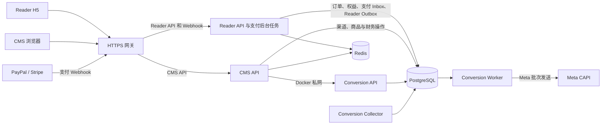

# STAR NOVEL 生产部署 SOP

适用于 Reader H5、CMS、支付域和回传中心的首次部署及协调升级。当前发布线要求 CMS、Reader 和 Conversion 使用同一数据库版本 **`2026111935`**。发下一版时，以该次发布提交中的三个 schema 检查和 CMS 内嵌迁移为准。回传首发批量上限为 **1**。

**发布顺序**　同一提交打包 → 网关进入维护并停旧写入及发送 → CMS 单次迁移 → 补并发索引和授权 → Redis、Conversion API、CMS → 核对支付账户和回传路由 → Collector、Conversion Worker（暂停发送）、Reader → 发布两个前端和验证 Webhook → 恢复业务并回补维护窗口事件 → 单独启用 Meta 发送。

## 1. 拓扑与网络



| 组件 | 默认生产部署与端口 |
| --- | --- |
| 宝塔 Nginx | 公网 `80/443`。独立托管 CMS 和 H5 两个 SPA，HTTPS 反代业务 API 和支付回调。 |
| `cms` / `reader` | 同一 Compose 项目，默认分别绑定宿主机 `127.0.0.1:8081` / `127.0.0.1:8080`。Reader 进程同时运行支付 Inbox、对账和恢复任务。 |
| `conversion-api` | CMS 使用 `http://conversion-api:8092`；API 在容器内监听 `:8092`，宿主机映射仅回环。公网网关不配置 `/internal/conversion/*`。 |
| `conversion-worker` / `conversion-collector` | 共用后端镜像，分别按 `--mode=worker`、`--mode=collector` 启动。无公网监听。 |
| PostgreSQL / Redis / OSS | PostgreSQL 走 RDS VPC 内网和实际配置端口。Compose Redis 走 `redis:6379` 并保留 `redisdata` 卷。OSS 正文与封面沿用目标环境的 Bucket、路径和访问权限。 |

标准发布使用同机 Compose。已有多节点 Reader 部署应先从网关摘除全部旧节点，逐节点使用同一发布版本和业务环境，再恢复内网 upstream。跨主机节点使用受限 VPC 端口和共享依赖，本机回环地址只在当前主机可用。

## 2. 发布前准备

1. 选定已审核的提交和服务器 CPU 架构。确认 CMS、Reader、Conversion 和两个前端来自同一提交，检查工作区，避免将未审核的本地改动打入发布包。记录各环境当前 schema、容器镜像、前端版本和网关 upstream。
2. 核对 RDS 恢复点可用性并记录恢复时间，保留上一版发布目录、镜像和两套前端。首次建库确认 UTF8、业务账号、迁移所需对象权限和 `pg_trgm`。现有生产按统一 `star_novel` 业务账号执行，确认能够迁移及访问 `public`、`conversion`、支付与目录对象。所有 Reader 节点使用同一 Reader JWT 密钥，CMS 使用独立的 `cms.jwt_secret`。
3. 记录待处理的支付和回传状态。按账户和环境保存支付恢复游标、待处理回调、存量协议、收款与退款待核对项，以及待发、发送中、未知和已确认的转化。记下维护窗口起止时间及其时区，供 Webhook 补查。
4. 确认网关维护切换方式、渠道控制台访问权限和回退负责人。空库首次发布不再内置固定密码超管账号，需在执行 `cms -migrate` 前通过 `CMS_BOOTSTRAP_ADMIN_PASSWORD`（可选配 `CMS_BOOTSTRAP_ADMIN_USERNAME` 默认 `admin`、`CMS_BOOTSTRAP_ADMIN_NICKNAME` 默认 `管理员`）注入强密码（长度 ≥ 12，至少包含大小写字母、数字、特殊字符中的 3 类，禁止 `admin123`/`password`/`changeme`/`<...>` 等弱口令或占位符）以安全引导首个超级管理员；初始化完成后可从环境文件中移除 `CMS_BOOTSTRAP_ADMIN_PASSWORD`，后续重跑 `-migrate` 会自动跳过且不会重置已有超管密码。

### 2.1 构建与装载

在仓库根目录执行。构建需要 Go 1.25、Python 3 与 PyYAML、Node.js 和 npm。以下以 Linux amd64 为例。

```bash
python3 deploy/linux/prepare-config.py --check
./deploy/scripts/build-linux.sh amd64
(cd cms-front && npm ci && npm run build)
(cd reader-front && npm ci && npm run build)
```

后端归档为 `deploy/dist/star-novel-linux-amd64.tar.gz`，同目录有 `.tar.gz.sha256`。归档含 CMS、Reader、Conversion 和 Conversion Ops 二进制、Compose、配置生成器及配套 SQL。两个 `dist/` 独立发布。归档含生产配置和密钥，只通过受控渠道传输。若从早于 `2026111704` 的库升级或全新建库，同时从该提交携带 [Reader 并发索引脚本](cms-backend/db/reader_query_indexes.sql)。需要支付运维 CLI 时按 [4.3](#43-维护窗口事件补查与财务操作) 一并构建并校验。

服务器先校验归档和文件，再合并线上环境参数。部署目录使用 `/www/star-novel-server/releases/<release>`，`current` 在验收后更新。以下命令从存放归档及校验文件的受控目录执行。

```bash
sha256sum -c star-novel-linux-amd64.tar.gz.sha256
install -d -m 0750 /www/star-novel-server/releases
tar -xzf star-novel-linux-amd64.tar.gz -C /www/star-novel-server/releases
cd "/www/star-novel-server/releases/${RELEASE_DIR:?请填写归档中的版本目录名}"
sha256sum -c SHA256SUMS
chmod 600 config.yaml
```

保留包内 `deployment.image_tag`。按生产实际值合并 DB、JWT、OSS、支付、私网鉴权和回传参数。开启首发维护时将新版 `conversion.meta_enabled` 设为 `false`，`conversion.meta_batch_size` 设为 `1`。保存本次配置与上一版的受控副本，生成的 `.env` 和 `*.env` 由脚本维护。

### 2.2 回传配置基线

生产入口为 `deploy/linux/config.yaml` 的 `conversion` 段，服务器使用当前发布目录的 `config.yaml`。分销隔离测试使用 [config.test.yaml](conversion-backend/config.test.yaml)。环境、URL、密钥、并发和发送参数均从对应配置生成。

| YAML 配置 | 生产部署核对项 |
| --- | --- |
| `environment`、`private_url`、`private_token`、`private_addr`、`private_host_port` | 环境为 `production`，Reader、CMS、回传进程、接入和 Pixel 一致。CMS 与 API 共用私网 Token。容器内监听与 Compose 端口匹配。 |
| `credential_key_version`、`credential_keys_json` | API 使用当前版本写入凭据，Worker 使用共同的密钥环解密。值为版本到 32 字节 Base64 密钥的 JSON 映射。 |
| `worker_instances`、`db_max_conns`、`worker_db_max_conns` | 首发按 2 个 Worker、每个 16 连接。API 和 Collector 各 8，回传合计上限 48。另计 CMS 的 15、每个 Reader 前台 21 与支付后台 4，以及 RDS 运维和迁移预留。 |
| `reader_normalizers`、`inbox_normalizers`、`normalizer_limit` | 每个 Worker 规划 Reader 2、Partner Inbox 2，总预算 4。当前生产只注册 Reader 消费者。已启用消费者合计应落在预算内，预算不超过 Worker 连接池的一半。 |
| `normalize_batch`、`worker_poll_interval`、`worker_queue_probe_interval` | 每个消费者每轮 20 条，心跳及扫描间隔 15s，空闲探测 250ms。 |
| `meta_enabled`、`meta_graph_version`、`meta_batch_size` | 上线验收前关闭发送；使用发布配置指定的 Graph 版本。首发 `1`，后续按灰度结果调整。 |
| `meta_global_limit`、`meta_concurrency`、`meta_pixel_interval`、`meta_request_timeout` | 每环境全局 5，单进程最多 5，同 Pixel 领取至少间隔 3s，单请求超时 5s。同一环境的所有实例使用相同全局上限。 |
| `callback_addr`、`sinan_mock_enabled`、`partner_report_enabled` | 生产配置保留回环地址，两个开关均为 `false`。默认 Compose 无 Callback 和 Partner Worker 服务。 |

隔离司南测试用以下命令生成独立环境文件，先把测试 DSN 指向已迁移的专用库。全套支付沙箱另用 `conversion.environment: sandbox` 和渠道 `sandbox`，财务任务和结账据此选定环境。其 RDS、Redis、支付应用、回调、Pixel、密钥和网关与生产隔离。

```bash
python3 deploy/linux/prepare-config.py --config conversion-backend/config.test.yaml --check
python3 deploy/linux/prepare-config.py --config conversion-backend/config.test.yaml \
  --output-dir /tmp/star-novel-conversion-test-env
```

### 2.3 支付配置与镜像准备

Linux 部署在私有 `config.yaml` 的 `payment` 段维护支付配置。运行 `prepare-config.py` 后，由现有 Compose 直接加载生成的 `cms.env` 和 `reader.env`。

- `payment.credential_keys` 填入版本化密钥环，格式为 `v1:<32 字节密钥的 Base64>`，多个版本用逗号分隔。生成器向 CMS 和所有 Reader 注入同一套密钥环。`payment.credential_active_key_version` 指定 CMS 加密新凭据使用的版本。保留仍被存量密文引用的旧密钥版本。
- 仍使用环境变量凭据的账户，按需在 `payment` 段填写 PayPal Webhook、Stripe 目录校验、对账及售后配置。多账户旧凭据通过 `account_references` 和 `account_environment` 传给 Reader。Stripe 的旧路径开关由 `stripe_single_checkout_enabled` 和 `stripe_vip_checkout_enabled` 控制，数据库管理账户按 CMS 的商户开关放行。
- 测试与部署使用各自独立的支付密钥环。PayPal、Stripe 的凭据和 Webhook 签名由渠道提供，动态商户从 CMS 录入。配置文件和生成的环境文件保留 `600` 权限。

```bash
dc() { docker compose -p star-novel -f compose.yaml "$@"; }
python3 prepare-config.py --check
python3 prepare-config.py
dc config --quiet
dc build cms
```

## 3. 维护窗口与数据库切换

1. 网关进入维护，停止新结账、履约、CMS 写入和配置发布。支付 Webhook 暂时不可接收时返回可重试的 `503`，保留渠道重投和事件补查的证据。
2. 停止旧 Meta Worker 的新领取，等待在途请求和回执收尾。单独记录失租、结果未知和待核对任务。停止全部旧 Reader 实例及其支付任务、CMS、Conversion API、Worker 和 Collector。已运行的分销 Callback 与回告 Worker 一并停用。已有 Compose 部署从旧 `current` 目录用该版本的 Compose 文件停服务；首次从独立容器切换时核对实际容器名再停用。保留旧镜像、配置及 Redis 数据卷。
3. 确认迁移连接指向正确 RDS。只由新包中的 CMS 执行迁移。新库会初始化基线、基础种子、5 个内置 RBAC 角色并通过 `CMS_BOOTSTRAP_ADMIN_*` 环境变量创建首个超级管理员（空库缺少或传入弱 `CMS_BOOTSTRAP_ADMIN_PASSWORD` 将直接拒绝迁移）；旧库按版本执行待应用的迁移（若已存在启用态超级管理员则自动跳过引导）。用接近生产数据量的库预演，当前进程迁移时限为 90 秒，单条 SQL 上限 60 秒，业务表锁等待上限 3 秒。迁移失败时检查退出码、账本和锁等待，解除阻塞后再重试。

```bash
# 从新版 releases 目录执行（空库首次发布需在 cms.env 或本次命令中传入强密码 CMS_BOOTSTRAP_ADMIN_PASSWORD）
dc run --rm --no-deps cms -migrate
```

4. 用预先配置的 libpq 服务名或受控凭据连接同一个库，核对账本并运行独立索引脚本。以下示例使用 `PGSERVICE=star_novel_release`，需先将该服务名指向本次 RDS 目标。

```bash
PGSERVICE=star_novel_release psql -X -v ON_ERROR_STOP=1 \
  -c 'SELECT max(version) FROM reader_schema_migrations;'
PGSERVICE=star_novel_release psql -X -v ON_ERROR_STOP=1 \
  -f migrations/conversion_query_indexes.sql
```

   当前应返回 `2026111935`。并发索引脚本使用自动提交。核对脚本中的索引均存在且 `pg_index.indisvalid=true`；失败留下的无效索引需由 DBA 按实际定义处理后再重跑，脚本的 `IF NOT EXISTS` 会跳过同名对象。新库或未应用阅读性能索引的旧库，按同样方式执行随包准备的 `reader_query_indexes.sql`。独立数据库角色环境迁移后应用 [角色授权脚本](cms-backend/db/conversion_role_grants.sql)；生产统一使用具备相应对象权限的 `star_novel` 时无需拆分角色。使用 OSS 正文且存在历史预览缺口时，执行 `dc run --rm --no-deps cms -backfill-chapter-previews` 并核对结果。

5. 核对存量订单、协议、收款、回调游标和权益。环境或原账户缺少依据的记录留在支付中心待核对；历史整本权益按原商品和小说证据核验。回传按现场记录判定是否需要历史接管。确认旧服务从未对 Meta 上报时直接部署新链路；如已有历史发送证据，先保持新发送暂停，再按原业务键、事件 ID 和发送证据检查接管范围。 [历史队列接管](conversion-backend/README.md#历史队列接管)

```bash
dc up -d --no-build --wait --wait-timeout 180 redis conversion-api cms
dc ps
curl -fsS http://127.0.0.1:8081/healthz
```

Conversion API 在 Compose 中没有 HTTP 健康检查。`dc ps` 后，在 CMS 登录验证回传概要和吞吐查询成功，分别使用 `/api/v1/admin/conversion/summary` 和 `/api/v1/admin/conversion/throughput` 检查私网鉴权、角色与数据库读取。首次新建后台可先发布 CMS 静态产物到受控管理入口，以完成第 4 节配置。

## 4. 配置业务并启动 Reader

### 4.1 支付账户、回调与商品

<a id="支付复查修复与商户切换schema-2026111926"></a>
<a id="支付域收尾与正式环境放行schema-2026111925"></a>
<a id="stripe-vip-与销售模式扩展schema-2026111924"></a>

1. SuperAdmin 在「支付中心 → 渠道与商户」核对现有 PayPal、Stripe 商户、环境、主账户、新单和订阅开关。新商户先建草稿并加密保存凭据，确认账号身份、权限和环境，验证通过后发布。发布对新单生效前，先核对原账户的在途 Checkout、续费、退款与争议。保留旧账户的有效凭据、入口和订单绑定，直到存量售后处理完成。
2. 动态账户使用 CMS 展示的 `/api/v1/wallet/webhook/channel/<token>` 路径，以实际 Reader HTTPS 域名配置各渠道账户端点。PayPal 记录该应用的 Webhook ID，Stripe 使用该端点的签名密钥。需要在线验证的端点，在 Reader 启动并开放该路径后完成渠道登记与投递测试。已注册的 `/api/v1/wallet/webhook/paypal`、`/api/v1/wallet/webhook/stripe` 和 `/api/v1/wallet/webhook/subscription/<provider>` 按原商户保留。网关保留请求体、签名头及真实协议，Webhook 路径跳过缓存、登录跳转和浏览器挑战。
3. 按启用能力订阅结账、扣款、订阅变化和失败、退款、冲回、风险与争议事件；使用自动对账时再核对结算和报表事件及账户读取权限。CMS 的渠道校验和真实签名回调分别验收，核对每个账户和环境的回调入库。 [渠道事件与业务确认依据](docs/payment-domain-architecture-and-implementation.md#渠道事件与业务确认依据)
4. 在「支付中心 → 商品」准备商品版本和目标环境的 PayPal 或 Stripe 绑定。核对价格、USD 币种、单次或订阅周期、市场、Stripe 税务和销售模式，按所需渠道同步并发布。为对应环境的充值模板选择已发布版本，核对推广链接与模板、H5 显示及实际下单快照。Stripe 分别确认一次性购买和 VIP 的账户能力及 Reader 开关；Managed Payments 还需核对获批市场、税务责任和 Link 售后。 [统一商品与定价](docs/payment-domain-architecture-and-implementation.md#37-统一商品与定价)

### 4.2 Pixel、推广路由与进程启动

<a id="付款部分回传schema-2026111915"></a>

1. 在 CMS「像素管理」核对同环境 Pixel、Access Token、`source=starnovel` 和 `account_key=reader` 接入及 Pixel 授权。检查启用状态、事件白名单、推广链接绑定和附加目标规则。空白名单会跳过所有事件。部分回传按发布规则生效；需要历史首付覆盖的推广链先验证并留存证据，再启用该链规则。
2. 启动 Collector、Conversion Worker 和 Reader。Worker 保持暂停 Meta 发送，仍归一化 Outbox、扫描恢复并写心跳。Reader 启动后即执行支付后台任务，启动前先复查账户、凭据和现存队列。

```bash
dc up -d --no-build --wait --wait-timeout 180 conversion-collector conversion-worker reader
dc ps
curl -fsS http://127.0.0.1:8080/healthz
```

3. 检查 Reader 支付日志和 CMS 订单、订阅、退款页。在回传中心核对两个 Worker 副本的 `normalize`、`meta` 心跳，以及 Collector 最近采样时间、积压和告警。首轮应看到 Meta 暂停，采样与归一化持续更新。也可在同一库执行以下只读检查。

```bash
PGSERVICE=star_novel_release psql -X -v ON_ERROR_STOP=1 <<'SQL'
SELECT worker_type, instance_id, heartbeat_at, paused, last_progress_at
FROM conversion.worker_heartbeats
WHERE environment = 'production'
ORDER BY worker_type, heartbeat_at DESC;
SELECT sampled_at FROM conversion.collector_samples WHERE environment = 'production';
SQL
```

### 4.3 维护窗口事件补查与财务操作

<a id="资金流水schema-2026111919"></a>
<a id="结算与银行对账schema-2026111920"></a>

记录网关恢复后的渠道重投结果。使用当前发布提交的 `payment-ops`，按账户和环境从维护开始前的安全重叠窗口调度补查，保持原事件 ID 和去重键。默认 Linux 包未包含该 CLI；构建时可在 `reader-backend` 下执行 `GOOS=linux GOARCH=amd64 CGO_ENABLED=0 go build -trimpath -o /path/to/artifacts/payment-ops ./cmd/payment-ops`。如在 Compose 上运行，通过受控路径只读挂载可执行文件并继承 Reader 的环境。

```bash
dc run --rm --no-deps --entrypoint /app/bin/payment-ops \
  -v "${PAYMENT_OPS_BIN:?请设置已校验的 CLI 绝对路径}:/app/bin/payment-ops:ro" reader \
  -kind event-recovery -provider "${PAY_PROVIDER:?}" -account "${PAY_ACCOUNT:?}" \
  -environment "${PAY_CHANNEL_ENV:?使用 live 或 sandbox}" -from "${PAY_RECOVERY_FROM:?使用 RFC3339}"
```

核对预览范围后加 `-apply -reason '维护窗口事件回补'`。Reader 执行已调度的任务，按账号跟踪游标、失败项和 Inbox 终态。个别已核实事件用 `event-retry`；超过渠道可查询窗口的记录，按原收款、账单、退款、争议或报表证据核对。出现未知收款时先查询原尝试，保留原幂等键。

财务在「支付中心 → 对账」按同一账户和环境核验交易、退款、余额流水、划拨和银行匹配。PayPal Settlement 保留完整文件分卷，Stripe 关联原 Balance Transaction／Payout，银行流水保留独立参考与审核证据。大文件和专项补查用 `payment-ops` 的 `paypal-ledger`、`stripe-ledger`、`paypal-settlement`、`stripe-payout`、`bank-statement`、`settlement-match` 等入口，先预览再按财务审核结果执行。 [支付域实施与验收](docs/payment-domain-architecture-and-implementation.md#7-验收矩阵)

## 5. 前端、网关与放量

1. 按线上宝塔站点盘点实际域名与根目录。Linux 部署说明中的现有站点包括 `cms.starsfic.com`、`starsfic.com`、`h5.starsfic.com` 和 `www.starnovel.top`。H5 使用同源 `/api/v1`，CMS 使用同源 `/api/v1/admin`。分开上传两个 `dist/` 至版本目录并切换站点根目录，保留上一版产物。若现网使用固定根目录，先上传新版带哈希的资源，再切换 HTML，保留上一版 HTML 引用的资源。
2. HTTPS 网关应把 CMS 的 `/api/v1/admin/` 转到 `127.0.0.1:8081`，H5 的 `/api/v1/` 转到 `127.0.0.1:8080` 或实际 Reader 内网 upstream，保留 URI 和代理头。SPA 采用 `try_files $uri $uri/ /index.html;`，入口 HTML 禁用强缓存，API、带签名的支付回调及动态响应不走 CDN 缓存。支付写请求保持原幂等路径，网关不配置非幂等请求自动切换重试。改动网关时先执行 `nginx -t`，通过后再重载。
3. 从受控入口验收后端和两个前端。先恢复支付 Webhook 并检查回补进度，再按账户恢复已验收的新结账和新订阅入口。正式环境按本次批准的账户、市场和销售模式开放。存量续费、售后和对账按原账户处理。
4. 先关 Meta 发送验证 Reader 事件的原始时间、稳定事件 ID、Outbox 消费、归一化和 Pixel 路由。用指定 Pixel 办理首轮发送验收后，在生产 `config.yaml` 设 `conversion.meta_enabled: true`，保持 `conversion.meta_batch_size: 1`。需要单副本首轮观察时，先把 `worker_instances` 设为 1，验收后恢复到 2。只重建 Conversion Worker。

```bash
python3 prepare-config.py --check
python3 prepare-config.py
dc config --quiet
dc up -d --no-build --no-deps --force-recreate conversion-worker
```

5. 检查已确认、结果未知、429、凭据暂停、积压、心跳及吞吐分位。后续按 `1 → 10 → 50 → 100` 的候选档逐级灰度，每次先看真实批大小和回执确认率，再看 Outbox 延迟、连接等待及 Pixel 间隔。减小批次后，已领取请求仍按原冻结成员和回执恢复。 [吞吐验收与上线顺序](docs/conversion-throughput-plan.md#6-测量验收与上线顺序)

## 6. 验收与发版记录

| 链路 | 验收证据 |
| --- | --- |
| 服务和基础设施 | 三个后端 schema 一致，CMS/Reader `/healthz` 正常，`/health` 版本与制品一致，Redis、RDS、正文及封面访问正常。两个 SPA 深链接可刷新，CMS `/pixels`、`/conversions`、`/payments` 可访问。 |
| 交易与权益 | 按渠道和账户验收购买、同步回跳、签名回执、重复 Webhook、查单和一次履约。核对整本权益与原小说、订阅首付及续费账期、期末取消和重新开通、部分退款与全退。风险／争议、退款、对账状态在相应 CMS 权限内可查。 |
| 回传 | 从真实业务键追溯 Reader Outbox、归一化、目标 Pixel、批次、成员与最终回执。缩小批量、部分接收、未知结果、失租和迟到旧凭据错误在隔离环境演练，确认较新成功回执仍决定后续领取。正式观察积压、最老待处理时间、429、未知成员、凭据暂停和 Collector 告警。 |
| 分销 | 当前生产保持关闭。隔离环境验证回调验签、相同回调去重、冲突识别、Inbox 消费和回告。正式开放前完成正式契约、鉴权、签名、空值编码、结果未知后的核对规则及正式消费者注册，随后单列公网精确路径及回告验收。 [司南模拟联调](conversion-backend/README.md#司南阶段-c-模拟联调) |

达到放行条件后，从当前成功运行的发布目录更新 `current`。

```bash
ln -sfn "$(pwd -P)" /www/star-novel-server/current
```

在 `/www/star-novel-server/DEPLOYMENT_RECORDS.md` 记录提交、归档校验、镜像标签、前端版本、schema、维护窗口、恢复点、补查进度、已开放支付路由和 Meta 配置。保留当前及上一版发布目录与镜像，按运维保留期清理过期目录和本次传输副本。部署记录只存取证编号与配置版本。

## 7. 故障隔离、回退与密钥轮换

| 故障范围 | 操作 |
| --- | --- |
| 前端静态发布 | 切回上一套与运行中 API 兼容的 H5 或 CMS 静态目录，验证入口 HTML 和支付返回地址。 |
| 新结账或渠道配置 | 关闭受影响账户的新单或订阅，必要时关闭对应 Reader Stripe 开关。保留原账户、回调、对账和售后，以核实的上一份有效配置重新发布或以新凭据前滚。 |
| Meta 投递 | 将 `conversion.meta_enabled` 设为 `false`，重新生成并重建 Worker。保留 Outbox、归一化、Collector、请求账本及在途回执证据。结果未知进入人工核对，重排沿用原事件身份。 |
| 同 schema 应用故障 | 用已验证支持当前 schema、支付记录和批次账本的上一版镜像与配置恢复。先看仓内 `RequiredSchemaVersion` 和实际发布记录，从对应版本目录重建相关进程并验收，再更新 `current`。 |
| 跨 schema 迁移或新版本已处理业务 | 优先按当前 schema 前滚。需要恢复数据库时维持维护窗口，协调恢复点、配套的全部应用和前端。恢复前核对恢复点之后已发生的第三方扣款、退款、续费与 Meta 回执，拟定补账、回调回补和去重方案，确认后恢复外部写入。 |

配置变更在 `config.yaml` 中维护，并重新生成服务环境文件。Pixel 加密密钥轮换时先在所有读取方部署新旧密钥，再修改 API 写入版本并逐个轮换 Pixel 凭据；复核存量密文引用后才退役旧密钥。支付密钥环同样先扩充 CMS 与 Reader 的读密钥，再切换 CMS 写入版本并在商户页面按「验证 → 发布」轮换。源数据清理、凭据校验与回传人工重排使用有审计记录的 CMS 或受控运维 CLI。 [Conversion 运维入口](conversion-backend/README.md#运行与运维)
