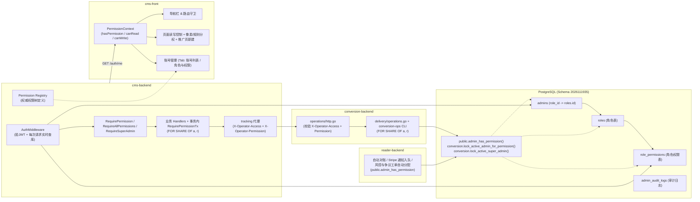

# StarNovel CMS 权限管理重构实施方案（RBAC 导航栏分级 + 读写拆分）

> **文档状态**：v3.1（终版，已按最新确认精简）  
> **适用范围**：`cms-backend`、`cms-front`、`reader-backend`、`conversion-backend`、PostgreSQL 迁移（`2026111935.sql`）  
> **发布前提**：空库首次发布初始化（无需兼容旧角色存量迁移）  
> **设计原则**：单角色 RBAC（用户 → 角色 → 权限）、权限树与前端导航栏严格对齐、全面拆分 `read` / `write` 权限、每次请求实时查库、三端统一事务级权限复核、最小权限隔离与安全引导首个超管

---

## 1. 背景与目标

### 1.1 现状问题
当前 StarNovel 的后台权限体系存在以下结构性缺陷：
1. **硬编码角色**：`admins.role` 仅为字符串字段，无数据库 `roles` / 权限关联表，前后端各自维护角色白名单数组。
2. **安全漏洞与鉴权割裂**：
   - `POST /api/v1/admin/auth/register` 未挂载 `AuthMiddleware` 与权限校验，存在未授权注册管理员的风险。
   - 空库初始化脚本（`seed.sql`、`postgres.go`）内置固定密码的 `admin/admin123` 超级管理员，首次发布即存在高危默认口令风险。
   - `user`、`domain`、`feedback` 等路由仅做了登录校验，缺少模块权限控制。
   - 存在三套鉴权逻辑：普通路由仅信任 JWT 中的 `role`；`billing` 与 `tracking` 各自手写查库逻辑。
3. **跨服务与事务层强耦合旧角色名**：
   - `conversion-backend` 的 HTTP 层、写事务函数（`conversion.lock_active_admin`、`verifyOperatorTx`）及 `conversion-ops` CLI 均硬编码旧角色名。
   - `cms-backend/internal/billing` 的事务复核硬编码 `SuperAdmin/Finance`。
   - `reader-backend` 后台自动对账、Stripe 通知入队、争议工单分配及风控工单审核人自动分配未基于权限体系核验当前状态与权限。
4. **读写未拆分**：绝大多数页面和接口无法区分“只读查看”与“写操作”，且无法创建自定义岗位角色。

### 1.2 重构目标
- 建立标准的 **用户 → 单角色 → 权限点** RBAC 模型，初始化 5 个系统内置角色（`Admin`、`Leader`、`AdOptimizer`、`ContentOperations`、`FinanceManager`），并支持动态增改自定义角色与权限矩阵。
- **安全引导首个超管**：移除 `seed.sql` / `postgres.go` 中的固定密码超管初始化；空库首次发布通过环境变量安全注入强密码创建首个超级管理员。
- **授权上限与防提权**：`system.accounts:write` 与 `system.roles:write` 严格限定仅超级管理员（`is_super_admin = TRUE`）拥有与执行；并发安全保护最后一个启用超管。
- **零缓存实时鉴权**：每次请求直接查库解析当前账号状态与权限，高风险写操作在事务内复核账号启用状态与对应权限。
- **跨模块最小权限隔离**：杜绝用 `dashboard:read` 或跨模块权限放行明细接口，跨模块下拉统一提供仅含最小字段的专用只读 Options 接口（模板商品选项按 `sandbox` / `live` 分开返回）。
- **三端统一（CMS / Reader / Conversion）**：同步升级三端 Schema 版本至 `2026111935`，全部事务复核、后台任务筛选（含风控与争议工单自动分配）及运维 CLI 权限边界切换至统一数据库权限判定。
- **前端体验闭环**：角色与权限合并在「系统管理 → 账号管理」页内以双 Tab 展示；像素配置抽屉独立拆分接入配置权限与付款回传规则权限；推广链接页补齐独立「新建推广链接」入口。

---

## 2. 核心架构与数据流



---

## 3. 数据库设计、空库初始化与三端同步

### 3.1 表结构与权威 SQL 权限函数（新增 `cms-backend/db/migrations/2026111935.sql`）

1. **`roles` 表**：
```sql
CREATE TABLE IF NOT EXISTS roles (
    id BIGSERIAL PRIMARY KEY,
    code VARCHAR(64) NOT NULL UNIQUE,
    name VARCHAR(100) NOT NULL,
    description TEXT NOT NULL DEFAULT '',
    is_system BOOLEAN NOT NULL DEFAULT FALSE,
    is_super_admin BOOLEAN NOT NULL DEFAULT FALSE,
    status SMALLINT NOT NULL DEFAULT 1, -- 1-Active, 2-Disabled
    created_at TIMESTAMPTZ NOT NULL DEFAULT CURRENT_TIMESTAMP,
    updated_at TIMESTAMPTZ NOT NULL DEFAULT CURRENT_TIMESTAMP
);
```

2. **`role_permissions` 表**：
```sql
CREATE TABLE IF NOT EXISTS role_permissions (
    role_id BIGINT NOT NULL REFERENCES roles(id) ON DELETE CASCADE,
    permission_code VARCHAR(100) NOT NULL,
    created_at TIMESTAMPTZ NOT NULL DEFAULT CURRENT_TIMESTAMP,
    PRIMARY KEY (role_id, permission_code)
);
CREATE INDEX IF NOT EXISTS idx_role_permissions_code ON role_permissions(permission_code);
```

3. **`admins` 表扩展（单角色外键）**：
```sql
ALTER TABLE admins ALTER COLUMN role TYPE VARCHAR(64);
ALTER TABLE admins ADD COLUMN IF NOT EXISTS role_id BIGINT REFERENCES roles(id);
CREATE INDEX IF NOT EXISTS idx_admins_role_id ON admins(role_id);
```
> [!NOTE]
> 保留 `admins.role` 列并在写操作中同步写入对应角色的 `code`，便于审计与运维排查；全部权限判定以 `admins.role_id -> roles -> role_permissions` 为唯一真相源。空库初始化完成后将 `admins.role_id` 约束为 `NOT NULL`。

4. **统一数据库级权限判定与锁函数**：
```sql
-- 1. 供 Reader 后台任务与通用 SQL 筛选具备指定权限的启用管理员
CREATE OR REPLACE FUNCTION public.admin_has_permission(p_admin_id text, p_permission text)
RETURNS boolean
LANGUAGE sql STABLE AS $$
    SELECT EXISTS (
        SELECT 1
        FROM public.admins a
        JOIN public.roles r ON r.id = a.role_id
        WHERE a.id = p_admin_id
          AND a.status = 1
          AND r.status = 1
          AND (
              r.is_super_admin = TRUE
              OR EXISTS (
                  SELECT 1
                  FROM public.role_permissions rp
                  WHERE rp.role_id = r.id
                    AND rp.permission_code = p_permission
              )
          )
    )
$$;

-- 2. 供 conversion-backend 业务写事务使用：核验启用管理员、启用角色及目标权限
CREATE OR REPLACE FUNCTION conversion.lock_active_admin_for_permission(operator_id text, required_permission text)
RETURNS TABLE(role_code varchar)
LANGUAGE sql SECURITY DEFINER SET search_path = pg_catalog, pg_temp AS $$
    WITH locked AS (
        SELECT a.id, a.status AS admin_status, r.id AS role_id, r.code, r.status AS role_status, r.is_super_admin
        FROM public.admins a
        JOIN public.roles r ON r.id = a.role_id
        WHERE a.id = operator_id
        FOR SHARE OF a, r
    )
    SELECT l.code::varchar
    FROM locked l
    WHERE l.admin_status = 1
      AND l.role_status = 1
      AND (
          l.is_super_admin = TRUE
          OR EXISTS (
              SELECT 1
              FROM public.role_permissions rp
              WHERE rp.role_id = l.role_id
                AND rp.permission_code = required_permission
          )
      )
$$;
REVOKE EXECUTE ON FUNCTION conversion.lock_active_admin_for_permission(text, text) FROM PUBLIC;

-- 3. 供 conversion-ops 高危数据清理（retention）专用：严格仅允许启用态超级管理员执行
CREATE OR REPLACE FUNCTION conversion.lock_active_super_admin(operator_id text)
RETURNS TABLE(role_code varchar)
LANGUAGE sql SECURITY DEFINER SET search_path = pg_catalog, pg_temp AS $$
    WITH locked AS (
        SELECT a.status AS admin_status, r.code, r.status AS role_status, r.is_super_admin
        FROM public.admins a
        JOIN public.roles r ON r.id = a.role_id
        WHERE a.id = operator_id
        FOR SHARE OF a, r
    )
    SELECT l.code::varchar
    FROM locked l
    WHERE l.admin_status = 1
      AND l.role_status = 1
      AND l.is_super_admin = TRUE
$$;
REVOKE EXECUTE ON FUNCTION conversion.lock_active_super_admin(text) FROM PUBLIC;
```
> [!IMPORTANT]
> 同步更新 `cms-backend/db/conversion_role_grants.sql`：
> - 授予 `api_role` 执行 `conversion.lock_active_admin_for_permission(text, text)`；
> - 授予 `retention_role` 执行 `conversion.lock_active_super_admin(text)`（最小授权原则，`retention_role` 仅调用超管锁校验函数）。

### 3.2 空库初始化：5 个内置角色与首个超管安全引导（解决 P1-1）
1. **彻底移除固定密码超级管理员**：
   - 删除 `cms-backend/db/seed.sql` 中的 `admin / admin123` 固定密码 `INSERT` 语句；
   - 删除 `cms-backend/internal/db/postgres.go` `applyBaseline` 中的硬编码 `admin / admin123` `INSERT/UPDATE` 语句。
2. **初始化 5 个系统内置角色**（在 `2026111935.sql` 事务中幂等插入，`is_system = TRUE`）：
   - `Admin`（管理员，`is_super_admin = TRUE`，全量权限）
   - `Leader`（负责人）
   - `AdOptimizer`（优化师 / Ad Optimizer）
   - `ContentOperations`（内容运营 / Content Operations）
   - `FinanceManager`（财务 / Finance Manager）
   - 同时为后 4 个角色写入第 4.2 节默认权限矩阵，并执行 `ALTER TABLE admins ALTER COLUMN role_id SET NOT NULL`（空库无存量行）。
3. **首个超管安全引导初始化（`cms-backend -migrate` 末尾自动检查）**：
   - 在 `cms-backend/internal/config/config.go` 新增配置项：
     - `CMS_BOOTSTRAP_ADMIN_USERNAME`（默认 `admin`，校验长度 ≥ 4）
     - `CMS_BOOTSTRAP_ADMIN_PASSWORD`（**无代码默认口令**）
     - `CMS_BOOTSTRAP_ADMIN_NICKNAME`（默认 `管理员`）
   - 在 `cms-backend -migrate` 执行完所有 SQL 迁移后，事务内检查是否已存在启用态超级管理员（`EXISTS(SELECT 1 FROM admins a JOIN roles r ON r.id = a.role_id WHERE r.is_super_admin = TRUE AND a.status = 1)`）：
     - **若已存在**：直接跳过，绝不修改或重置已有超管账号密码。
     - **若不存在（空库首次发布）**：
       - 强制校验 `CMS_BOOTSTRAP_ADMIN_PASSWORD` 非空且满足强密码策略（长度 ≥ 12，且拒绝 `admin123` / `password` / `changeme` / `<...>` 等弱口令与占位符；缺失或不合规则 `-migrate` 返回明确错误并退出，**绝不静默写入固定密码**）。
       - 使用 `bcrypt.DefaultCost` 实时生成哈希，插入绑定 `Admin` 角色的超级管理员记录并写入 `admin_audit_logs`，日志仅打印账号名，不打印明文密码。
   - 同步更新 `deploy/linux/cms.env` 与 `DEPLOYMENT_SOP.md`，注明空库首次部署通过 `CMS_BOOTSTRAP_ADMIN_PASSWORD` 引导创建首个超管，初始化完成后可从环境变量移除该配置。

### 3.3 三端 Schema 版本号同步升级
以下三处精确版本检查在**同一分支同步升级至 `2026111935`**：
- `cms-backend/internal/db/postgres.go`：`RequiredSchemaVersion = 2026111935`
- `reader-backend/internal/db/postgres.go`：`RequiredSchemaVersion = 2026111935`
- `conversion-backend/internal/delivery/store.go`：`const required = 2026111935`

---

## 4. 权限目录、授权上限与默认角色矩阵

### 4.1 权限树规范（对齐 `cms-front/src/config/navigation.tsx`）

权限码格式：`<group>.<module>:<action>`（首页总览为 `dashboard:read`），后端集中定义在 `cms-backend/internal/auth/permissions.go` 作为唯一权威源，并通过 `GET /api/v1/admin/auth/permissions` 下发给前端。

**核心安全规则**：
1. **写含读规则**：任何模块的 `:write` 权限均自动隐含该模块的 `:read` 权限（后端 `NormalizePermissions` 自动补齐，前端勾选 `:write` 自动勾选 `:read`，取消 `:read` 自动取消 `:write`）。
2. **授权上限（超管独占账号与角色写权限）**：
   - `system.accounts:write` 与 `system.roles:write` 标记为 `super_admin_only: true`。
   - **不可委派**：创建/修改任何非超管角色时，服务端强制拒绝包含这两项权限码的请求；前端权限矩阵对非超管角色将其置灰锁定并标注「仅超级管理员拥有」。
   - **双重强制执行**：所有账号管理写接口与角色管理写接口在路由中间件和事务内均强制断言 `IsSuperAdmin`。
   - `system.accounts:read` 与 `system.roles:read` 允许按需授予非超管角色。
3. **最后一个启用超级管理员保护**：
   - 严禁管理员删除、禁用或降权自己；
   - 任何涉及超管账号的删除、禁用、降权操作，均通过事务锁保证操作后仍至少保留 1 个启用态超级管理员。

| 一级导航分组 (`group`) | 二级导航模块 (`resource`) | 读权限 (`:read`) | 写权限 (`:write`) | 备注 |
| --- | --- | --- | --- | --- |
| **首页总览** (`dashboard`) | 首页总览 | `dashboard:read` | — | 仅允许进入首页壳，各卡片按业务读权限按需加载 |
| **内容运营** (`content`) | 书籍管理 | `content.novels:read` | `content.novels:write` | 小说、章节、封面、批量导入、全局计费设置 |
| | 书城配置 | `content.operations:read` | `content.operations:write` | 推荐位、榜单、签到活动配置与预览 |
| **用户营收** (`revenue`) | 用户管理 | `revenue.users:read` | `revenue.users:write` | 读者列表/详情/钱包；封禁与调账 |
| **支付中心** (`payments`) | 交易与订单 | `payments.orders:read` | `payments.orders:write` | 订单、支付详情/凭证；Stripe 市场审核批准 |
| | 订阅与账期 | `payments.subscriptions:read` | `payments.subscriptions:write` | 订阅列表与账期明细（写权限预留） |
| | 退款 | `payments.refunds:read` | `payments.refunds:write` | 退款单与队列查看；**全部退款入口**与 PayPal 对账 |
| | 风控 | `payments.risk:read` | `payments.risk:write` | 风控工单/决策查看；风控工单处置 |
| | 争议与冲回 | `payments.disputes:read` | `payments.disputes:write` | 争议/冲回工单查看；争议工单处置 |
| | 资金对账 | `payments.reconciliation:read` | `payments.reconciliation:write` | 账本流水/打款/异常；对账指令与自动对账开关 |
| | 渠道与商户 | `payments.channels:read` | `payments.channels:write` | 渠道/售后策略；渠道绑定及商品 `live` 生命周期 |
| | 商品与定价 | `payments.products:read` | `payments.products:write` | 商品目录；新建/复制/沙箱发布暂停退役 |
| **广告投放** (`ads`) | 推广链接 | `ads.promotions:read` | `ads.promotions:write` | 推广链接列表、创建、编辑、删除 |
| | 充值模板 | `ads.templates:read` | `ads.templates:write` | 充值模板查看、创建、编辑、删除、设默认 |
| | 像素管理 | `ads.pixels:read` | `ads.pixels:write` | 像素、接入源、投递目标管理 |
| | 回传中心 | `ads.conversions:read` | `ads.conversions:write` | 回传汇总/事件/订单/审计；重试、补发、付款规则发布 |
| **客诉管理** (`support`) | 用户反馈 | `support.feedback:read` | `support.feedback:write` | 反馈查看与回复处理 |
| **系统管理** (`system`) | 域名管理 | `system.domains:read` | `system.domains:write` | 落地页域名管理 |
| | 账号管理 *(Tab 1)* | `system.accounts:read` | `system.accounts:write` *(超管独占)* | 后台管理员管理 |
| | 角色与权限 *(Tab 2)* | `system.roles:read` | `system.roles:write` *(超管独占)* | 角色与权限矩阵管理 |

### 4.2 初始内置角色默认权限矩阵

| 模块 | 管理员 (`Admin`) | 负责人 (`Leader`) | 优化师 (`AdOptimizer`) | 内容运营 (`ContentOperations`) | 财务 (`FinanceManager`) |
| --- | :---: | :---: | :---: | :---: | :---: |
| `dashboard` | R | R | R | R | R |
| `content.novels` | R/W | R/W | R | R/W | R |
| `content.operations` | R/W | R/W | R | R/W | — |
| `revenue.users` | R/W | R/W | — | R/W | R |
| `payments.orders` | R/W | R | — | — | R/W |
| `payments.subscriptions` | R/W | R | — | — | R/W |
| `payments.refunds` | R/W | R | — | — | R/W |
| `payments.risk` | R/W | R | — | — | R/W |
| `payments.disputes` | R/W | R | — | — | R/W |
| `payments.reconciliation` | R/W | R | — | — | R/W |
| `payments.channels` | R/W | — | — | — | R |
| `payments.products` | R/W | R/W | — | — | R/W |
| `ads.promotions` | R/W | R/W | R/W | R/W | — |
| `ads.templates` | R/W | R/W | R | R | R/W |
| `ads.pixels` | R/W | R/W | R/W | — | R |
| `ads.conversions` | R/W | R/W | R/W | — | R |
| `support.feedback` | R/W | R/W | — | R/W | — |
| `system.domains` | R/W | R | — | — | — |
| `system.accounts` | R/W | — | — | — | — |
| `system.roles` | R/W | — | — | — | — |

---

## 5. 实时鉴权、事务复核与路由矩阵

### 5.1 无缓存实时鉴权与事务级权限复核
1. **无缓存请求级鉴权（`AuthMiddleware`）**：
   - 解析并校验 Bearer JWT，提取 `admin_id`。
   - **每次请求直接走主键索引查库**加载当前 `Principal`（`admins JOIN roles` + `role_permissions`），不设进程内缓存。
   - 若账号不存在、`admins.status != 1` 或 `roles.status != 1`，直接返回 `401 Unauthorized`（`code: "account_inactive"`）。
2. **权限中间件**：
   - `RequirePermission(code)` / `RequireAllPermissions(codes...)` / `RequireAnyPermission(codes...)`：超级管理员直接放行，否则校验对应权限集合，未命中返回 `403 Forbidden`。
   - `RequireSuperAdmin()`：严格仅允许 `principal.IsSuperAdmin == true` 放行，用于所有账号管理与角色管理写接口。
3. **高风险写操作事务内复核与超管保护**：
   - **业务写事务复核**：资金、退款、渠道、商品发布、对账、充值模板与转化写操作在事务内调用 `auth.RequirePermissionTx(ctx, tx, adminID, permCodes...)`（或 `conversion.lock_active_admin_for_permission` / `conversion.lock_active_super_admin`），核验账号启用、角色启用且具备对应操作权限。
   - **最后一个启用超级管理员保护**：涉及超管账号的删除、禁用或降权（`PUT /auth/admins/:id`、`DELETE /auth/admins/:id`），在事务内通过咨询锁与行锁校验操作后仍至少保留 1 个启用态超级管理员，同时禁止管理员删除、禁用或降权自己。

### 5.2 账号与角色管理 API（`cms-backend/internal/auth/handler.go`）

| 方法与路径 | 权限要求 | 说明 |
| --- | --- | --- |
| `POST /auth/login` | 公开 | 校验用户名/密码及账号、角色启用状态，返回 JWT + 完整 `Principal`（含 `permissions`） |
| `GET /auth/me` | 已登录（实时查库） | 返回 `id`, `username`, `nickname`, `role_id`, `role`, `role_name`, `is_super_admin`, `permissions` |
| `GET /auth/permissions` | `RequireAnyPermission("system.roles:read", "system.accounts:read")` | 返回权威权限树元数据（含 `super_admin_only` 标记） |
| `GET /auth/admins` | `RequirePermission("system.accounts:read")` | 管理员列表（含 `role_id`, `role`, `role_name`, `is_super_admin`, `status`） |
| `POST /auth/admins` & `POST /auth/register` | `RequireSuperAdmin()` | 创建管理员（绑定启用态 `role_id`），写审计日志 |
| `PUT /auth/admins/:id` | `RequireSuperAdmin()` | 更新昵称、密码、`role_id`、`status`；保护最后一个启用超管并禁止自禁/自降权，写审计日志 |
| `DELETE /auth/admins/:id` | `RequireSuperAdmin()` | 删除管理员；禁止自删并保护最后一个启用超管，写审计日志 |
| `GET /auth/roles` | `RequireAnyPermission("system.roles:read", "system.accounts:read")` | 角色列表（含绑定账号数、`permissions`、`is_system`, `is_super_admin`, `status`） |
| `POST /auth/roles` | `RequireSuperAdmin()` | 新建自定义角色（拒绝 `super_admin_only` 权限码，自动补齐 write→read），写审计日志 |
| `PUT /auth/roles/:id` | `RequireSuperAdmin()` | 修改角色信息及权限集合（禁止修改 `is_super_admin` 角色，拒绝 `super_admin_only` 权限码），写审计日志 |
| `DELETE /auth/roles/:id` | `RequireSuperAdmin()` | 删除自定义角色（禁止删除内置角色或仍有绑定账号的角色），写审计日志 |

### 5.3 业务模块路由权限映射与最小字段 Options 接口

**原则**：所有业务明细 `GET` 接口**严格只认本模块 `:read` 权限**，绝不用 `dashboard:read` 或跨模块权限放行敏感业务明细；跨模块下拉选项统一收敛到专用最小字段只读接口。

| 模块 | 路由 | 路由权限要求 | 事务内复核 / 特别说明 |
| --- | --- | --- | --- |
| **novel** | `GET /novels`, `GET /novels/:id`, `GET /novels/:id/chapters`, `GET /novels/:id/chapters/:index`, `GET /settings` | `content.novels:read` | 不再对 `dashboard:read` 或 `ads.promotions:read` 开放章节正文/小说全量明细 |
| | `GET /novels/:id/chapters/identities`, `POST/PUT/PATCH/DELETE /novels/**`, `POST /settings` | `content.novels:write` | — |
| **operations** | `GET /operations`, `POST /operations/preview`, **`GET /operations/novel-options`** *(新增)* | `content.operations:read` | `novel-options` 仅返回已发布书籍最小字段（`id, title, author, cover_url, rating, status, publish_status, view_count, genres`），不含章节正文 |
| | `PUT /operations/ranking-config`, `PUT /operations/ranking`, `PUT /operations/campaigns/checkin`, `PUT /operations/groups/:group` | `content.operations:write` | — |
| **user** | `GET /users`, `GET /users/:id` | `revenue.users:read` | 不再对 `dashboard:read` 放行，杜绝泄露读者钱包与消费记录 |
| | `PUT /users/:id/status`, `POST /users/:id/adjust-wallet` | `revenue.users:write` | — |
| **billing - 订单** | `GET /orders`, `GET /payments/orders`, `GET /payments/orders/:id/payment-details`, `receipts`, `checkout-evidence`, `stripe-market-review` | `payments.orders:read` | 取消 `Support`/`Admin` 角色名硬编码特判，统一按权限返回 |
| | `POST /payments/orders/:id/stripe-market-review` | `payments.orders:write` | 事务内 `RequirePermissionTx(..., "payments.orders:write")` |
| **billing - 退款（统一口径）** | `GET /payments/refunds`, `queue`, `request/:key`, `:id` | `payments.refunds:read` | — |
| | **`POST /orders/:id/refund`**、`POST /payments/refunds`、`POST /payments/refunds/:id/reconcile-paypal` | **`payments.refunds:write`** | 两处退款入口唯一口径为 `payments.refunds:write`，事务内 `RequirePermissionTx(..., "payments.refunds:write")` |
| **billing - 订阅** | `GET /payments/subscriptions`, `GET /payments/subscriptions/:id/stripe-periods`, `paypal-periods` | `payments.subscriptions:read` | 取消 `Support` 角色硬编码限制 |
| **billing - 风控与争议** | `GET /payments/cases`, `GET /payments/cases/:id` | `RequireAnyPermission("payments.risk:read", "payments.disputes:read")` | Handler 内按 `view`/`kind` 细校：`risk`/`risk_review`/`risk_signal` 需 `payments.risk:read`；`disputes`/`dispute`/`reversal` 需 `payments.disputes:read` |
| | `GET /payments/cases/owners` | `RequireAnyPermission("payments.risk:read", "payments.disputes:read", "payments.channels:read")` | 按权限返回启用态可选负责人列表（支持按 `role_scope=risk|disputes|aftercare_finance` 筛选，对应 `payments.risk:write`、`payments.disputes:write`、`payments.disputes:write + payments.refunds:write`） |
| | `GET /payments/cases/decisions` | `payments.risk:read` | — |
| | `POST /payments/cases/:id/actions` | `RequireAnyPermission("payments.risk:write", "payments.disputes:write")` | 事务内按工单 `kind` 复核 `payments.risk:write` 或 `payments.disputes:write`；`caseCanRejectSQL` 用 `public.admin_has_permission(p.finance_id, 'payments.refunds:write')` 复核；指派 `assign` 同步校验目标 `owner_id` 具备对应工单写权限 |
| **billing - 对账** | `GET /payments/reconciliation/movements`, `payouts`, `report-issues`, `activity`, `accounts`, `commands*` | `payments.reconciliation:read` | — |
| | `PUT /payments/reconciliation/accounts/:id/automatic`, `POST /payments/reconciliation/commands` | `payments.reconciliation:write` | 事务内 `RequirePermissionTx(..., "payments.reconciliation:write")` |
| **billing - 渠道** | `GET /payments/accounts` | `RequireAnyPermission(各 payments.*:read)` | 仅返回支付渠道下拉元数据（`id, provider, environment, display_name, status`），不含敏感凭据 |
| | `GET /payments/channels`, `GET /payments/channels/:id/aftercare-policy` | `payments.channels:read` | — |
| | `POST/PATCH/PUT /payments/channels/**`（含 `aftercare-policy`） | `payments.channels:write` | 事务内 `RequirePermissionTx(..., "payments.channels:write")`；`aftercare-policy` 保存时校验 `reviewer_id` 具备 `payments.risk:write`、`finance_id` 同时具备 `payments.disputes:write` 与 `payments.refunds:write` |
| **billing - 商品（统一口径）** | `GET /products`, `GET /products/:id` | `payments.products:read` | 渠道绑定明细（`PayPalBinding`、`StripeBinding`、`AllBindings`）仅当调用方同时具备 `payments.channels:read` 时返回 |
| | `POST /products`, `POST /products/:id/copy` | `payments.products:write` | 事务内 `RequirePermissionTx(..., "payments.products:write")` |
| | `POST /products/:id/publish`, `pause`, `retire` | 路由要求 `payments.products:write`；**若 `environment == "live"` 额外要求 `payments.channels:write`** | 事务内：`sandbox` 复核 `payments.products:write`；**`live` 统一复核 `payments.products:write` + `payments.channels:write`**（发布/暂停/退役三态完全一致） |
| | `PUT /products/:id/bindings/paypal`, `PUT /products/:id/bindings/stripe` | **`RequireAllPermissions("payments.products:write", "payments.channels:write")`** | 事务内复核 `payments.products:write` + `payments.channels:write`（含 `stripe_offer.go`） |
| **ads - 推广链接** | `GET /promotion-links`, **`GET /promotion-links/options`** *(新增)* | `ads.promotions:read` | `options` 仅返回推广表单必需最小下拉项（已发布书籍 `id, title, coin_cost_per_thousand, start_pay_chapter_index`、像素 `id, name, pixel_id`、线上模板 `id, name, is_default`、启用域名 `id, name, domain, type, is_default`、全局默认计费值） |
| | `POST/PUT/DELETE /promotion-links/**` | `ads.promotions:write` | — |
| **ads - 充值模板** | `GET /recharge-templates`, **`GET /recharge-templates/product-options`** *(新增，解决 P2-3)* | `ads.templates:read` | **按 `sandbox` 和 `live` 分开返回**已发布商品基础选项：`{ "sandbox": ProductOption[], "live": ProductOption[] }`（仅含 `id, code, name, product_type, price_cents, currency, coins, bonus, vip_cycle, novel_scope_type, novel_scope_ids, publication_status, dual_channel_ready, readiness_reasons`，不含渠道绑定密文/凭据） |
| | `POST/PUT/DELETE /recharge-templates/**` | `ads.templates:write` | 事务内 `beginTemplateChange` 复核 `ads.templates:write` |
| **ads - 像素与回传** | `GET /fb-pixels`, `GET /conversion/destinations`, `GET /conversion/integrations` | `ads.pixels:read` *(destinations/integrations 列表亦对 `ads.conversions:read` 放行，用于回传中心筛选与展示)* | — |
| | `POST/PATCH /conversion/destinations*`, `POST/PATCH /conversion/integrations*` | `ads.pixels:write` | 转发 `X-Operator-Access: write`、`X-Operator-Permission: ads.pixels:write` |
| | `GET /conversion/orders/:order_id`, `summary`, `throughput`, `events*`, `audit`, `integrations/:id/payment-policy`, **`GET /conversion/promotion-options`** *(新增)* | `ads.conversions:read` | `promotion-options` 仅返回付款规则绑定所需的推广链接 `id, name, novel_title, fb_pixel_id` |
| | `POST /conversion/events/:id/deliveries`, `deliveries/:id/retry`, `partner-reports/:id/retry`, `integrations/:id/payment-policy/preview`, `publish` | `ads.conversions:write` | 转发 `X-Operator-Access: write`、`X-Operator-Permission: ads.conversions:write` |
| **feedback** | `GET /feedback`, `GET /feedback/:id` | `support.feedback:read` | — |
| | `PUT /feedback/:id` | `support.feedback:write` | — |
| **domain** | `GET /domains` | `system.domains:read` | — |
| | `POST/PUT/DELETE /domains/**` | `system.domains:write` | — |

---

## 6. 跨服务改造（`conversion-backend` & `reader-backend`）

### 6.1 `conversion-backend` 同步改造（含 CLI 权限边界，解决 P2-1）
1. **Schema 版本升级**：`conversion-backend/internal/delivery/store.go:86` 升级 `required = 2026111935`。
2. **HTTP 层权限协议**（`conversion-backend/internal/operations/http.go`）：
   - 接收 `cms-backend` 转发的请求头：`X-Operator-ID`、`X-Operator-Role`（真实角色 `code`）、`X-Operator-Access`（`read` | `write`）、`X-Operator-Permission`。
   - `GET` 请求要求 `X-Operator-ID` 非空且 `X-Operator-Access` 为 `read` 或 `write`；
   - 非 `GET` 请求要求 `X-Operator-Access == "write"` 且 `X-Operator-Permission` 与目标路由匹配（destinations / integrations / sinan-mock → `ads.pixels:write`；deliveries / retry / payment-policy → `ads.conversions:write`）。
3. **事务层权限复核改造**（`conversion-backend/internal/delivery/operations.go`）：
   - `delivery.Operator` 增加 `Permission string` 与 `RequireSuperAdmin bool`。
   - `verifyOperatorTx` 按业务写操作调用 `SELECT role_code FROM conversion.lock_active_admin_for_permission($1, $2)`，按超管独占清理调用 `SELECT role_code FROM conversion.lock_active_super_admin($1)`，并将真实 `role_code` 回填审计记录。
4. **`conversion-ops` CLI 权限边界明确化**（`conversion-backend/cmd/conversion-ops/main.go`）：
   - **`retention`（过期数据脱敏清理，高危破坏性操作）**：**仅允许启用态超级管理员执行**（`Operator{ID: *operator, RequireSuperAdmin: true}`，调用 `conversion.lock_active_super_admin`），普通拥有 `ads.conversions:write` 的自定义角色或业务角色不可执行。
   - **`review-legacy-environment` / `repair-missing` / `retry-delivery` / `retry-partner-report` / `append-target`**：明确要求 **`ads.conversions:write`**（`Operator{ID: *operator, Permission: "ads.conversions:write"}`，超管自动放行）。
   - 更新 `--operator` flag 帮助文档与对应单测。

### 6.2 `reader-backend` 同步改造（含风控工单审核人复核，解决 P1-3）
1. **Schema 版本升级**：`reader-backend/internal/db/postgres.go:109` 升级 `RequiredSchemaVersion = 2026111935`。
2. **后台任务与工单自动分配 SQL 全部切换至 `public.admin_has_permission`**：
   - `reader-backend/internal/payment/settlement/automatic.go:60`（自动对账任务领取）：
     ```sql
     JOIN admins u ON u.id = s.actor_id AND public.admin_has_permission(u.id, 'payments.reconciliation:write')
     ```
   - `reader-backend/internal/payment/settlement/commands.go:49`（Stripe 结算通知自动入队）：
     ```sql
     JOIN admins u ON u.id = s.actor_id AND public.admin_has_permission(u.id, 'payments.reconciliation:write')
     ```
   - `reader-backend/internal/payment/aftercare/repository.go:73`（**风控工单自动分配复核审核人当前权限**）：
     ```sql
     UPDATE payment_cases c
     SET work_state = 'pending',
         owner_id = CASE
             WHEN p.reviewer_id IS NOT NULL
              AND public.admin_has_permission(p.reviewer_id, 'payments.risk:write')
             THEN p.reviewer_id
             ELSE NULL
         END,
         work_due_at = COALESCE(c.due_at, now() + make_interval(secs => p.review_seconds))
     FROM payment_aftercare_policies p
     WHERE c.id = $1
       AND p.account_id = c.account_id
       AND c.kind = 'risk_review'
       AND c.is_open
       AND c.work_state = 'observed'
       AND p.hold_fulfillment
     ```
     > 说明：即使原配置审核人已被禁用或撤销 `payments.risk:write`，风控工单仍必须正常进入 `pending` 拦截发币并设定 `work_due_at`（保障资金风控不失守），但不再把 `owner_id` 分配给失权账号（置为 `NULL` 待有效风控人员认领）。
   - `reader-backend/internal/payment/aftercare/repository.go:82`（争议工单自动分配负责人）：
     ```sql
     JOIN admins finance ON finance.id = p.finance_id AND public.admin_has_permission(finance.id, 'payments.disputes:write')
     ```

---

## 7. 前端改造方案（`cms-front`）

### 7.1 权限上下文与 API 类型（新增 `cms-front/src/context/PermissionContext.tsx`）
- 扩展 `AdminUser` 接口（`cms-front/src/utils/api.ts`）：
  ```ts
  export interface AdminUser {
    id: string;
    username: string;
    nickname: string;
    role_id: number;
    role: string;       // role code
    role_name: string;  // role display name
    is_super_admin: boolean;
    permissions: string[];
  }
  ```
- 提供 `PermissionProvider` 与 `usePermission()` Hook（`hasPermission`, `hasAnyPermission`, `hasAllPermissions`, `canRead`, `canWrite`, `isSuperAdmin`）。
- 移除 `cms-front/src/utils/promotion.ts` 中的硬编码角色常量与判断函数。

### 7.2 导航栏与路由守卫（`navigation.tsx` & `App.tsx`）
- `NAV_TREE` 移除全部硬编码 `roles` 数组，改为声明 `requiredPermissions: string[]`（「账号管理」为 `['system.accounts:read', 'system.roles:read']`）。
- `App.tsx` 新增 `PermissionRoute` 守卫：无权访问时跳转当前用户首个可见菜单；若无任何菜单权限展示「暂无访问权限，请联系管理员分配角色」空态页。
- 支付订单页统一渲染 `OrdersTab`（废弃硬编码 `SupportPayments` 分支）。

### 7.3 「账号管理」双 Tab 改造（`AccountsTab.tsx` + `components/accounts/`）
保持侧边栏「系统管理 → 账号管理」（`/accounts`）入口，页头分双 Tab（支持 `?tab=accounts|roles`）：
1. **Tab 1：账号管理**（可见：`system.accounts:read`；写操作：仅 `isSuperAdmin`）：
   - 角色筛选与分配下拉动态读取 `GET /auth/roles`；表格新增「状态」列及启用/禁用快捷操作；新建账号改调 `POST /auth/admins`。
2. **Tab 2：角色与权限**（可见：`system.roles:read`；写操作：仅 `isSuperAdmin`；组件 `RolesPanel.tsx` + `RoleFormDrawer.tsx`）：
   - 导航栏分级权限矩阵：按一级分组展开/折叠，支持分组一键全选只读/读写；勾选写自动勾选读，取消读自动取消写；`super_admin_only` 权限对非超管角色置灰锁定；`Admin` 角色以只读锁定态展示全部勾选。

### 7.4 全业务页面读写适配与关键交互补齐（解决 P2-2 & P2-3）

| 页面 / 组件 | 权限控制与改造要点 |
| --- | --- |
| `DashboardTab.tsx` | 严格按 `revenue.users:read`、`content.novels:read`、`payments.orders:read`、`payments.reconciliation:read` 分别条件请求并渲染卡片；无权限卡片不发请求不展示 |
| `NovelsTab.tsx` | 读写由 `content.novels:read/write` 控制；快捷「生成推广链接」按钮由 `ads.promotions:write` 控制 |
| `OperationsTab.tsx` | 选书抽屉改调 `GET /operations/novel-options`；写操作由 `content.operations:write` 控制 |
| `UsersTab.tsx` | 封禁与调账由 `revenue.users:write` 控制；订单跳转链接由 `payments.orders:read` 控制 |
| `OrdersTab.tsx` | 退款按钮由 `payments.refunds:write` 控制；Stripe 市场审核由 `payments.orders:write` 控制 |
| `PaymentCenter.tsx` / `PaymentChannelsPanel.tsx` | 移除 `support`/`finance` 硬编码；渠道与售后策略写操作由 `payments.channels:write` 控制 |
| `PaymentRefunds.tsx` | 发起退款与 PayPal 对账由 `payments.refunds:write` 控制 |
| `PaymentCases.tsx` | 按 `view`（`risk` / `disputes`）分别由 `payments.risk:write` / `payments.disputes:write` 控制处置区 |
| `PaymentReconciliation.tsx` & `SettlementCommands.tsx` | 对账指令上传与自动记账开关由 `payments.reconciliation:write` 控制 |
| `ProductsPage.tsx` | 新建/复制/沙箱发布暂停退役由 `payments.products:write` 控制；渠道绑定详情由 `payments.channels:read` 控制；渠道绑定写操作与 `live` 发布/暂停/退役由 `payments.products:write && payments.channels:write` 控制 |
| `PromotionsTab.tsx` | 顶部新增「新建推广链接」按钮与弹窗（受 `ads.promotions:write` 控制），数据源改调 `GET /promotion-links/options` |
| `TemplatesTab.tsx` *(解决 P2-3)* | 编辑器改调 `GET /recharge-templates/product-options`，一次获取分离后的 `{ sandbox, live }` 已发布商品选项并分别填入 `sandboxProducts` 与 `liveProducts`；写按钮与 `/new`、`/edit` 路由受 `ads.templates:write` 控制 |
| `PixelsTab.tsx` & `IntegrationConfigDrawer.tsx` *(解决 P2-2)* | **严格拆分接入配置权限与付款回传规则权限**：<br>- `canWriteIntegration = canWrite('ads.pixels')` 控制「接入配置」Tab 的表单编辑与提交；<br>- `canReadPolicy = canRead('ads.conversions')` 控制「付款回传规则」Tab 显隐（无权限时不展示、不发请求）；<br>- `canWritePolicy = canWrite('ads.conversions')` 传给 `PaymentPolicyPanel` 控制规则编辑、预览与发布；<br>- `canReadAudit = canRead('ads.conversions')` 控制「配置审计」Tab 显隐 |
| `ConversionCenterTab.tsx` | 写操作由 `ads.conversions:write` 控制；推广链接下拉改调 `GET /conversion/promotion-options` |
| `FeedbackTab.tsx` | 回复与状态更新由 `support.feedback:write` 控制 |
| `DomainsTab.tsx` | 增删改与设默认由 `system.domains:write` 控制 |
| `HeaderAccountMenu.tsx` | 展示 `admin.role_name`（兼容自定义角色名） |

---

## 8. 分阶段实施顺序

1. **阶段一：数据库迁移、空库安全引导与三端 Schema 版本对齐**
   - 新增 `cms-backend/db/migrations/2026111935.sql`，更新 `embed.go`、`conversion_role_grants.sql`。
   - 移除 `seed.sql` 和 `postgres.go` 中的固定密码超管写入，实现 `CMS_BOOTSTRAP_ADMIN_*` 强口令引导初始化。
   - 同步升级 `cms-backend`、`reader-backend`、`conversion-backend` 三端 `RequiredSchemaVersion = 2026111935`。
2. **阶段二：`cms-backend` RBAC 核心与实时鉴权**
   - 实现 `internal/auth/permissions.go`、`role_repository.go`、`role_service.go`、`role_handler.go`。
   - 升级 `AuthMiddleware`（每次请求查库，零缓存）、实现 `RequirePermission` / `RequireAllPermissions` / `RequireAnyPermission` / `RequireSuperAdmin` / `RequirePermissionTx`。
   - 改造账号/角色 CRUD 与审计日志，落实超管独占写权限与最后一个启用超管保护，封堵 `/auth/register`。
3. **阶段三：三端业务权限迁移、Options 接口与后台任务/CLI 改造**
   - 改造 `cms-backend` 全部业务 Handler 及 `billing` 事务复核；新增 4 个轻量只读 Options 接口（含 `sandbox`/`live` 分离的模板商品选项）。
   - 同步改造 `conversion-backend`（`operations/http.go`、`delivery/operations.go`、`cmd/conversion-ops` 明确 `retention` 仅超管、其余操作 `ads.conversions:write`）。
   - 同步改造 `reader-backend`（`settlement/automatic.go`、`settlement/commands.go`、`aftercare/repository.go` 含风控审核人与争议负责人双复核）。
4. **阶段四：前端 RBAC 体系与全量页面改造**
   - 新增 `PermissionContext`，改造 `navigation.tsx`、`App.tsx`、`HeaderAccountMenu.tsx`。
   - 改造 `AccountsTab.tsx` 双 Tab 与分级权限矩阵抽屉；拆清 `IntegrationConfigDrawer.tsx` 的接入配置与付款规则权限；在 `PromotionsTab.tsx` 补齐「新建推广链接」入口；完成全部页面适配。
5. **阶段五：全链路自动化测试与集成验收**

---

## 9. 验证计划

### 9.1 自动化测试命令
```bash
# 1. CMS 后端
cd cms-backend && go vet ./... && go test -race ./internal/auth/... && go test ./...

# 2. Reader 后端
cd reader-backend && go vet ./... && go test ./...

# 3. Conversion 后端
cd conversion-backend && go vet ./... && go test ./...

# 4. CMS 前端
cd cms-front && npm run lint && npm run build
```

### 9.2 关键验收清单
1. **空库首次发布与三端就绪（含安全超管引导）**：
   - 空库未提供 `CMS_BOOTSTRAP_ADMIN_PASSWORD`（或提供弱口令 `admin123`）执行 `cms-backend -migrate` 被拒绝并报出可定位错误；
   - 提供合乎要求的 `CMS_BOOTSTRAP_ADMIN_PASSWORD` 执行 `cms-backend -migrate`，验证 5 个内置角色（`Admin`、`Leader`、`AdOptimizer`、`ContentOperations`、`FinanceManager`）及首个超管创建成功（重复执行 `-migrate` 幂等且不重置已有超管密码）；
   - 依次启动/检查 `cms-backend`、`reader-backend`、`conversion-backend`，验证三端 Schema 版本（`2026111935`）检查通过并就绪。
2. **授权上限、超管保护与防提权**：
   - 未鉴权调用 `POST /auth/register` 返回 `401`。
   - 创建/编辑非超管角色传入 `system.accounts:write` 或 `system.roles:write` 被服务端拒绝；非超管账号调用账号/角色写接口返回 `403`。
   - 尝试删除、禁用或降权最后一个启用超管被拒绝，系统始终保留至少一个启用超管，且禁止管理员自删/自禁/自降权。
3. **最小权限隔离与防明细泄露**：
   - 仅有 `dashboard:read` 的账号访问首页不报 403 且不展示无权卡片；直接调用 `GET /users`、`GET /users/1`、`GET /orders`、`GET /novels/1/chapters/1` 全部返回 `403`。
   - 仅有 `ads.templates:read` 的账号调用 `GET /recharge-templates/product-options` 正常返回分离的 `sandbox` / `live` 已发布商品选项，且直接调用 `GET /products` 返回 `403`。
4. **自定义角色跨服务写操作、后台任务认领与 CLI 边界**：
   - 使用 `AdOptimizer` 或仅含 `ads.conversions:write` 的自定义角色成功写入 Conversion 接口并记录审计；无对应权限的账号被拒；使用非超管账号执行 `conversion-ops retention` 被拒绝，仅超级管理员可执行 `retention`。
   - 使用 `FinanceManager`（或仅含 `payments.reconciliation:write` 的自定义角色）开启自动对账后，验证 `reader-backend` 后台成功领取对账任务与 Stripe 通知任务；无 `payments.reconciliation:write` 权限的账号不会被后台领取。
   - 风控工单自动分配：当 `reviewer_id` 具备 `payments.risk:write` 时自动分配 `owner_id`；当配置审核人未启用或不具备 `payments.risk:write` 时，新风控工单仍进入 `pending` 拦截状态但 `owner_id` 置空不误分配；争议工单同理校验 `payments.disputes:write`。
5. **支付统一授权口径**：
   - `POST /orders/:id/refund` 与 `POST /payments/refunds` 统一仅认 `payments.refunds:write`。
   - 商品 `sandbox` 发布/暂停/退役仅需 `payments.products:write`；渠道绑定与 `live` 发布/暂停/退役统一需 `payments.products:write` + `payments.channels:write`（前端按钮、路由、事务复核一致）。
6. **前端权限分离与推广独立创建闭环**：
   - 仅有 `ads.pixels:write`（无 `ads.conversions:write`）的账号在像素页打开接入抽屉可修改接入配置，但不可编辑/发布付款回传规则；仅有 `ads.conversions:write`（无 `ads.pixels:write`）的账号在像素/接入抽屉不可改接入配置但可编辑/发布付款回传规则。
   - 仅有 `ads.promotions:write`（无 `content.novels:read`）的账号从侧边栏进入「广告投放 → 推广链接」，通过顶部「新建推广链接」按钮独立完成创建。
