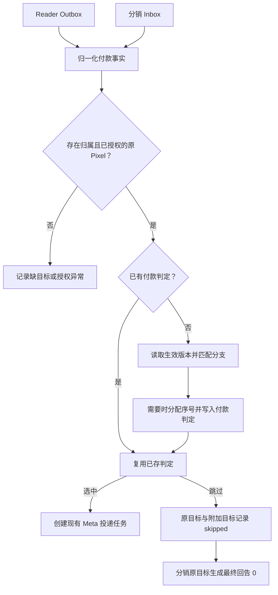

# 购买与订阅事件部分回传开发方案

适用 StarNovel 自建平台、番茄司南及后续分销来源。基于代码 `22be987` 和数据库 schema `2026111909`。部分回传由 `conversion-backend` 内的公共规则模块执行，判定单位是一笔有效付款。Reader 和分销适配器提供付款事实，现有 Meta Worker 和分销 Worker 分别负责投递与回告。

本文补充[统一转化回传架构](conversion-reporting-architecture.md)中的付款事件资格、目标建单、跳过状态与运营统计。

## 1. 业务口径

| 项目 | 执行规则 |
| --- | --- |
| 事件范围 | 已支付且符合来源业务资格的 `Purchase`、有可信首付依据的 `Subscribe`。注册和发起结账走各自现有链路。 |
| 判定单位 | 每笔完成规则评估的真实付款保存一次判定，包含默认全传。同一笔订阅首付的 `Purchase` 和 `Subscribe` 共用判定，本地仍有各自独立的事件、投递和尝试记录。 |
| Pixel 前置条件 | 有归属且已授权的原 Pixel 才参与规则判定。Token 解密、权限或网络错误由投递层处理。 |
| 配置范围 | 按环境、接入账户、应用和推广链接配置。Reader 的应用范围用固定内部值。缺链接时进入本接入和应用的 `default`。有链接但未配置专属规则时继承 `default` 配置，循环仍按该链接独立计数。 |
| 规则条件 | 按付款类型、币种和金额区间匹配。StarNovel 可选择仅回传同一用户在当前推广链接下首笔成功履约的有效付款。首单认定先于金额筛选和抽样。 |
| 规则动作 | 全传、按比例、传 X 漏 Y。未配置规则或有完整事实但未命中规则时默认全传。 |
| 变更生效 | 发布后，下一笔首次成功判定的订单使用新版本。已经判定的订单沿用原结果。循环续号与金额区间继承见第 3 节。 |

例如，一笔 9.99 USD 付款是用户在链接 A 的首单，按金额被跳过。以后在 A 支付 39.99 USD，仍属于复购。该用户在链接 B 的第一笔有效付款，在 B 下有独立的首单资格，即使 A、B 共用 Pixel。

### 1.1 来源能力

| 来源 | 稳定付款键 | 当期支持 |
| --- | --- | --- |
| StarNovel | Reader 订单 `order_id`。同单的 `Subscribe` 从该付款订单读取判定。 | 代币、整本、订阅首付与续费，用户在推广链接下的首单，金额、币种和三种动作。 |
| 司南 | 接入账户与 `app_id` 范围内的原始 `order_id`。回调 `event_id` 继续用于接收幂等和原始回告。 | 代币与 VIP 的 `Purchase`，实付金额、币种和三种动作。当前 VIP 类型仅标识商品类别。 |
| 新分销平台 | 由适配器根据平台契约提供。 | 接入时声明可可靠提供的条件，CMS 按能力展示配置选项，发布接口复核。 |

司南的用户追踪摘要尚无稳定账户 ID 的契约保证，历史付款覆盖仍待确认。仅首单、订阅首付或续费筛选需等相应字段可验证后开放。司南联调同时核对 `order_id` 的唯一范围，以及同一订单补发是否始终复用原 `event_id`。发现同一付款键带来不同源事件 ID 时，已有同类付款事件保留为原投递，后到记录保留去重或冲突证据。若金额、币种、付款类型、来源推广链或原 Pixel 冲突，显示付款事实冲突供核对。若正式契约要求对不同源事件 ID 分别回告，需先确认重复付款的回告语义。

## 2. 规则结构与匹配算法

### 2.1 配置模型

一个作用域只有一个生效版本。版本包含付款范围、按付款类型和币种归组的金额规则，以及未命中时的全传行为。链接专属版本整体优先；缺少专属版本的链接沿用 `default` 的整份配置。

| 配置 | 约束 |
| --- | --- |
| 付款范围 | `all_paid` 允许全部有效付款参与规则判定，最终结果由全传、按比例或传 X 漏 Y 决定。`default` 只允许 `all_paid`。当期仅已核实历史付款覆盖的 StarNovel 推广链接专属配置可以发布 `first_paid_on_promotion`。 |
| 付款类型配置 | 分为明确付款类型的配置与所有类型的通用配置。每组可定义金额区间和本组兜底分支。 |
| 动作枚举 | 金额区间和兜底分支使用相同的 `mode` 枚举。全传为 `all`，按比例为 `ratio`，传 X 漏 Y 为 `cycle`。发布接口拒绝枚举外的值。 |
| 金额区间 | 按 ISO 4217 币种分别定义，左闭右开 `[min,max)`，`max=null` 表示无上限。允许区间间隔。同币种、同付款类型的区间不得重叠。金额转换到该币种最小单位按整数比较，金额及长 ID 以字符串进入 CMS 接口，禁止浮点比较。 |
| 比例 | 比例用基点整数 `0..10000`，如 `3000` 表示 30%。 |
| 循环 | `send_count > 0`、`skip_count > 0`，校验两者之和和持久化序号都在安全整数范围内。 |

针对同一笔付款，先应用付款范围，再选定付款类型配置。该类型有专属配置时使用该组，未配置专属组时使用所有类型的通用组。在选定组内按**同币种的匹配区间 → 本组兜底 → 默认全传**执行。CMS 展示选组顺序及各组未命中时的行为。

例如，代币组的兜底是「按 50% 回传」，通用组的 USD `[30, 90)` 是「全传」。一笔 50 USD 的代币订单按代币组兜底抽样。没有专属组的 VIP 订单可命中通用金额区间并全传。

缺金额、币种或首单依据且会影响匹配结果时，返回 `rule_fact_missing` 并进入可见的待核查状态。已有来源数据校验继续优先处理永久无效数据。业务事实缺失且无法确认发送条件时沿用原投递期限及失败规则；该场景未产生按规则跳过的结果。

### 2.2 动作计算

- **全传**。直接保存选中，循环序号不推进。
- **按比例**。按长度前缀编码 `environment`、`integration_id`、应用、链接作用域和稳定付款键，计算固定 SHA-256，取前 8 字节为大端无符号整数，对 `10000` 取模。结果小于比例基点即选中。算法版本随判定保存。比例变更作用于后续付款，已判定订单继续使用已存结果。
- **传 X 漏 Y**。在匹配分支的计数器内原子分配下一个正整数 `n`。若 `(n-1) mod (X+Y) < X`，选中；其余跳过。计数包含本循环选中和跳过的订单，粒度为去重后的付款。排序以首次判定事务取得该分支序号的顺序为准。

命中结论包括 `selected` 或 `skipped`，原因可用 `rule_send_all`、`rule_not_first_payment`、`rule_ratio_selected`、`rule_ratio_skipped`、`rule_cycle_selected`、`rule_cycle_skipped`、`rule_no_match_send`。缺目标、授权、字段和投递错误沿用独立诊断原因。

## 3. 版本与序号继承

计数键为**实际付款作用域 × 稳定规则分支 ID**。实际范围由环境、接入、应用及链接或 `default` 确定。规则版本 ID 和 Pixel ID 不进入计数键。继承同一配置的两个链接各自分配序号。无链接的付款才推进 `default` 的计数。

| 修改 | 下一笔如何处理 |
| --- | --- |
| 改 X/Y | 旧序号接续。原规则 `传 3 漏 2` 至第 5 笔，改 `传 1 漏 1` 后第 6 笔跳过，第 7 笔回传。 |
| 改为全传或按比例 | 保留累计值，暂停分配循环序号。切回后从原位置接续。 |
| 修改原金额区间 | 原分支 ID 保留，续原序号。 |
| 拆分一个区间 | 仅最低金额的新段继承原分支 ID，其余段由系统生成新 ID。 |
| 合并相邻区间 | 结果区间继承原最低金额段的分支 ID。各旧区间历史判定仍引用各自原版本。 |
| 新增区间 | 生成新分支 ID，首次匹配的循环付款为第 1 笔。 |

例如原 `[30, 90)` 已计到 8，拆成 `[30, 60)` 与 `[60, 90)` 后，低段下一笔为 9，高段下一笔为 1。若稍后合并，以当时低段的最新序号接续。继承发生在同一配置作用域、币种与付款类型内。

### 3.1 配置发布事务

发布请求用结构化操作表达 `update_band`、`split_band`、`merge_bands` 或 `add_band`，后端解析继承关系并分配新 ID。拆分的子区间完整覆盖旧区间，合并操作引用相邻区间。需要同时改边界时，与编辑操作一并在同次发布应用。作用域、币种或付款类型发生改变时按新分支处理。CMS 只显示继承效果。

发布时锁定接入记录，校验 `expected_version`，从当前生效版本生成不可变新版本，切换生效指针并写审计，同事务提交。从继承配置创建专属版本时，还需校验 `expected_inherited_version`。预览和发布由服务端校验付款范围。`default`、分销来源和历史付款覆盖未核实的 StarNovel 链接只允许 `all_paid`，提交首单模式返回 400，并说明原因。付款首次评估在读取生效版本前取得同一接入行的共享锁，确保发布与订单判定有确定顺序。循环模式在此基础上锁定实际作用域下的计数行。预览序号是当前快照，发布期间仍可能有付款推进序号。

链接首次从继承 `default` 切为专属配置时，后端统一以该链接当前生效的继承版本作为变更基线。未改动或修改的分支保留 ID，拆分和合并按本节最低金额段规则自动继承，只有新增分支分配新 ID。预览和发布共用同一算法，从哪个 CMS 入口提交都得到相同结果。例如链接 A 在继承的区间已计到第 8 笔，首次发布专属版本时只调整 X/Y，下一笔仍取第 9 笔。

停用专属配置后重新采用 `default` 时，按生效分支 ID 读取该链接自己的计数。共享同一分支 ID 的区间延续同一个计数器。回到此前已有的其他默认分支时，从该分支上一次使用的序号续计。

## 4. 数据与事务

### 4.1 持久化模型

下表为迁移实现的表与索引契约。表名可跟随仓库命名规范，唯一性和外键边界须保留。

| 表或字段 | 最小字段与约束 |
| --- | --- |
| `conversion.payment_policy_scopes` | 主键 `id`，`environment, integration_id, app_scope, scope_kind, promotion_key` 唯一。使用 `scope_kind` 区分链接与 `default`。用显式空键表示默认范围，保证 SQL 空值语义下唯一性。复合外键约束接入和环境。 |
| `conversion.payment_policy_versions` | `id, scope_id, version_no, config, published_by, published_at`。作用域与版本号唯一。规则分支 ID 在版本间按第 3 节继承。生效指针必须引用同一作用域的版本。 |
| `conversion.payment_policy_decisions` | `id, environment, integration_id, app_scope, payment_key, actual_scope, policy_version_id, branch_id, mode, cycle_sequence, sample_bucket, outcome, reason, amount_minor, currency, payment_kind, decided_at`。付款键在各环境、接入和应用内唯一。每笔完成评估的付款必须落库。无配置时保存 `selected`、默认全传原因及空版本 ID。已有生效版本但未命中时保存 `selected`、默认全传原因及该版本 ID。使用复合外键约束接入和环境。 |
| `conversion.payment_policy_counters` | `environment, integration_id, app_scope, scope_kind, promotion_key, branch_id, last_sequence`。作用域与分支唯一。用 `INSERT … ON CONFLICT … DO UPDATE … RETURNING` 在同一事务分配序号。计数键与规则作用域可分离，例如没有专属配置的链接也需要自己的计数。 |
| `conversion.events` | 增加可空 `payment_policy_decision_id` 和明确的评估状态。新增付款记录区分待评估与已判定。历史事件使用历史标记。关联判定需验证同一接入、环境和稳定付款键。对已判定的新事件建立 `(payment_policy_decision_id, event_name)` 部分唯一索引，保证一笔付款的每种标准事件只有一条。 |
| Reader 首单事实 | 以 `(user_id, promotion_link_id)` 唯一保存首单订单 ID，并把结果写入履约 Outbox 快照。`Subscribe` 和 `Purchase` 使用同一快照。按链接记录历史付款覆盖核验状态，供规则预览和发布查询。 |

为逐单查询建立判定付款键索引，为按判定查询事件建立事件外键索引。审计记录复用现有操作审计表，规则快照与判定不复制 Cookie、邮箱、IP、Token 或用户跟踪摘要。规则版本、引用中的计数及判定记录的保留期，须覆盖可重试窗口和 CMS 历史对账期限。

### 4.2 Reader 首单事实

首单按 Reader **成功履约的先后**确定。渠道付款时间继续作为原始事件发生时间。若 A 在渠道 10:00 付款但回调延迟，B 在渠道 10:01 付款且先成功履约，则 B 是该用户在该链接下的首单，A 后续履约时归为复购。

在已验证付款准备首次履约时，沿用既有付款、订单及订阅锁顺序，写入履约结果前再对 `(user_id, promotion_link_id)` 加同一把事务锁。锁内完成有效履约、认领首单，并通过 [付款履约事件产出](../cms-backend/db/migrations/2026111902.sql)的后续迁移将事实写入 Outbox。真实用户与推广链接取自付款订单快照。同键并发按成功履约顺序确定首单，事务回滚时释放认领。金额档位、Pixel Token、规则命中和后续退款均沿用已确认的首单归属。

迁移期间在停止履约写入的切换窗口，按已有可核实的 `fulfilled_at` 和订单 ID 依次补齐历史首单，再启用在线认领。历史范围不完整时，链接保持未核实状态。新建链接可根据创建后全程由在线链路记录付款的证据核实覆盖，未配置专属规则时继承 `default` 的 `all_paid`。

保留现有 `capi_expectation` 的付款业务资格，两个事件的快照都写入同一首单事实和原始付款键。对自然流量、缺目标、历史未知与暂未启用规则等场景沿用已知的业务资格语义。首单事实可早于成功路由，确保第一笔付款没有合法目标时也不会把第二笔误识别为第一笔。

### 4.3 归一化与建单事务



1. 在 [Reader 消费事务](../conversion-backend/internal/delivery/reader.go)和[分销消费事务](../conversion-backend/internal/partner/inbox.go)内复用现有目标校验。付款规则只针对已确认业务资格且拥有授权原目标的事件。已存在的路由阻塞及永久数据错误不转换成规则跳过。
2. 以付款唯一键在事务内抢占判定写入权。先尝试插入付款行，命中唯一冲突时在新语句读取已提交判定。只有首次获得写入权的事务可以分配序号。随后读取生效版本、评价规则并写完整结论。无配置或未命中时也要落库默认全传结果，供该付款后续事件复用。临时行、计数、事件、目标及消费标记一起提交或回滚，数据库内只可观察到完整提交的判定。
3. 当前 [`EnqueueTx`](../conversion-backend/internal/delivery/enqueue.go) 对已有源事件直接返回，重放继续执行相同的快速退出。新事件须引用正确付款判定。订阅首付的两条 Outbox 可以并发消费，付款唯一键确保共用一次结果。两条事件可以按现有 Outbox 粒度分别提交。不同源事件 ID 在同一付款下重复提交同类事件时，复用既有事件并记录来源处理结果，避免再次建单。
4. 原目标有效但 Token 缺失或失败时，已选中订单继续走现有凭据故障逻辑；修复后使用原判定。路由阻塞恢复时，如果新付款没有判定，`RetryDelivery` 或补建路径须先执行同一规则入口。跳过时同事务关闭该付款已经建立的待判定投递；未归一化的同单事件后续复用该结论。锁顺序由服务统一为先付款键、再读规则和计数、最后锁需要改动的投递行。同一事务涉及多个目标时按投递 ID 升序。
5. `AppendTarget` 验证已有判定，规则跳过或待评估的订单拒绝人工追加。已选中且通过现有校验的事件继续支持追加。发送入口增加防护，确保需要评估的新付款只有 `selected` 能进入 `sending`。原有历史数据沿用历史记录与既有补建凭据。

对「旧系统已投递其中一条、迁移后补建另一条」的同单，按历史付款处理。检查同单历史事件和接管账本，保留已有发送证据，避免按新版本重新采样旧付款。补建原因在 CMS 展示，已有投递重试和回告内容保持首次持久化结果。

### 4.4 目标、回告与状态

| 结果 | 目标状态与回告 |
| --- | --- |
| 规则选中 | 进入现有队列。Meta 明确确认后的分销原目标最终回告 `1`；明确失败或到截止始终无有效确认回告 `-1`。 |
| 规则跳过 | `skipped` 与规则原因。司南原 Pixel 由现有 [`createReport`](../conversion-backend/internal/delivery/recovery.go)生成唯一最终回告 `0`。 |
| 未授权、缺目标、规则事实不足 | 记录具体异常或待核查原因。已有待恢复目标继续受投递期限管理。 |

回告继续带司南原始事件 ID 和原始 Pixel，保留独立队列和重试语义。缺 `promotion_id` 的订单内部归 `default`，出站 `promotion_id` 按已确认的空值表示回告。隔离 Mock 可先用 JSON `null` 验证字段存在和值为空；正式适配器以司南确认接受的编码和成功响应为上线验收。未确认空值编码时保留原最终回告任务，在 CMS 显示契约阻塞，确认编码后重排同一任务。

## 5. CMS 和 API

### 5.1 接口

| CMS 路径（`/api/v1/admin` 下） | 行为 |
| --- | --- |
| `GET /conversion/integrations/:id/payment-policy` | 按 `app_id` 与可选 `promotion_id` 取得专属或继承配置、生效版本、允许条件和当前序号。 |
| `POST /conversion/integrations/:id/payment-policy/preview` | 校验草案，返回最终区间、自动继承结果、未命中行为和当前序号快照。事务只读。 |
| `POST /conversion/integrations/:id/payment-policy/publish` | 提交 `expected_version`、作用域和规则操作。服务端为首个专属版本记录「新建回传规则」，为后续版本和恢复继承记录「变更回传规则」。CMS 提交 `publication_id` 以便用审计核对超时请求。首次从继承配置发布链接专属规则时，提交 `expected_version=null` 和当前 `expected_inherited_version`。支持停用专属配置并恢复继承。版本冲突返回 409，配置无效返回 400。成功返回当前有效配置与版本。 |
| `GET /conversion/audit?subject_type=integration&subject_id=...&app_id=...&publication_id=...` | 按操作人、接入、应用、可选 `promotion_id` 和发布 ID 精确核对。返回本次发布记录或空值，以及当前作用域状态。可读时 `current_status=available` 并返回生效配置。司南应用已解除授权时状态为 `app_unauthorized`，Reader 推广链接已删除时状态为 `promotion_deleted`，两种情况均返回 `current=null`。 |

复用 [CMS 私网代理](../cms-backend/internal/tracking/conversion_orders.go)和[转化服务路由](../conversion-backend/internal/operations/http.go)的权限边界。Admin、SuperAdmin 可预览和发布，MediaBuyer、Finance 可读脱敏配置和结果。接口校验接入、应用、环境与操作人权限，审计保存前后版本和操作原因。

一次拆分发布的请求示例。金额为币种最小单位，分支和版本 ID 均由服务分配。预览使用相同草案字段并返回各段的继承说明。

```json
{
  "app_id": "100001",
  "promotion_id": "300001",
  "expected_version": "12",
  "publication_id": "a76ffdd73606423fb47e1be7f519e62c",
  "operations": [
    {
      "op": "split_band",
      "branch_id": "71",
      "bands": [
        {"min_minor": "3000", "max_minor": "6000", "mode": "cycle", "send_count": 3, "skip_count": 2},
        {"min_minor": "6000", "max_minor": "9000", "mode": "ratio", "rate_bps": 5000}
      ]
    }
  ]
}
```

### 5.2 前端界面与交互

**沿用现有 CMS 的布局、主题色、密度和交互。** 在「像素管理 → 接入与授权绑定」的接入行操作区新增「回传规则」，打开该接入详情抽屉的「回传规则」页签。沿用现有 `CmsDialog` 抽屉、`CustomSelect`、`TableRegion`、`SkeletonRows`、`ConversionStatusDot`、`InlineErrorBanner` 和主次按钮样式。规则表单在独立面板内维护草稿，接入授权配置和回传规则分别通过各自的接口保存。审计沿用接入详情现有的查询和时间线，将规则发布、恢复继承纳入对应接入的审计记录。[接入列表](../cms-front/src/components/conversion/ConversionIntegrationsPanel.tsx) · [接入详情抽屉](../cms-front/src/components/conversion/IntegrationConfigDrawer.tsx) · [现有审计组件](../cms-front/src/components/conversion/ConfigurationAuditSection.tsx)

| 界面区块 | 字段和行为 |
| --- | --- |
| 范围和生效版本 | 抽屉头部沿用来源与接入账户。表单选择应用和作用域「接入默认」「指定推广链接」。Reader 固定应用时直接展示；分销按当前接入的授权应用选择。推广链以字符串 ID 查询，能解析名称时显示名称和 ID；司南可录入原始 `promotion_id`。显示「专属规则」「继承接入默认」「默认全传」及生效版本。链接有专属配置时，「恢复继承」作为一项草稿变更进入同一发布流程。 |
| 付款范围 | 展示「全部有效付款」和「仅用户在本链接的首单」。根据接口返回的可配置能力渲染。默认规则、分销来源和历史覆盖未核实的链接显示「全部有效付款」及首单不可选的具体原因。 |
| 付款类型与兜底 | 提供「所有付款类型」和来源支持的类型，如司南的「代币」「VIP」。每组可配置兜底动作，空配置提示「本组未命中时全传」。配置说明按第 2.1 节的先选类型组、再匹配金额的顺序生成。 |
| 金额区间 | 使用现有表格样式，列为「币种」「最小金额（含）」「最大金额（不含）」「回传方式」「参数」「操作」。新增、编辑、拆分和合并直接更新金额区间表。点击「删除」立即从表格移除该行。点击「发布」使区间变更生效。新增区间的币种固定为 USD。无上限有明确标签。比例显示百分比，循环参数分别标注「传几笔」和「漏几笔」。按币种精度转换十进制字符串，提交最小单位整数的字符串。 |
| 发布 | 抽屉底部提供「取消」和「发布」。草稿可直接发布。发布接入默认规则会作用于该应用下继承默认配置的链接。服务端自动记录发布原因。 |

配置名称和数值优先单行显示，金额及统计数值按列对齐。窄屏复用 `TableRegion` 的横向滚动，范围选择和底部动作按现有抽屉布局折行。所有字段提供可见标签，行操作的可访问名称包含目标区间，错误说明关联到具体字段。键盘可以完成编辑、删除和发布，提交错误时定位第一个无效字段。[现有抽屉](../cms-front/src/components/ui/CmsDialog.tsx) · [表格与加载组件](../cms-front/src/components/ui/Primitives.tsx)

### 5.3 草稿、权限与异常状态

1. **加载配置。** 切换应用或推广链接时从 GET 接口读取对应范围，展示加载状态；过期的响应丢弃。有未发布修改时，切换范围、切换页签或关闭抽屉前提示是否放弃草稿。
2. **生成草稿。** 按已读版本维护金额区间表的变更。输入错误定位到字段或区间行，包括金额精度、区间重叠、比例范围和循环参数。发布时将变更转换为新增、更新和删除操作。拆分和合并保留最低金额段的原分支，服务端分配新分支 ID。
3. **发布草稿。** 可直接发布当前作用域下的草稿。提交期间锁定发布按钮，成功后刷新生效版本、接入审计和展示数据。
4. **处理错误。** HTTP 400 展示字段错误和发布失败原因。HTTP 409 保留草稿，提供「查看最新配置」。刷新时用草稿起始版本、草稿和最新版本比较金额及回传参数，合并互不冲突的字段。独立且已完成的区间删除从草稿移除。目标消失或同一字段存在不同修改时，金额区间表显示冲突并暂停发布，运营可撤销对应编辑。拆分和合并检查所有关联区间。发布请求超时时，按发布 ID 精确核对审计。查到成功记录时结束待确认流程，显示本次发布版本，以及当前生效版本或作用域不可用的原因。确实没有记录时保留草稿，作用域仍可用时可核对后重试。
5. **权限。** Admin、SuperAdmin 显示编辑和发布操作。MediaBuyer、Finance 打开同一面板查看生效规则、版本和判定结果。API 继续校验访问角色及作用域。

### 5.4 订单、投递和监控呈现

在[订单查询](../conversion-backend/internal/operations/orders.go)和[事件详情](../conversion-backend/internal/operations/events.go)增加付款判定摘要，包括规则版本、配置来源、实际链接或 `default`、匹配区间、选中／跳过和原因。循环规则显示序号。已有原 Pixel 状态与分销回告状态并列展示。配置的兜底全传与缺少规则输入在页面上使用不同标签。分销订单查询支持按 `app_id` 区分相同的来源订单号，未指定应用且匹配多个应用时提示选择具体应用。

「逐单对账」在付款级展示一次规则判定，同笔 `Purchase` 和 `Subscribe` 的投递结果分别展示。「回传事件」详情沿用现有状态组件，明确显示「已选中回传」「按规则跳过」「待核查规则数据」或「历史订单」，下方可查看规则版本、金额区间、序号和判定原因。司南原 Pixel 的回告结果继续展示在分销回告区。比如先展示「按规则跳过 · 传 3 漏 2 · 第 4 笔」，再展示「司南回告 0 · 已确认」。[逐单对账](../cms-front/src/components/conversion/ConversionOrdersTab.tsx) · [事件详情](../cms-front/src/components/conversion/ConversionEventDrawer.tsx)

监控新增两项口径：

- **订单回传覆盖率** = 已选中付款数 ÷ 已判定付款数，按付款键去重。示例为判定 100 笔、选中 40 笔，覆盖率 40%。
- **选中后原目标确认率** = 已确认的原目标事件数 ÷ 已选中且应投递的原目标事件数，按事件计数，支持 `Purchase` 与 `Subscribe` 筛选。示例为 40 条已选中 `Purchase` 中有 38 条得到确认，确认率 95%。

沿用「监控与告警」现有筛选器、表格和百分比显示，表头注明覆盖率按付款、确认率按事件，分母为空时显示 `—`。已有缺入队、缺目标、缺业务时间及投递故障统计继续显示。规则跳过计入覆盖率统计和逐单对账，告警聚焦真实投递异常与规则事实缺失。按 Pixel 汇总时分别看原目标与追加目标。[现有监控页](../cms-front/src/components/conversion/ConversionSummaryTab.tsx)

### 5.5 创建推广链接时选择回传规则

在 StarNovel 的「生成书籍推广链接」表单中，紧接「绑定 Facebook 像素」增加「回传规则」字段。复用现有表单控件和样式，Pixel 仍是创建推广链接的必填项。这里的接入默认规则指当前环境下 `StarNovel 自建 / reader` 的 `default`。[创建推广链接表单](../cms-front/src/components/novels/PromotionLinkModal.tsx) · [推广链接接口](../cms-backend/internal/novel/handler.go)

| 选项 | 操作和生效方式 |
| --- | --- |
| **继承接入默认规则**（预选） | 直接通过现有创建接口保存推广链接。判定时读取接入当时生效的 `default`。如果默认规则为 50%，摘要显示「继承接入默认 · 按 50% 回传」。未设置接入默认配置时按全传处理。接入默认更新后，继承链接从下一笔首次判定的订单开始使用更新后的配置。该链接的循环仍使用自己的计数。 |
| **配置本链接专属规则** | 先生成链接，再用返回的推广链接 ID 打开已选定作用域的回传规则面板。以当前接入默认版本为草稿基线，复用现有发布接口、版本校验和序号继承。发布成功后，新判定订单使用链接专属版本。 |

生成链接和发布专属规则分别反馈结果。若取消编辑，或核实专属规则尚未发布，则显示「继承接入默认」。发布冲突或结果未确认时按第 5.3 节重新读取生效版本。配置入口定位到已创建的链接，重试发布时复用该链接 ID。首单选项使用第 3.1 节的发布校验。

保留推广链接现有创建权限。Admin、SuperAdmin 可选择并发布链接专属规则；仅有建链权限的角色可以直接继承默认。具备规则读取权限时加载简短的默认规则摘要，摘要暂不可用时保留「继承接入默认」标签。司南链接在司南平台创建，在本系统通过「接入与授权绑定」按原始 `promotion_id` 配置专属规则。

## 6. 开发顺序与发布

| 阶段 | 交付与退出条件 |
| --- | --- |
| A. 公共模型与规则 | 新增 schema、版本发布、稳定比例算法和序号继承。单元测试覆盖边界，多 Worker 数据库回归证明计数唯一和事务回滚。 |
| B. Reader 接入 | 履约快照提供首单及付款事实，购买与订阅首付共享判定。补齐目标建单、重试、补建和人工追加入口。 |
| C. 分销接入 | 司南只开放契约已具备的付款条件。Mock 验证缺链接进 `default`、原目标跳过回告 `0`、到期无确认回告 `-1`。正式空值编码单独联调。 |
| D. CMS 和上线 | 交付规则配置、版本审计、建链选择、逐单对账和监控。隔离环境回归通过后按接入、按单条推广链接逐步启用。 |

迁移使用下一个可用 schema 版本，更新 [CMS 嵌入与迁移](../cms-backend/db/embed.go)、[CMS 版本检查](../cms-backend/internal/db/postgres.go)、[Reader 版本检查](../reader-backend/internal/db/postgres.go)和[转化服务版本检查](../conversion-backend/internal/delivery/store.go)。按角色模式补齐必要读写授权，复用部署 SOP 的版本门禁。迁移后默认配置保持全传，先核对未启用规则时的订单和回告结果，再发布测试链接规则。故障回退可发布保留分支标识的全传版本，后续新付款全传，既有判定及计数原样保留。

## 7. 验收矩阵

| 场景 | 通过条件 |
| --- | --- |
| 无规则、未命中区间 | 有授权原目标的有效付款全传，保存唯一的默认全传判定；没有归属 Pixel 的订单不消耗计数。 |
| 动作配置 | CMS 的区间和兜底分支只提供全传、按比例、传 X 漏 Y。发布接口对枚举外的动作返回 400。 |
| 更新规则期间处理同单两事件 | 在无配置时消费 `Purchase` 并落库默认全传判定。随后发布 50% 抽样规则，选取在新规则下会被跳过的同笔付款来消费 `Subscribe`，仍复用原全传结果。另覆盖已配置但未命中时的默认全传。 |
| 付款类型与金额规则优先级 | 代币专属组配置 50% 兜底，通用组配置 USD `[30, 90)` 全传。使用抽样未选中的 50 USD 代币订单验证跳过，50 USD 且无专属组的 VIP 订单全传。 |
| 金额边界、多币种 | `30.00 USD` 命中 `[30, 90)`，`90.00 USD` 命中下一段；相同数值的其他币种使用自己的区间。拒绝区间重叠与非法精度。 |
| 比例稳定性 | 同一付款键跨重试、跨 Worker、跨 `Purchase` 与 `Subscribe` 得到同一结果；修改比例只影响新判定。 |
| 分销付款重复 | 相同源事件 ID 重放继续幂等。不同源事件 ID 指向同一付款时，同类付款事件和目标只建一次；付款事实冲突可核查。 |
| 循环与并发 | `传 3 漏 2` 连续 10 笔得到 6 传 4 跳过，多 Worker 下序号唯一且连续。故障注入回滚第一笔时，下一笔复用回滚序号。 |
| 隔离作用域 | 两条同 Pixel 链接各自循环；缺链接的订单仅消耗 `default` 序号；继承同一配置时仍保持各链接自己的序号。 |
| 修改与切换 | 第 5 笔后改 `传 1 漏 1`，第 6 笔跳过。全传或比例期间序号暂停，切回续号。并发发布与判定时，每笔只看到一套完整版本。 |
| 继承转专属 | 链接 A 继承的区间已计到第 8 笔，首次发布专属规则并调整 X/Y 后接第 9 笔。其他链接和 `default` 计数各自独立，专属配置中的新增区间从第 1 笔开始。 |
| 拆分与合并 | 拆分后最低金额段自动续号；其他段第 1 笔起计。合并继承原低段；其他付款类型、币种和链接计数独立。 |
| 首单 | 同用户换链接时分别认领首单。首单被金额规则跳过后第二笔仍为复购。并发履约只认领一笔。较早发生的渠道付款晚到并随后履约时归为复购。回滚的履约事务不占首单。历史事实不完整时运营可看到未知原因。 |
| 首单发布约束 | 已核实历史覆盖的 StarNovel 链接可以发布仅首单规则。`default`、分销来源和未核实历史覆盖的 StarNovel 链接提交仅首单规则时均返回 400。缺链接的合格订单及没有专属配置的新链接继续按 `default` 的 `all_paid` 与配置动作正常评估。 |
| CMS 配置操作 | 在接入详情完成范围选择、编辑、拆合、行内删除和发布。复用现有主题、抽屉和控件。核对常规及窄屏布局，键盘可以完成操作，读角色只看到已发布配置。 |
| CMS 草稿与冲突 | 切换作用域时适用未发布提醒。模拟并发发布返回 409 后，当前草稿保留，查看最新版本并核对草稿后可重试发布。 |
| 建链时继承默认 | 预选继承并成功建链。接入默认从 50% 改为循环后，继承链接的新付款使用更新的默认版本，各链接使用自己的计数。仅有建链权限的角色仍可完成此流程。 |
| 建链时配置专属规则 | 用新建链接 ID 配置并发布专属规则。模拟发布失败后仍显示继承状态，重试发布沿用同一链接；成功后生效版本显示为专属。 |
| 同单两事件 | 同笔订阅首付同时产出 `Purchase`、`Subscribe`，一起传或一起跳过。两个归一化 Worker 并发消费时只推进一次序号。 |
| 缺授权、凭据和修复 | 缺授权时不消耗计数。授权恢复后首次进入规则，规则跳过的订单不能经补建或追加 Pixel 绕过。Token 故障恢复沿用已选中结果。 |
| 分销回告 | 规则跳过仅为原 Pixel 最终回告 `0`；选中后到期仍无确认最终回告 `-1`。后者仍需按已确认规则编码无 trace。缺推广 ID 的最终回告空值经联调成功。 |
| 运营查询 | 逐单可查命中版本、实际计数范围、应用的金额区间和跳过原因。覆盖率按付款，确认率按事件；缺入队和缺目标继续可见。 |

使用独立 PostgreSQL 测试库，依次执行：

```bash
set -e
: "${STAR_NOVEL_TEST_DATABASE_URL:?请设置独立 PostgreSQL 测试库}"
export STAR_NOVEL_TEST_DATABASE_URL
(cd conversion-backend && go test -race -count=1 ./... && go vet ./...)
(cd cms-backend && go test -race -count=1 ./... && go vet ./...)
(cd reader-backend && go test -race -count=1 ./... && go vet ./...)
(cd cms-front && npm run lint && npm run build)
```
