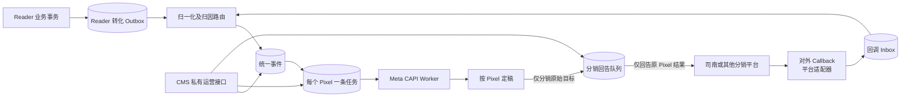
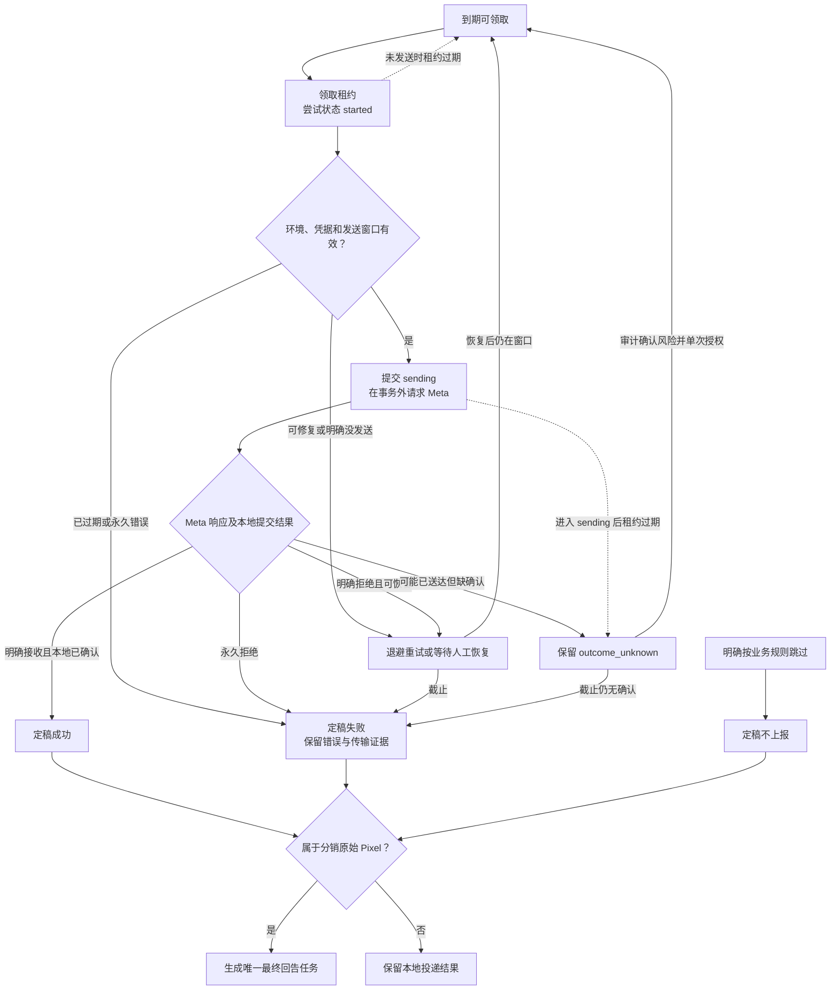
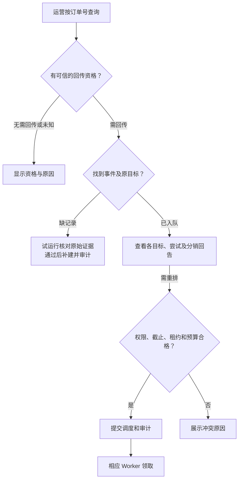

# 统一转化回传架构升级与开发文档

适用项目为 Star Novel。代码基线为 `b1bdf1b`，数据库基线为 `2026111704`。外部契约以接入时确认的《【白光】主动回传API文档》为准。本文是统一转化回传的实施依据，涵盖接入、Meta CAPI Worker、运营监控、状态恢复、迁移和验收。本文中的运行阈值为建议初值，按流量和联调结果调整。

## 1. 范围与已确认规则

| 项目 | 规则 |
| --- | --- |
| 事件来源 | StarNovel 自建平台和外部分销平台。第一家分销平台为番茄司南。各分销平台采用自己的回调入参、鉴权和结果契约。 |
| 发送目标 | 首期支持 Meta CAPI。每条事件默认回传其归属 Pixel，可按配置同时投递多个已授权 Pixel，也可人工追加目标。StarNovel 和分销来源可以共用已授权 Pixel。 |
| 司南事件 | 染色成功、订单创建、充值支付完成全部上报。染色使用 `CompleteRegistration`，建单使用 `InitiateCheckout`，代币或 VIP 充值完成使用 `Purchase`。 |
| 司南回告 | 必接，只回告司南原始 `pixel_id` 的最终结果。始终未收到 Meta 明确接收确认时，最终结果为失败。 |
| 投递可靠性 | Meta CAPI Worker 负责持久化队列、租约隔离、结果确认、分类重试和按期限定稿。 |
| 运营入口 | CMS 提供订单对账、投递监控、队列告警、按目标审计重排和缺失事件补建。 |

首期服务与 StarNovel 同仓，独立部署，复用现有 PostgreSQL。Reader 拥有用户、交易和履约事实，转化服务拥有接收、路由和投递状态。第三方回调与 Meta 请求停留在转化服务，Reader 在自己的事务中写 Outbox。架构按统一模块实现，各平台仅提供事实转换和回告规则。

## 2. 服务边界与数据流



| 工程位置 | 实现职责 |
| --- | --- |
| `reader-backend/internal/auth`、`internal/wallet` | 在注册、结账成功绑定、订阅审批保存和已验证履约事务内写入 Outbox。迁移后 Reader 的 PayPal 对账继续运行，CAPI 投递迁至新 Worker。 |
| 新增 `conversion-backend` | 同一 Go 模块提供 Callback HTTP 入口和 Worker 两种运行方式。Worker 归一化 Inbox 和 Outbox、执行 Meta 投递、定稿和回告。CMS 私有接口由该服务提供。 |
| `conversion-backend/internal/partner/sinan` | 解析司南三个入口、校验接入范围、转换来源字段、构造原 Pixel 的最终结果回告。入站鉴权实现按司南后续确认的规则接入。 |
| `conversion-backend/internal/media/meta` | 构造 Meta 请求、解析单事件确认、错误编码和 trace，向投递层返回结构化结果。 |
| `cms-backend/internal/tracking`、CMS 前端 | CMS 鉴权、角色授权、运营 API 代理、对账和审计界面。CMS 私有调用上送经核验的操作人身份。 |
| `cms-backend/db` | 维护共享 PostgreSQL 的版本迁移，创建转化表、索引、角色授权和 Reader 入队入口。 |

部署时，公网网关只开放已配置分销方的 Callback 路径。CMS 查询与操作走私网和服务间认证。Reader 仅写本地 Outbox 和业务资格快照。转化服务持有 Inbox、任务及凭据的访问权限。Webhook 接收、Meta 投递和分销回告使用独立并发配额，某家分销方回告积压时仍可接收新事件。

增加分销平台时，按新增平台接入账户、来源事件映射、鉴权、Pixel 授权和结果回告格式实现适配器。通用层只调用接入、归一化和回告接口，避免业务方分支进入 Meta 客户端与队列状态机。

适配器的输入输出约定如下。队列调度、数据库事务和状态转移由通用层执行。

| 调用 | 输入及输出 |
| --- | --- |
| `VerifyInbound` | 接入配置、请求头和原始报文，返回经过验证的接入身份或鉴权错误。 |
| `Normalize` | 已持久化的接入身份、来源事件类型及报文，返回统一事件与原始回告字段，或带原因的隔离结果。 |
| `SendToMedia` | 冻结的转化事件、Meta ID 和当前目标凭据。返回 `accepted`、`not_sent`、`retryable_rejection`、`permanent_rejection` 或 `outcome_unknown`，并带确认或错误证据。凭据或权限需要修复时附配置错误原因。 |
| `BuildPartnerReport`、`SendPartnerReport` | 用原目标的定稿结果和原始字段生成稳定业务载荷。发送时补本次鉴权，返回合作方接受、可重试或契约阻塞。 |

## 3. 事件、数据模型与路由

### 3.1 事件产生和业务口径

| 来源 | 业务触发 | Meta 事件及去重依据 |
| --- | --- | --- |
| StarNovel | 新用户创建成功 | `CompleteRegistration`，沿用事务产生的用户主键。同一有效会话的刷新和账号绑定沿用现有业务规则。 |
| StarNovel | 一次性充值或整本购买完成 PayPal 订单绑定，订阅保存审批结果 | `InitiateCheckout`，以本地 `checkout_id` 或订阅意向 ID 去重。同一个已持久化业务键重放只产生一条事件。不同业务键分别记录。 |
| StarNovel | 单次充值、整本购买、订阅首付或续费已确认收款并履约 | 每笔实际支付产生 `Purchase`，保留订单类型。符合首笔条件的订阅另产生一条 `Subscribe`。首笔归属在订阅行锁下与履约一起提交，后续退款和续费保留该归属。 |
| 司南 | 每次染色成功 | `CompleteRegistration`。同一用户的多次不同染色事件分别保留，以司南业务事件 ID 去重。CMS 显示原始事件名「染色成功」，业务统计仍可区分来源。 |
| 司南 | 创建订单 | `InitiateCheckout`。以来源事件 ID 去重，`order_id` 用于下钻关联。 |
| 司南 | 充值支付完成，`recharge_type=1` 或 `2` | `Purchase`。保留充值类型。VIP 支付按支付事件处理，只有未来来源契约能证明首付或续费时才新增对应业务分类或事件。 |

StarNovel 支付消息继续受现有履约、退款前置校验和历史权益恢复规则约束。Stripe 沿用当前禁用状态。实现细节如下。

- 注册在创建用户、钱包和欢迎奖励的同一事务内以 `registration:<user_id>:CompleteRegistration` 入队。结账在 `BindCheckout` 或 `finishSubscriptionIntent` 持久化成功的事务内入队，键分别为 `checkout:<checkout_id>:InitiateCheckout` 和 `subscription-intent:<intent_id>:InitiateCheckout`。
- 单次充值、整本购买和订阅扣款在款项、退款及权益核对完成后，同一事务首次持久化 `capi_expectation` 并触发支付入队。付款用 `payment:<order_id>:Purchase`，订阅首笔用 `subscription:<subscription_id>:Subscribe`。待人工复核的订单完成履约后才确定资格。后续退款保留此前的履约资格与事件记录。
- 订阅在既有扣款、订单、订阅锁顺序下分配首笔归属。只有 `eligible` 可以转为 `claimed` 并保存首笔订单 ID。迁移优先用现有 `Subscribe` 队列行确认归属。历史首笔已履约但无可用事件记 `historical`，证据不足记 `unknown`，两类都各自按规则生成后续 `Purchase`。
- 支付原始时间取可验证的渠道交易时间，并保存时间来源。缺证据时业务正常履约，转化记录标记 `event_time_missing` 供对账。司南沿用回调原始 `event_time`。金额经十进制解析，按币种精度保存并生成 Meta 金额。

原始发生时间在归一化、重试、迁移和追加目标时保持不变。支付实现参见 [支付业务规则](reader-payments-business-rules-and-support.md)、[订单绑定与履约](../reader-backend/internal/wallet/checkout.go)、[订阅写入路径](../reader-backend/internal/wallet/repository.go) 和 [注册事务](../reader-backend/internal/auth/service.go)。

### 3.2 存储契约

建议新服务表放在 `conversion` schema，部署共享 PostgreSQL。日期时间统一保存为 `timestamptz`。下表列出第一期必须落地的持久化对象与约束。

| 表 | 核心字段及约束 |
| --- | --- |
| `recharge_orders`、`user_subscriptions` | 前者增加 `capi_expectation`，记录应产生的事件名、稳定业务键、Pixel、资格原因、环境、业务时间和时间来源。已知无需生成使用空事件列表，待复核或历史未知保留 NULL 并按订单上下文区分。后者保存 `capi_subscribe_state` 和 `capi_subscribe_order_id`。 |
| `reader_conversion_outbox` | Reader 本地稳定键、业务类型、本地订单或意向 ID、`occurred_at`、归因及资格快照和入队时间。业务事务内幂等插入。归一化成功时，在同一个数据库事务提交统一事件、投递任务并标记该消息已消费。 |
| `conversion.integrations` | `id`、`source`、`account_key`、`environment`、`enabled`、授权应用范围、适配器契约版本、鉴权配置引用和回告配置引用。环境、来源和接入账户唯一。允许同一平台配置多个独立账户。 |
| `conversion.inbox` | 接入 ID、事件类型、原始 `event_id`、收到时间、有效字段摘要、最小必要原文或加密引用、解析状态和错误。正常事件以 `(integration_id, source_event_type, source_event_id)` 唯一。字段冲突或缺失走单独隔离记录，并限制原文访问。 |
| `conversion.events` | 统一事件 ID `id`、接入 ID、原始事件类型和 ID、`event_name`、来源订单 ID、推广链 ID、归因状态、发生时间、接收时间和 `created_at`、金额和币种、来源页面及最小匹配数据。归一化以接入 ID、来源事件类型和事件 ID 唯一。事件与尝试分开计数。 |
| `conversion.destinations`、`conversion.integration_destinations` | 目标包含环境、媒体、Pixel ID、启用及退役状态、凭据引用，`(environment, media, pixel_id)` 唯一。关联表记录接入允许投递的目标及默认路由。同一个目标可授权给多个来源。 |
| `conversion.credentials` | 保存 Token 和回告凭据的密文、密钥版本和轮换时间，密钥由服务部署配置提供。目标及接入用 ID 引用凭据。 |
| `conversion.deliveries` | 事件 ID、目标 ID、`meta_event_id`、目标角色 `role`、冻结路由、`created_at`、`deadline_at`、`finalized_at`、状态和原因码。调度记录 `next_attempt_at`、`last_attempt_at`、`lease_token`、`lease_until`、`attempts`、`retry_budget_base_attempt`、`budget_reset_used` 和 `unknown_retry_used`。以 `(event_id, destination_id)` 唯一。 |
| `conversion.delivery_attempts` | `(delivery_id, attempt_no)` 唯一。记录领取、进入发送、响应及落库时间、可证明的传输结果、HTTP 状态、Graph 错误码及子码、Meta 接收数量、真实 `fbtrace_id` 和脱敏摘要。 |
| `conversion.partner_reports` | `(integration_id, event_id, original_delivery_id)` 唯一。只引用原目标，保存内部定稿结果、冻结的业务回告字段、契约版本和发送状态。回告尝试单独记录时间、结果、重试计划及错误。 |
| `conversion.worker_heartbeats` | 按环境、工作类型和实例 ID 保存心跳、暂停状态和最近一次有效推进时间，由独立采集器检查。 |

对 `role='original'` 的投递任务加按事件唯一的部分索引。新来源入队事务同时写入原目标及附加任务，回告任务只允许引用同一分销事件的原目标。StarNovel 自然流量或历史事件缺 Pixel 时，事件可入库供核对，记录事件级原因。已认证且获授权的司南事件始终保留原目标记录，已确定跳过时也写入 `skipped`，便于定稿和回告。

以 `matched`、`organic`、`missing_pixel`、`unknown` 记录归因情况。有明确营销归属但缺可信目标时标为 `missing_pixel`。自然流量以来源可验证为准。旧事件原始证据不足时标为 `unknown`。状态与队列任务分开保存，让 CMS 能识别应投递但无目标或无任务的事件。

为两个出站队列建立 `(next_attempt_at, id)` 待领取部分索引，为 `deadline_at` 建待定稿部分索引。对接入来源、Pixel、时间、订单号和事件 ID 支持有界查询。清理满保留期的原文或归因字段时保留逻辑事件键、目标键、投递结果和审计，防止已处理事件因重放再次入队。

### 3.3 路由与 Meta ID

1. **归属目标。** StarNovel 一次性结账与购买共用订单的 `fb_lead_metadata`，订阅结账使用意向的 `attribution`，订阅付款沿用转存后的原始归因。注册沿用服务端解析出的推广快照。司南以 Callback 自带的原始 `pixel_id` 为主目标，经 `app_id`、接入账户和目标授权校验。若本地已登记该 `promotion_id`，核对绑定 Pixel。不匹配时进入阻塞并告警，保留原目标及原因。
2. **同时发多个 Pixel。** 仅在接入为该事件来源明确配置授权附加目标时生成任务。按物理目标去重，主目标和附加目标分别记录 Meta 回执。附加目标标记为额外投递。
3. **历史追加目标。** 在 CMS 按事件 ID 操作，选择授权的目标并填写原因。校验原始时间、匹配字段和 Meta 窗口，新增目标任务，同一操作重放返回原任务。回告继续锚定原目标。如果此前的目标已经收到事件，追加目标仍是一次独立投递。
4. **ID 分层。** 保存业务事件 ID、各来源的原始 ID 和投递时使用的 Meta `event_id`。纯服务端事件默认使用稳定的来源命名空间和业务键。若某 Pixel 同时有对应浏览器事件，按接入协议保存其经过验证的同名同 ID，实际发送时冻结每个目标使用的 Meta ID。旧事件接管保留原 Meta ID。平台结果回告使用平台原始 `event_id`。 [Meta 去重规则](https://developers.facebook.com/documentation/ads-commerce/conversions-api/deduplicate-pixel-and-server-events)

推广改绑与 Pixel 退役共同锁定目标配置。仍被推广链接引用的 Pixel 先迁移绑定，再退役。退役配置继续供历史快照、待付款订单、活跃订阅和积压事件使用，可按原目标轮换 Token。CMS 显示退役依赖。新路由只选择可用的目标。

司南传入的 `external_id_hash`、`email_hash`、`country_hash` 校验格式后按摘要使用。按实际存在且获授权的字段转发 `fbc`、`fbp`、用户 IP、UA 和 URL。Callback 请求本身的 IP 与 UA 属于平台服务器。`website` 使用已确认域名下的真实页面和浏览器 UA，去除敏感查询参数。可证实为自动扣款的续费采用 `system_generated`。字段不足时记录明确原因。Meta 最迟接受 7 天内的原始事件。[Meta 服务端事件参数](https://developers.facebook.com/documentation/ads-commerce/conversions-api/parameters/server-event)

## 4. 司南接入实现

### 4.1 回调入口

对外登记三个独立 HTTPS 地址，`{integration_key}` 只用于查找接入账户。

| 路径 | 入站事件 |
| --- | --- |
| `POST /callbacks/sinan/{integration_key}/attribution-succeeded` | 染色成功 |
| `POST /callbacks/sinan/{integration_key}/order-created` | 订单创建 |
| `POST /callbacks/sinan/{integration_key}/recharge-paid` | 充值支付完成 |

处理顺序为请求大小限制、鉴权、JSON 和基础字段检查、应用及 Pixel 授权校验、事务写入 Inbox、返回 HTTP 200 和 `{"code":0,"msg":"success"}`。相同键且同一业务内容的重复请求返回相同成功。业务载荷摘要以契约字段的规范化表示计算，排除每次请求变化的签名与传输字段。

我方联调预期为鉴权或越权返回 401/403，无法解析的请求返回 400，存储临时失败返回 503。冲突键、缺事件 ID 或缺原始时间的已认证请求保存隔离记录，拟返回 409/422。禁止合成事件 ID 或发生时间后发送。最终错误码和司南重试行为以联调确认为准。契约描述了请求失败后的两次重试（约 1 分钟、3 分钟），业务错误码是否触发重试和补发入口在开通时核对。

接入账户预置允许的 `app_id`、Pixel 和事件类型。原始载荷中的 `pixel_id` 只是受校验的业务数据，凭据从目标配置读取。司南入站鉴权待定，现有文档中的 Ed25519 规则用于我方向司南**回告**。开发在隔离环境使用显式测试验证器模拟身份，生产入口仅在完成入站鉴权联调后开启。

### 4.2 原始字段与归一化

除通用字段外，保留回告原始 `app_id`、`pixel_id`、`distributor_id`、`promotion_id`、`ad_id`、`adset_id`、`order_id` 和必要的 `device_id`。对契约中的整数 ID 使用 `int64` 或等价无损表示，CMS 序列化为字符串，避免浏览器数值丢失精度。同一 `order_id` 的创建和支付是不同业务事件。契约所述事件 ID 在重试时沿用，生成规则、唯一范围及字段必填保证需要确认。若作用域小于接入账户与事件类型，正式配置必须把对应范围（如应用）纳入接入身份。

## 5. Meta CAPI Worker 与分销回告

### 5.1 投递状态与失败分类

| 状态 | 语义与推进 |
| --- | --- |
| `pending` | 待发送，或已证实未发送/被可重试错误拒绝。按租约领取和退避。 |
| `blocked` | 配置、凭据、目标绑定待修复，或自动尝试预算耗尽且仍可人工恢复。可在截止前审计重排。 |
| `outcome_unknown` | 请求可能已送达，缺有效确认，如写出后超时、结果截断、HTTP 200 缺接收计数或发送后进程退出。窗口内等待审计处理。 |
| `succeeded` | 单事件请求返回 HTTP 200 且 `events_received=1`，响应已成功解析并完成本地定稿。 |
| `failed` | 明确永久拒绝、超预算、超期、无法修复，或者到截止时始终缺少明确接收确认。保留失败类别和传输证据。 |
| `skipped` | 对有资格处理的来源事件，已按明确的业务规则决定不发送。 |

| 证据 | Worker 行为 |
| --- | --- |
| 数据库临时读失败，或能确认请求尚未发出 | 记录 `not_sent`，退避后重排。 |
| 有明确拒绝接收的限流响应，或可验证的可重试 Graph 错误 | 记录拒绝、错误码及子码，遵守有效的 `Retry-After` 后重排。 |
| Token 缺失、失效，权限不足或推广绑定待修复 | 写 `blocked` 与具体原因，按 Pixel 告警。原目标修复后，允许截止前审计恢复。 |
| 明确永久参数错误、数据不完整且无法修复 | 定稿 `failed` 并记录原因。 |
| 写出后超时、断连、含糊的 5xx、HTTP 200 无有效确认，或确认未落库 | 记 `outcome_unknown`。人工可在截止前确认风险后重排一次。 |

成功只依据结构化接收证据。日志写入丢失或诊断明细取不到，都有单独的告警指标。沿用原 Meta ID 方便对账，纯服务端重复发送按可能重复计数处理。[Meta Graph API 错误处理](https://developers.facebook.com/docs/graph-api/guides/error-handling) · [Meta 去重规则](https://developers.facebook.com/documentation/ads-commerce/conversions-api/deduplicate-pixel-and-server-events)

### 5.2 领取、提交与定稿

1. 在短事务内用 `FOR UPDATE SKIP LOCKED` 领取可执行任务，递增尝试序号，生成租约令牌，插入 `started`。领取数以当前可用并发、全局和每 Pixel 发送配额为上限。租约覆盖批内最大等待、HTTP 超时和数据库结果提交。过期租约和到期结转分批扫描。
2. 准备发送时重新校验环境、窗口、目标凭据和可用租约，按令牌提交尝试状态 `sending`。提交成功后在事务外执行请求。复用设有明确超时的 HTTP 客户端及后台连接池。临时停机先停领取和新请求，给在途尝试留出有界的结果提交通道。
3. 按 `delivery_id + lease_token + attempt_no` 锁定并核对任期，同一事务写结构化尝试结果和队列状态。成功、终态失败或业务跳过同时执行原目标的回告任务创建规则。两处更新必须各命中一行，否则回滚，旧租约不能覆盖新任期或终态。诊断报文独立存储和过期，保存失败不反转已提交的结构化确认。
4. 过期租约恢复时，只有停在 `started` 的尝试可自动重排。停在 `sending` 或无法证明没发出的历史尝试归入 `outcome_unknown`。人工确认重复风险后可授权一次新尝试，使用同一目标、Meta ID、原始时间及归因快照。此次未取得确认时保留原不确定证据，等待定稿或按剩余窗口提前定稿失败。
5. 自动退避使用带抖动的指数策略。建议初始 30 秒，常规上限 1 小时，每轮最多 24 次。明确未被接收且预算耗尽时，可在窗口内进入 `blocked`。运营核实故障已修复后最多重置一次本轮计数，历史尝试序号保持递增。明确超过期限、下次允许的请求已无足够时间或永久错误，直接定稿失败。
6. 首批目标从事件进入系统时起算期限，人工追加目标从任务创建时起算，默认 24 小时。以该期限与 `occurred_at + 7 天 - 请求安全余量` 较早者为 `deadline_at`。每次领取、发出和人工重排均校验剩余窗口。到期定稿由独立扫描推进，不依赖再发送一次。定稿时等待在途租约有界收尾；已终态后的晚到响应只保存证据和告警。到期仍无明确接收确认时使用 `failed`，保留不确定或具体错误证据。

沿用当前每 15 秒最多领取 5 条作为容量压测起点。上线前按实测峰值设置领取批量、进程并发和共享的每 Pixel 配额。为支付类事件保留领取容量，同时保证注册和结账持续消费。多实例扩容需检验合计发送速率，避免单个高流量目标挤占其他目标。



### 5.3 司南最终回告

以原始 Pixel 投递任务为依据，定稿与写 `partner_reports` 同事务。回告模板冻结结果和原始回告字段。追加目标、其他来源、待重试和中间失败只更新本地状态。定稿后原 Pixel 的结果不可改写，运营恢复须在定稿前完成。

| 原目标最终结果 | 司南回告 | 实现要求 |
| --- | --- | --- |
| 已接收 | `report_status=1` | 以有效单事件接收确认为准，保存该次实际 Meta 响应摘要及真实 `fbtrace_id`。 |
| 明确失败 | `report_status=-1` | 保存最终失败原因。只使用该次实际响应提供的 trace。 |
| 一直没有有效确认 | `report_status=-1` | 到截止或结束恢复时定稿，内部保留 `meta_no_confirmation`、最后实际尝试时间及传输证据。即使 Meta 有可能已经收到，回告业务结果仍是失败。 |
| 按规则不上报 | `report_status=0` | 按司南契约省略该状态无需填写的发送时间、消息和 trace 字段。 |

**无 trace 的联调要求。** 司南文档将 `fbtrace_id` 和消息列为失败回告必填。连接失败、超时和本地前置错误可能没有真实 trace。适配器须经司南确认 `report_status=-1` 时无 trace 的合法编码（例如省略或空值），并用对方目标环境验证成功响应。服务始终按已确认的业务规则生成失败回告任务。契约尚未允许该编码时，任务显示「失败已定稿，回告待契约确认」，可在配置修复后继续发送同一最终回告。携带真实 trace 的任务照常处理。不得伪造 trace、借用其他目标的响应或改用 `0` 表示失败。

结果回告有独立的待发、重试、契约阻塞、接收结果未知和已确认状态。Worker 按司南出站契约签名。HTTP 和业务成功码均符合接入约定时标记完成。失败只处理回告任务，原 Meta 任务保持终态。同一回告的业务字段（包括原始 `event_id`、原始 Pixel、结果和 `report_time`）保持不变，鉴权时间戳、nonce 和签名按每次请求生成。任务唯一键防止应用内重复建单。对方确认支持同一业务回告重放后，回告超时才允许自动重试，否则记录接收结果未知并进入待核对。现有契约示例与字段表在 `message/messages`、`adset_id/ad_set_id`、必填 `promotion_id` 和 `ad_id` 上需核对。司南的回告时限、无发送时的 `report_time` 取值与错误处理在接入配置中记录。

## 6. 运营监控、对账与恢复

### 6.1 CMS 接口与筛选

以下为拟新增的 CMS 路径，挂在现有 `/api/v1/admin` 下。

| 路径 | 能力 |
| --- | --- |
| `GET/POST /conversion/integrations`、`PATCH /conversion/integrations/{id}` | 接入账户、授权应用、允许事件、Pixel 绑定、暂停状态和回告配置。 |
| `GET/POST /conversion/destinations`、`PATCH /conversion/destinations/{id}` | 注册 Pixel、变更显示名、轮换 Token、软退役。换 Pixel ID 创建新目标并调整绑定。已有任务引用旧目标。 |
| `GET /conversion/events`、`GET /conversion/events/{id}` | 按环境、来源、接入、事件、时间、订单、推广链、Pixel、投递状态和归因状态查询。详情显示事件资格、各目标结果、可分页的尝试记录及分销回告。 |
| `GET /conversion/orders/{order_id}` | 默认查 StarNovel 本地订单。带 `integration_id` 时按接入 ID 和外部订单号查分销订单。分别显示资格、已收到的事件和各自去向。已知应回传但没有队列记录时也返回结果供排查。 |
| `GET /conversion/summary` | 分环境、来源、接入、事件和目标汇总投递及回告。返回最老待发时长、确认延迟、未入队和各失败原因统计。 |
| `POST /conversion/events/{id}/deliveries` | 给事件追加已授权的 Pixel，提交 `destination_id` 和 `reason`。校验窗口，幂等创建任务并写审计。 |
| `POST /conversion/deliveries/{id}/retry` | 某目标在定稿前重排。提交 `expected_attempts` 和 `reason`，结果未知时另需 `acknowledge_duplicate_risk=true`。成功返回 202 和新调度时间。 |
| `POST /conversion/partner-reports/{id}/retry` | 调整既有回告的调度。保留原始结果和业务字段，审计记录操作者和原因。 |

列表默认最近 24 小时及每页 50 条，上限 100 条，按 `created_at, event_id` 倒序游标分页。订单号和事件 ID 的精确查询可跨范围。时间使用带时区的 RFC 3339。响应包括原始及内部事件 ID、业务时间、入队时间、当前目标、最后尝试、结构化错误、下次调度、截止时间和确认时间。历史证据仅显示可验证的部分。

CMS 的「回传日志」默认展示回传事件，旧日志作为脱敏历史明细。复用现有管理员机制，`Admin`、`SuperAdmin` 可变更接入和执行运营写操作，`MediaBuyer`、`Finance` 可读与业务相关的脱敏结果。实时复核账号和角色，并在写事务内记录操作者、原因及前后状态。原因去除首尾空白后须为 1 至 500 字符。格式错误返回 400，权限不足返回 403，不存在返回 404，状态或版本冲突返回 409。对外只提供排查所需字段。凭据只写轮换，原始 Cookie、IP、UA、邮箱摘要或完整查询参数保留在已授权的处理链路内。[原回传页面](../cms-front/src/pages/TrackingLogsTab.tsx) · [现有审计实现](../cms-backend/internal/billing/template_audit.go)

### 6.2 对账与统计口径

- **StarNovel 支付对账。** 从 `recharge_orders.capi_expectation` 出发，以稳定业务键左关联 Reader Outbox、统一事件和原目标任务。识别无需回传、资格未知、应回传未入队、已入队待归一化、缺目标、已创建投递、已有确认。存在统一事件就能证明已入队，即使消费完成的旧 Outbox 已清理。首笔订阅只在保存归属的订单上期待 `Subscribe`。自然流量、履约前退款和历史恢复单列，旧数据缺资格快照时按已有队列记录和可验证证据显示。
- **分销对账。** 以已认证并持久化的 Inbox 记录为已知事件范围，按接入和外部订单号下钻。分别显示解析失败、待归一化、主目标结果、附加目标及最终回告。漏收到整个回调需按分销方账单或回放清单另行核对。
- **成功率。** 以业务发生时间归属统计区间，原目标成功率为「原目标已被 Meta 接收的唯一应回传事件数 / 应回传事件数」。应归因但缺 Pixel 或未入队仍计入分母。已知应回传但业务时间缺失的 StarNovel 支付按履约时间进入带标记的失败分组。自然流量、确认无需回传、历史未知和测试各自分组。附加 Pixel 按事件与目标计算投递指标，司南回告按原目标计数。Meta 接收与广告归因分别展示。

### 6.3 采集与告警

由独立于 Worker 进程的采集查询 PostgreSQL 队列和心跳。指标按环境、来源、接入和事件类型聚合，Pixel 级异常按目标合并告警。按时写心跳并记录最近有效推进，即使队列为空也有心跳。队列等待从入队到首次尝试，确认延迟分别统计业务发生到接收和入队到接收，避免把很早发生的补投误判成 Worker 延迟。

| 监控项 | 起始告警条件及运营动作 |
| --- | --- |
| Inbox 和归一化 | 最老待解析或隔离超过 5 分钟时按接入核查鉴权、缺字段和重复冲突。 |
| 应回传未入队 | 已履约超过 1 分钟且原资格应生成 `Purchase`，统一事件和待归一化 Outbox 都查不到时按订单排查。 |
| Meta 投递队列 | 最老可执行任务等待超过 5 分钟，查看领取、确认延迟、重试、429 和库连接用量。待处理任务数量按待发、活动租约、退避、阻塞和结果未知拆分。 |
| 凭据和发送结果 | Pixel 首次凭据失败、出现结果未知或未知失败率增高时查看原因与真实 trace，按目标合并去重。 |
| 分销回告 | 超过接入约定的最老未回告、无 trace 契约阻塞或回告结果未知时，查看回告队列及对方响应。 |
| Worker 心跳 | 有待处理任务且心跳缺失或持续无进展时告警。维护暂停单独标明并继续采集积压。 |

暂停开关分别控制接入、Meta 投递和分销回告，暂停投递时 Reader 可继续入队。发布前演练 Worker 进程停止后告警仍能触发。生产和测试使用独立数据库及 Pixel，生产发送拒绝带测试事件码。[Meta 测试事件说明](https://developers.facebook.com/documentation/ads-commerce/conversions-api/using-the-api#testEvents)

### 6.4 审计重排与缺行补建

- CMS 与转化服务 CLI 共用同一业务事务。重排时锁定目标行，校验 `expected_attempts`、环境、有效期、可恢复原因、剩余预算和租约。处于活动租约、已可领取或已定稿的任务返回冲突。重排保持原 Meta ID、Pixel、发生时间和归因快照。并发请求只允许一次有效调度和审计。
- 缺行恢复由拟新增的 `conversion-ops repair-missing --order-id <id> --event-name <name>` 执行，默认试运行。提交需 `--apply`、操作人、原因和证据引用。证明原订单资格、可信原 Pixel、原交易时间、稳定业务键和此前未进入发送后，在锁定订单的事务中补建缺失 Outbox 或原目标，并写审计。重放返回现有记录。仅有日志缺失或没有明确回执时保持待调查。
- 回告重排只操作回告队列，复用已定稿结果和原始字段。追加 Pixel 按新目标独立授权和排队，原目标和已定稿回告保留。



## 7. 开发顺序与上线

| 阶段 | 可交付内容和出口 |
| --- | --- |
| A. 通用核心 | 增加统一事件、绑定、任务及尝试表。完成 Meta Worker 领取、结果提交、租约恢复、定稿和回告任务。上线前用模拟接口验收失败分类和进程退出下的持久化处理。 |
| B. StarNovel 接入 | 注册、结账、购买和订阅路径入队。完成历史队列映射、CMS 逐单对账、独立告警以及追加、重排、缺行补建。验证 PayPal、权益、退款和结算回归。 |
| C. 司南接入 | 完成三个 Callback 和回告适配器。处理重复回调、原目标回告、无确认失败和回告独立重试。先以拟定鉴权和模拟契约走测试，待开通口径确认后做司南环境联调。 |
| D. 放量与后续分销 | 逐个接入账户启用。新的分销平台复用事件、投递和运营模型，按契约实现适配器和场景测试。 |

### 7.1 迁移和切换

1. 从仓库下一可用版本新增迁移，按历史顺序保留 `2026111704`。更新 CMS embed 与迁移入口，以及 Reader、CMS 和转化服务的 schema 检查版本。新增表、角色、支付入队触发器和版本登记在同一事务执行，并把版本登记作为最后一步。大表并发索引在事务外完成。用空库和接近生产规模的副本验证下文迁移、索引耗时与常用查询计划。
2. 发布前记录各服务版本、schema 账本、各事件状态数量和已确认事件 ID，备份数据库。在维护窗口冻结旧写入及 CAPI 消费者，等待旧的内存队列和在途请求收尾。使用新 CMS 二进制执行 `-migrate`，然后执行并验证并发索引。将现有推广绑定使用的 `fb_pixels` 导入目标注册表，保存 `legacy_fb_pixel_id` 映射并迁入凭据密文。新后台通过目标管理更新绑定和凭据。旧 Pixel 路由改为脱敏读取，历史订单保留原关联，新流程验收后清理旧明文凭据。
3. 可分批幂等迁移 `payment_event_outbox`。旧 `delivered` 保持成功和原 ID。未发送任务保留原时间、目标、快照和基线次数，旧尝试无确认的保留未知，投递环境无法验证的标记阻塞并人工核对。归因按已有证据映射，旧日志供历史定位。历史业务记录没有原事件时避免自动补发。迁移前已绑定的结账和已完成的订阅意向归属旧生产路径，重放这些记录不生成新结账事件。
4. 启动 schema 匹配的 Reader、CMS 和转化服务。切换 Reader 到新 Outbox，移除被替换的内存 CAPI 调用及 CMS 无调用发送函数，更新 README 与运维命令。保留原 PayPal 对账。初次启动关闭 Meta 发送与回告，核对旧新事件 ID、资格、目标、原始时间和状态数量，再启用一个 Worker。观察至少一个告警窗口，核对具体订单、确认结果、待发时长和异常率后放量。
5. 司南接入另开启用开关。入站鉴权、原始字段、无 trace 的失败回告和原 Pixel 回告均通过对接联调后再启用生产。
6. 迁移事务失败时核对账本与结构，再恢复旧部署。迁移提交后先暂停故障链路，再用匹配新 schema 的版本修复或前滚，保留业务及队列状态。现有 Reader 和 CMS 启动时要求 schema 版本精确匹配，回退旧代码须先核对切换后新增业务、未发和外部已接收结果，避免重复发送。[部署 SOP](../DEPLOYMENT_SOP.md) · [CMS 迁移](../cms-backend/internal/db/postgres.go) · [旧队列领取](../reader-backend/internal/wallet/outbox_repository.go)

迁移前及切换核对时执行下列只读查询。创建新表后再执行最后一条。明细对账按稳定 ID 进行，聚合数量用于发现异常。

```sql
SELECT max(version) AS schema_version FROM reader_schema_migrations;

SELECT event_name, state, count(*) AS events, min(created_at) AS oldest_created_at
FROM payment_event_outbox
GROUP BY event_name, state
ORDER BY event_name, state;

SELECT e.event_name, d.role, d.state, count(*) AS deliveries,
       min(d.created_at) AS oldest_created_at
FROM conversion.deliveries d
JOIN conversion.events e ON e.id = d.event_id
GROUP BY e.event_name, d.role, d.state
ORDER BY e.event_name, d.role, d.state;
```

### 7.2 联调待确认项

| 对接项 | 正式上线前需获得的证据 |
| --- | --- |
| 司南到我们的鉴权 | 双方确认签名或鉴权规则、重放保护、允许的应用范围。有效签名成功，篡改和重放按契约处理。 |
| 回调 ID、时间及订单字段 | 三种真实样例，确认 ID 作用域、`event_time` 与订单号可持续提供，以及推广、广告字段实际开放情况。 |
| 回告失败且无真实 trace | 司南确认合法请求体，并对无响应/超时事件的 `report_status=-1` 接收成功。 |
| 回告协议 | 确认可用端点、签名与字段名、必填字段、超时重试、幂等和最终回告时限。验证同一事件追加 Pixel 时只收到原目标的一条最终回告。 |

## 8. 验收矩阵

| 场景 | 通过条件 |
| --- | --- |
| StarNovel 核心交易 | 注册、结账、代币/整本支付、订阅首付和续费准确入队。业务回滚无事件。并发处理同一订阅的两笔有效收款，共两条 `Purchase` 和一条 `Subscribe`。首笔归属在退款、续费后仍固定。履约前退款、历史权益恢复和待复核不新增转化。 |
| 司南三个入口 | 各入口类型独立，成功写入后才应答。重试 2 次只产生一个事件，两笔不同染色均产生注册转换。代币和 VIP 各支付一次均产生对应购买，不从 VIP 类型猜测首付或续费。 |
| 跨来源和跨目标 | 相同原始 ID 在不同接入/事件类型下各自独立。允许的两种来源共用一个 Pixel；同一事件向两个 Pixel 各发送一次；事后追加另一个 Pixel 后原目标结果未变。 |
| 分类与最终失败 | 发送前故障和明确的 429 拒绝按期退避，凭据问题阻塞告警，永久参数错误定稿。有效接收确认回告 `1`，确定永久失败回告 `-1`，明确业务跳过回告 `0`。超时、HTTP 200 空确认、含糊的 5xx 和发送后崩溃先记未知，截止仍无确认回告 `-1`。无真实 trace 使用已联调的场景格式。 |
| 原目标定稿 | Meta 重试期间司南无中间回告，附加目标成功或失败均无额外回告。原 Pixel 分别测试成功、失败和无 trace，均接收且只保存一条业务终态。 |
| 回告重复和故障 | 模拟司南回告拒绝、超时和重试，验证只推进回告任务。定稿业务负载稳定，按每次请求重建鉴权。回告重复到达一方时行为符合联调契约。 |
| 崩溃和并发 | Inbox 提交后应答丢失可安全重放。分别在 `started` 和 `sending` 时崩溃，验证自动重排与结果未知不同。模拟 Meta 接收后本地事务未提交、晚到响应以及诊断落库失败。并发 Worker 领取有租约隔离，无法覆盖新任期或已提交的终态。 |
| 重排和补建 | 已定稿、过期、活动租约和已可领取的任务拒绝重排。并发重排只写一次审计。未知任务只能在有效期内经审计授权一次。缺行试运行无写操作，有证据时补建幂等，确认成功但日志缺失时无再次发送。 |
| 安全和历史 | 鉴权失败、跨应用 Pixel、生产测试混用、已退役 Pixel 新绑定、凭据失效、超出 7 天、历史重放，以及日志或 CMS 响应隐藏敏感字段。 |
| 监控和对账 | 按订单查出应回传未入队和没有目标的事件。测试多个 Pixel 对原目标、附加目标统计的影响。缺 Pixel 仍计入应回传分母，自然、测试、历史未知分组独立。停止 Worker 后独立告警触发，维护暂停有单独状态。 |
| 容量和恢复 | 停投递时业务仍可入队，停止回告不阻塞 Meta。按实测峰值压测多个 Worker，记录最老待发、确认延迟、429 和库连接使用。注册、结账和单个 Pixel 积压时支付任务仍推进。恢复后积压能清空。 |

从仓库根目录执行以下回归。使用专用 PostgreSQL，外部 HTTP 先使用模拟接口，司南真实接入和 Meta 测试 Pixel 单独联调。

```bash
set -e
: "${STAR_NOVEL_TEST_DATABASE_URL:?请先配置专用 PostgreSQL 测试库}"
export STAR_NOVEL_TEST_DATABASE_URL
(cd cms-backend && go test -race -count=1 ./... && go vet ./...)
(cd reader-backend && go test -race -count=1 ./... && go vet ./...)
(cd conversion-backend && go test -race -count=1 ./... && go vet ./...)
(cd cms-front && npm ci && npm run lint && npm run build)
```

`conversion-backend` 为本方案拟新增模块。验收记录至少保留内部事件 ID、分销事件 ID、三个不同 Pixel 的样例投递结果（含追加目标）、司南回告接收证据和故障演练结果。
