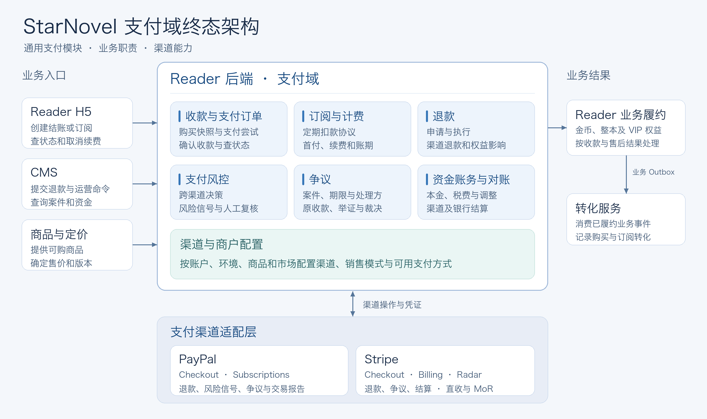
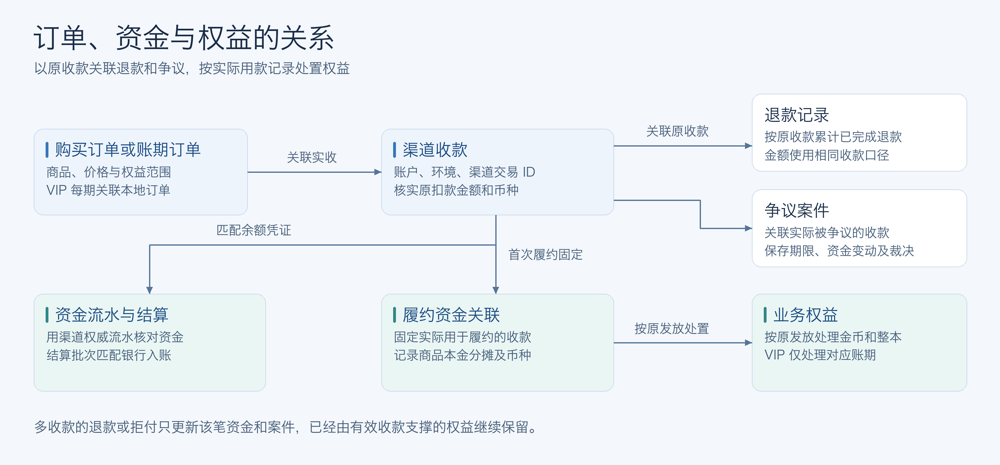
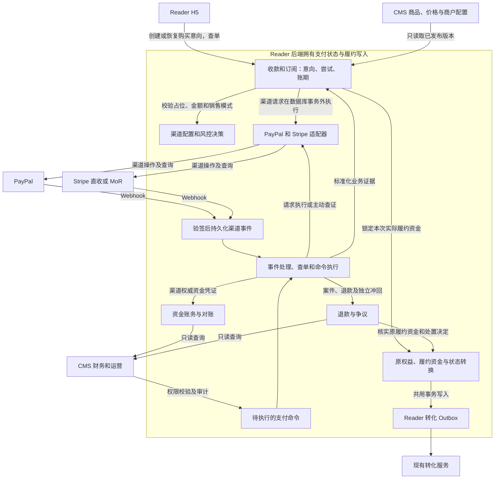
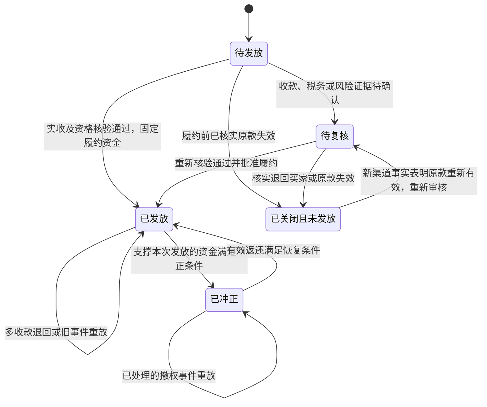

# StarNovel 支付域架构与开发实施方案

2026-11-21 · 设计评审稿

StarNovel 以一套支付域支撑金币充值、整本购买和 VIP。PayPal 与 Stripe 分别接入，Stripe 直收与 Managed Payments（MoR）按销售模式管理。开发从已经具备业务闭环的 PayPal 出发，先固化共用的订单、收款与权益契约，再补齐资金对账、风控和争议。第一笔对客户开放的 Stripe 交易直接进入正式处理路径。

**首版币种范围。** PayPal 和 Stripe 的商品定价、买家实际扣款、退款、渠道结算及银行对账统一使用 USD，金额以美分处理。业务凭证保留币种，用于核验交易和识别差异。其他币种及跨币种结算暂缓。

## 1. 终态架构



前端改造见[第 3.5 节](#35-reader-h5-与-cms-前端设计)及 `FE-01` 至 `FE-04`。编码 Agent 可直接读取[第 9 节的文本架构图与实现约束](#9-编码-agent-参考)。

支付域负责记录购买约定、支付协议、资金结果和售后案件。商品与定价负责可购套餐、售价、小说范围及版本。Reader 的履约逻辑负责金币流水、整本与 VIP 权益。转化服务消费符合现有规则的业务事件，沿用既有 Outbox、去重和投递契约。 [支付与权益业务规则](reader-payments-business-rules-and-support.md) · [转化事件口径](conversion-reporting-architecture.md#31-事件产生和业务口径)

**部署边界**采用现有 Reader、CMS 和 PostgreSQL。Reader、CMS、支付后台任务和数据库迁移统一使用 `star_novel` 账号。Reader 后端承载支付域并负责写入支付状态。CMS 负责商品和商户配置、财务权限、命令提交、查账和案件处理。查询授权、敏感字段访问和命令权限在应用层校验。CMS 提交带操作者和幂等键的支付命令，Reader 后台核验命令与目标状态后执行并回写结果。履约与支付仍可在同一数据库事务内提交，图中的模块边界由应用接口与写入路径落实。 [部署手册](../DEPLOYMENT_SOP.md)

| 通用模块 | 持有的职责 | Reader 或 CMS 获得的能力 |
| --- | --- | --- |
| 收款与支付订单 | 购买快照、渠道支付尝试、收款确认、异常订单 | 创建及恢复结账、按本地订单查状态、确认可履约收款。 |
| 订阅与计费 | 扣款协议、账单与已付周期、续费与停止续费状态 | 开通、查账期、取消自动续费、从扣费失败恢复。 |
| 退款 | 退款申请与执行状态、渠道退款明细、累计金额 | 审批与执行全额或部分退款、同步外部发起的退款、查询原收款及影响。 |
| 支付风控 | 跨渠道业务决策、渠道信号、复核及处置记录 | 结账前准确返回可执行动作，后台查询拦截、验证、预警和已收款待复核。 |
| 争议 | 案件、证据与原收款关联、处理方、期限、裁决 | 告警、跳转渠道后台、提供履约证据、跟踪资金及权益处置。 |
| 资金账务与对账 | 已证实的资金变动、手续费、代扣税和结算匹配 | 按订单、渠道收款、结算批次和银行入账查询与核对差异。 |
| 渠道与商户配置 | 账户和环境、商品映射、销售模式、支付方式及渠道能力 | 返回可用方式，按账户、商品类型和销售市场开放新购买。 |

## 2. 现状和迁移范围

- **开发分支** `codex/payment-domain`。
- **代码基线** `main` 与 `origin/main` 的提交 `5e5b3d8e5f72bdc8e27500f71d51e108b3703fde`（`Merge unified conversion reporting into main`）。开发分支从该提交创建。

下表按主线基线描述代码能力。生产部署与渠道权限需在实施时分别核实。

| 模块 | 当前覆盖 | 开发工作包 |
| --- | --- | --- |
| 收款与支付订单 | PayPal 金币与整本已有服务端定价、订单快照、收款确认、履约与补查。Stripe 渠道客户端独立开发，旧占位路由已移除。 [PayPal 订单服务](../reader-backend/internal/payment/application/checkout_service.go) · [Stripe 渠道客户端](../reader-backend/internal/payment/stripe) | `PAY-02`、`ST-01` |
| 订阅与计费 | PayPal 已有计划映射、续费入账、账期校验和取消补偿。现有 provider 接口之下仍有 PayPal 专用执行路径。 [接口](../reader-backend/internal/payment/provider.go#L82) · [账期记录](../reader-backend/internal/payment/application/subscription_service.go) | `PAY-03`、`ST-02` |
| 退款 | CMS 可通过 PayPal 退剩余可退金额。已能累计渠道侧的部分退款，并在累计退满时冲正权益。 [退款命令入口](../cms-backend/internal/billing/refund_command.go) · [退款规则](reader-payments-business-rules-and-support.md#1-产品规则) | `PAY-04`、`ST-01` |
| 资金账务与对账 | 有交易凭证、部分手续费与净额、订单及账期补查。PayPal 订阅收据的 `net_amount` 当前按收款总额写入，银行入账仍需核对。 [订阅收据入库](../reader-backend/internal/payment/application/subscription_repository.go) · [后台补查](../reader-backend/internal/payment/application/reconcile.go#L18) | `FIN-01` 至 `FIN-03` |
| 渠道与商户配置 | 有 PayPal 账户、环境、身份锁和套餐计划映射。旧 CMS「支付管理」为网关参数表单，按新架构退役，由支付中心的渠道与商户页面接管。 [现行渠道与商户页面](../cms-front/src/pages/PaymentCenter.tsx) · [账户校验](../reader-backend/internal/payment/paypal/credentialstore/reader.go) | `CFG-01` 至 `CFG-03`、`FE-01`、`FE-03` |
| 支付风控 | 有结账决策、渠道风险信号和授权复核工作台。真实渠道权限与暂缓履约参数随账户验收开放。 [订单校验](../reader-backend/internal/payment/application/checkout_service.go) | `RSK-01` 至 `RSK-03` |
| 争议 | 缺案件模型、同步、举证期限及处置能力。仪表盘当前按订单列表中的 `Refunded` 计数。 [订单页统计](../cms-front/src/pages/DashboardTab.tsx#L23) | `DSP-01` 至 `DSP-03` |

## 3. 支付契约和数据边界



### 3.1 核心记录和唯一性

| 记录 | 保存内容与约束 |
| --- | --- |
| 购买订单 | 保留 `recharge_orders` 和稳定订单 ID。下单时固定用户、商品版本、金额币种、币数或小说、投放归因。VIP 每个计费单元关联一个本地订单。 |
| 购买意向与占位 | 本地购买意向先于渠道尝试建立，固定用户、环境和所购对象，绑定稳定的订单或订阅意向 ID。符合互斥规则的整本和新 VIP 使用业务范围的原子占位。重试、离开页面后继续和切渠道复用原意向。 |
| 支付尝试 | 每次授权或结账绑定原购买意向、本地订单及渠道账户、环境、销售模式、渠道会话 ID、创建幂等键和状态。一次有效意向可有历史尝试，同一时刻只允许一个可能继续收款的主动结账。 |
| 扣款协议与账期 | 保留 `user_subscriptions`。保存协议、渠道套餐版本、续费状态、每期服务起止及收款关联。Stripe 以账单 ID 区分计费单元，PayPal 以有账期证据的 `Sale` 交易关联本地账期订单。 |
| 渠道收款 | 以 `third_party_payment_orders` 为迁移起点。每条已核实收款按渠道、账户、环境、对象类型和外部 ID 唯一。PayPal 使用 Capture 或 Sale，Stripe 保留 Session、PaymentIntent、Charge、Invoice 的关系，退款和争议按实际收款对象关联。 |
| 履约资金关联 | 在首次履约事务中记录订单或账期、权益发放记录、实际采用的收款及其商品本金金额和币种。一次性订单选定一笔有效收款，已核实的多笔账单付款可以按凭证分摊。未用于履约的多收款仍有独立资金记录。历史关联按可信收款和履约证据回填，缺证据时进入待核对。 |
| 退款、争议、资金流水 | 每笔原收款可有多次退款请求。每次请求以本地请求 ID 去重，渠道退款和案件分别用各自外部 ID 去重。资金流水采用渠道权威流水身份，均限定渠道账户和环境。争议支持关联多笔收款，一笔收款可关联多个案件。缺交易关联时保存待匹配记录。 |
| 支付事件、风控和操作记录 | 验签事件按渠道账户、环境、事件 ID 入库。风控保存信号来源、原因、结果、决定及复核记录。后台操作保留权限校验结果、操作者、请求 ID、状态和审计记录。独立收款冲回可直接关联原收款，案件关联可为空。 |
| 销售模式与税务依据 | 支付尝试保存下单时的规则版本、市场依据及预期税务责任。实际收款及每期账单保存经渠道确认的交易地区、适用客户类型、MoR 模式、间接税责任方与证据引用。责任未知或与批准范围不一致时进入核对。 |

### 3.2 金额、状态与一致性

- 支付、履约、风控、订阅协议、退款和争议分别保存状态。比如支付可以已收款且处于待复核，VIP 可以已取消续费且仍有已付权益，争议可以已结案且资金仍待核对。Reader 查询状态由服务端组合返回。
- 回跳只查询本人订单。Webhook 和主动查单都提交到同一个记账入口。渠道调用放在事务外，事务内锁定订单、已核验收款及相关权益，并提交对应的业务结果与 Outbox。锁顺序按当前 PayPal 路径盘点后统一，退款与争议冲正沿用同一顺序。
- 只在已有尝试已失效且确认无法继续收款后切换渠道。若两次尝试都被证实收款，分别记录资金，按首次履约事务选定的收款发放一次。多收款进入有审计的退款处理，其退款或拒付只更新该笔资金和案件。对实际支撑履约的收款，退款、争议和返还按同一关联重新核对权益影响。
- 购买和订阅转化沿用现有业务键与归因快照。在收款确认且履约后产生 `Purchase`，符合首笔条件时产生一次 `Subscribe`。退款后保留原转化证据。资金账务提供可追溯的金额拆分，由转化模块沿用或单独评审调整现有价值口径。 [统一转化契约](conversion-reporting-architecture.md#31-事件产生和业务口径)

#### 跨渠道购买意向和互斥范围

创建或恢复购买意向与发起渠道结账是两个操作。Reader 返回稳定的本地意向 ID，H5 在回跳、刷新和切换渠道时携带它。将用户、操作和请求幂等键与参数摘要绑定，命中同一键返回已有记录，参数冲突返回明确错误。渠道尝试只能在已有意向下创建，重试原尝试和切换渠道各有独立的服务端校验。

整本购买按环境、用户和小说占位，并在同一事务中核对既有整本权益。适用同类防重规则的新 VIP 按环境、用户与服务端定义的 VIP 互斥组占位，同时检查正在续费或状态未知的旧协议。该约束在查询渠道之前以数据库唯一键或事务锁保证，两个客户端即使带不同请求键也回到同一购买意向或收到可操作的冲突。占位跟随已生效的权益或协议，未决支付保留占位，取消后的重新开通资格按批准的产品规则处理。已有并存的 PayPal 协议仍能独立管理。

金币购买保留重复购买能力。H5 只在用户明确发起另一笔充值时创建新意向。同一次点击的重复请求、页面恢复和渠道切换沿用原意向。所有渠道共用占位判断，单个渠道的会话过期后仍需核实未产生收款，再允许替换尝试。

#### 渠道写操作的重试边界

创建结账、扣款和退款等写操作保存稳定的渠道幂等键、首次发送时间、请求参数摘要、已知外部对象 ID 和重试截止时间。适配器按渠道及操作定义幂等支持和保留窗口，Worker 在首次发送前持久化这些信息。窗口内仅对适配器允许重试的错误重发原请求，使用原参数和键。没有可确认的窗口时，首次发送结果未知即进入查证。

超过窗口、渠道缺少可靠幂等保障，或适配器将返回归为仅可查证的结果时，任务转换为只查状态，按已知对象、订单引用、Webhook 和财务凭证核实。查证后仍无法确认结果，转人工待办并保留退款预留或原结账尝试占位。确实证实原请求未产生效果后，由授权人员重新提交并关联原请求。重放事件只重跑本地处理和查证，渠道写请求仍受时间窗口约束。 [Stripe 幂等请求](https://docs.stripe.com/api/idempotent_requests) · [PayPal 幂等说明](https://developer.paypal.com/api/rest/reference/idempotency/)

#### 退款、全退和权益比较口径

首版业务金额统一为 USD，以美分存储和计算。分别记录商品定价及商品本金、渠道扣款、买家实付、渠道余额和银行结算。税与费用单独记录，缺失值保留为未知。

| 判断 | 采用的金额与证据 |
| --- | --- |
| 渠道可退余额 | 按原 USD 收款，根据原可退金额扣除已完成退款及在途预留，并核验渠道当前允许的金额与案件状态。多笔部分退款逐笔保留请求和结果。 |
| 买家是否全退 | 核实成功 USD 退款累计覆盖原 USD 含税扣款金额，按同一原收款比较。 |
| 权益影响 | 买家全退时，将该笔收款实际用于履约的全部本金计入退回。若一次发放由多笔收款支撑，按原发放关联累计已核实的退回本金，覆盖整次发放才适用全退冲正规则。部分退款、最终拒付损失或资金返还按核实的商品本金及已批准策略处理。本金分摊证据不足时进入复核。 |
| 商户资金差额 | 按渠道余额与结算凭证记录实退、代扣税、手续费、拒付划扣和返还。每项保留来源，避免影响买家全退判定。 |

例如商品本金为 10 USD、渠道含税扣款为 11 USD。两次成功退款在原扣款口径内分别为 5.50 USD，第一笔保留已发权益，第二笔达到买家全退且对应原履约收款时冲正一次。Stripe 在结算中保留代收税时，仍按渠道提供的 USD 原收款与退款对应关系判定。 [MoR 退款](https://docs.stripe.com/payments/managed-payments/how-it-works#refund-support)

#### 资金凭证与业务凭证

收款、退款、争议对象提供业务状态和归属。渠道余额流水或结算报表中的余额变动明细提供权威资金凭证。按渠道账户、环境和权威流水身份建立账务记录。Stripe 使用 `BalanceTransaction` ID。PayPal 源由适配器根据真实报表字段定义稳定行标识，覆盖同一交易下不同资金动作。Webhook、查询结果和报表通过渠道引用链接到已有流水。缺引用或多项候选时保留待匹配，同额和时间接近只能作为核对线索。 [Stripe 余额流水](https://docs.stripe.com/api/balance_transactions/object) · [PayPal 资金事件代码](https://developer.paypal.com/reports/reference/t-codes)

同一笔退款、拒付或独立冲回由多个入口到达时，业务对象保留各自 ID，资金影响按核实作用入账一次。报表补齐已有流水或记录可审计的更正。银行入账匹配结算批次与银行流水，买卖款项与结算划拨分别呈现。资金返还与原资金动作及已执行的权益处置关联。

#### 权益状态转换与恢复

首次发放沿用原业务键去重。处理售后时，在锁定原权益和履约资金关联后，根据当前已核实的资金事实、审批结果和产品规则计算目标权益状态。仅在目标与当前状态不同时提交转换。保存转换序号、来源事实和实际权益变更，对同一份已处理的资金依据与审批重放返回原结果。旧事件只补充证据或触发查证，以核实的当前凭证重算状态。

同一发放允许在新事实支持时经历冲正、恢复、再次冲正。金币恢复量引用前次实际扣回数，按付费币和赠币分别恢复，历史缺口另留审计记录。例如发放 100、实际扣回 70，返还后最多恢复对应的 70。整本恢复关联原小说，VIP 恢复使用原账期起止时间，到期账期仍按原时间记录。每次资金变化都要能追到适用的权益转换或无需动作的判断。

### 3.3 状态与跨模块触发条件

| 对象 | 公共状态或结果 | 可以触发的动作 |
| --- | --- | --- |
| 支付尝试 | 待用户操作、待渠道确认、成功、失败、失效 | 查询或恢复原尝试。失效并确认无法收款时可另建尝试。 |
| 渠道收款 | 待核验、已核验、需复核 | 核验通过且满足履约条件时提交正常履约。发现已全退时跳过发放，保留原收款和退款事实。 |
| 订阅协议与已付账期 | 协议有待开通、续费中、待取消、已停止等状态。账期单独保存已核实收款、应付、累计实收及有效时间。 | 收款累计覆盖该账期适用的应付金额并核验凭证后发放对应 VIP，取消确认改变未来续费安排。 |
| 退款 | 待执行、结果待确认、成功、失败 | 成功后按退款口径核对累计退回与履约资金关联。未知结果继续查证原请求。 |
| 争议 | 待处理、处理中、已结案，另存渠道阶段、裁决和资金状态 | 到期提醒、财务处理和资金核对。结案且资金凭证满足权益策略时提交授权处置。 |
| 履约 | 待发放、待复核、已发放、已冲正 | 发放、冲正与恢复各有依据和转换记录。已恢复的权益在新损失被证实后可再次冲正。 |

渠道对已结案案件的更正以重新核实的渠道详情和资金凭证入账。已入账的资金流水若被撤销，应新增关联的返还或更正记录，保留原处理依据。

### 3.4 服务入口与运行责任

| 调用方 | 操作契约 | 返回或审计要求 |
| --- | --- | --- |
| Reader H5 | 查可用渠道、创建或恢复购买意向、在该意向下结账或切渠道、查自己的订单及订阅、取消续费。创建意向提交套餐和适用小说。发起渠道操作提交意向 ID、渠道和请求幂等键。 | 返回稳定的本地意向 ID、渠道跳转信息和可查询状态。服务端生成回跳定位引用并核对登录用户的归属。购买记录可查本人的非终态和已完成订单。 |
| CMS 财务或运营 | 查订单、退款、资金流水和案件。退款、风险复核和权益处置按权限提交命令。 | 返回操作编号和处理状态。授权人员可按操作编号查结果，提交人可用原请求键查找自己的命令，收款详情可查关联的在途和近期退款。记录操作者、请求摘要、依据及处理结果。 |
| 支付后台任务 | 验签后持久接收、认领重试、主动查单、按游标回补、校验渠道资金凭证。 | 支持失败重试、状态查询和定向重放。事件接收幂等与业务处理幂等分别保障。权限不足、映射未知和金额异常进入可排查队列。 |
| 履约和转化模块 | 消费已核实资金结果，提交权益与业务事件。 | 复用现有金币、整本、VIP 和 Outbox。失败保留可重放状态，已完成履约保护原业务去重键。 |

### 3.5 Reader H5 与 CMS 前端设计

Reader H5 承载支付方式选择、结账、支付结果和订阅管理。CMS 建立统一的**支付中心**，按财务与运营工作组织页面。两端沿用各自平台已经使用的主题、交互和公共组件。

#### Reader H5 页面与状态

| 页面或区域 | 页面职责 | 前端契约 |
| --- | --- | --- |
| 充值与整本购买、开通 VIP | 在现有充值与会员购买入口显示商品、价格、支持的支付方式及主操作。以服务端返回的可用方式控制选择和按钮。 | 初次购买创建意向，重复提交或重新打开恢复原意向。切渠道需服务端确认原尝试已经结束。涉及自动续费时，在跳转前展示频率、价格依据与取消入口。 |
| 结账返回与进度 | 回到现有购买入口或支付结果界面，保留返回阅读上下文。 | 以本人意向或订单查询为准。显示待付款、支付确认中、已收款待发放、已完成、已取消或可重试。回跳参数只用于定位，网络故障显示可刷新状态。 |
| 钱包、购买记录与 VIP 管理 | 查询余额或已购内容，显示每份订阅的所属渠道、已付截止、续费和取消进度。 | 由服务端返回履约及订阅状态和可用管理动作。确认发放后刷新现有钱包、VIP 和阅读权限。取消处理中展示真实进度，已付截止与未来续费分别显示。 |

用户离开页面时停止轮询，返回后用原意向重新查询。等待超过前端查询时段时保留查进度和联系支持入口。价格展示使用服务端提供的金额及币种。托管结账存在税额变化时，明确当前为套餐报价，最终支付金额以渠道结账页为准。用户界面显示可理解的进度与下一步，渠道原始报文和风控原因留在授权后台。 [现有购买入口](../reader-front/src/pages/Recharge.tsx) · [个人页与钱包](../reader-front/src/pages/Profile.tsx)

**跨标签及无本地存储回跳。** Reader 发起渠道结账时生成指向原意向的不可枚举引用，并在渠道支持的返回参数中携带。服务端保存意向与尝试的映射、原账户归属及允许返回的站内页面，现有 PayPal 返回参数由兼容入口解析并查到同一意向。引用只用于定位。返回后先恢复登录，再由 Reader 核对用户和渠道尝试。未登录时保留定位引用供登录后继续，账户不匹配时仅提示切回付款账户或联系支持。原页面存储缺失时仍可按有效引用查原意向。引用缺失、失效或无法匹配时，从本人购买记录恢复待付款、确认中或已完成的订单。付款与履约均以服务端查询结果展示，站内阅读地址由已核实上下文生成。 [当前 PayPal 回跳](../reader-front/src/pages/Recharge.tsx#L152)

#### CMS 支付中心与旧入口退役

以 `/payments` 为新入口，沿用 CMS 侧栏、面包屑和内容区。打开支付中心时进入首个有权访问且已上线的子页。页面按能力逐步上线，各子页的查看、敏感明细、提交命令和审批权限由后端校验。渠道配置沿用 `SuperAdmin` 权限，退款执行沿用 `SuperAdmin` 和 `Finance` 权限。导航与按钮依据权限及服务端返回的可用操作显示。 [现有退款权限](../cms-backend/internal/billing/handler.go#L22)

| 子页 | 建议路由 | 关键内容与操作 |
| --- | --- | --- |
| 交易与订单 | `/payments/orders` | 订单筛选、渠道和销售模式、收款与履约状态。详情可查购买快照、支付尝试、收款、退款与争议，按 ID 跳到关联记录。 |
| 订阅与账期 | `/payments/subscriptions` | 协议、状态、已付账期、原收款及渠道管理入口。从账期详情跳到付款、退款和争议。 |
| 退款 | `/payments/refunds` | 原款与可退、已退及预留金额，退款来源、进度和操作审计。财务用确认弹窗提交退款命令。 |
| 风控 | `/payments/risk` | 决策与渠道信号分列，显示已收款待复核、负责人、期限、处置决定及关联售后。 |
| 争议 | `/payments/disputes` | 原收款、是否需本方响应、渠道阶段、举证截止、裁决和账务影响。可查授权证据并跳转渠道后台。独立冲回在原交易下可追踪。 |
| 资金对账 | `/payments/reconciliation` | 资金流水、结算批次、入账匹配及未匹配差异。以 USD 展示实收、税、费用和净额。 |
| 渠道与商户 | `/payments/channels` | 账户和环境、可用方式、商品映射、市场与直收／MoR。允许授权管理员校验配置与发布开关，页面仅显示脱敏标识和凭证引用状态。 |

旧 `/payment` 的 `PaymentTab` 与侧栏「支付管理」入口正式退役。新的渠道与商户页面接管配置读写。切换时移除旧页面，停用该表单经 `/settings` 读写支付凭证和商户配置的路径，保留经同等权限校验的旧地址跳转到 `/payments/channels`。已有 `/orders` 的交易查询与退款入口并入交易与订单，验收订单筛选、详情、历史链接和财务操作后切到 `/payments/orders`。充值模板仍作为商品与定价入口，支付中心通过商品版本关联配置。任何旧地址都通过新入口的权限校验。 [现有 CMS 路由](../cms-front/src/App.tsx#L302) · [侧栏配置](../cms-front/src/config/navigation.tsx#L69) · [支付中心](../cms-front/src/pages/PaymentCenter.tsx)

**配置来源切换。** P1 先把现有账户、环境、凭证引用与 Webhook 配置映射到新渠道记录，在存量副本验证 Reader 下单及回调、实际退款执行端、补查任务和历史交易仍绑定原渠道账户。切换时由新配置读写路径接管，CMS 查询只返回脱敏标识、环境、校验状态与权限允许的配置。`GET /settings` 按非支付字段白名单返回现有通用设置，`POST /settings` 只允许原授权角色写入允许的非支付字段。包含支付配置字段的混合请求整笔拒绝，保留小说设置的读写兼容。直接调用旧接口也执行这套限制。运行期配置需要回退时在服务端调整凭证来源，浏览器接口继续使用字段白名单。 [旧设置 API](../cms-backend/internal/novel/handler.go#L59) · [小说设置调用](../cms-front/src/pages/NovelsTab.tsx#L349)

财务页面的支付、履约、退款、风险和争议状态各自展示。列表统一提供加载、无记录、筛选无结果和请求失败反馈，保留页码、筛选条件及重试入口。退款、风险决定、争议权益处置和发布配置等操作在确认前显示目标、影响和金额币种。使用 `CmsDialog` 的可识别标题，初始焦点放在安全操作，关闭后回到触发按钮。按钮在提交中防止重复点击，服务端受理后显示命令处理中，直到查询到最终结果再显示成功或失败。 [CMS 公共弹窗](../cms-front/src/components/ui/CmsDialog.tsx)

#### CMS 应用权限与脱敏

以下权限范围已确认，适用于前端开发和联调。身份依现有 CMS 角色识别，数据库统一使用 `star_novel`。同一权限规则适用于新页面、兼容地址以及新旧 API。应用层对未列入的权限默认拒绝。 [现有 CMS 角色](../cms-front/src/config/navigation.tsx#L36) · [现有订单和退款路由](../cms-backend/internal/billing/handler.go#L22)

| 页面与数据范围 | 可查看 | 可操作 |
| --- | --- | --- |
| 交易与订阅摘要 | `SuperAdmin`、`Finance`、`Admin`。`Support` 通过已知订单号或用户定位其客服业务所需的脱敏订单、退款进度和权益摘要。 | 财务命令按对应子页权限执行。客服侧提供查进度和移交财务。 |
| 退款、风控与争议 | `SuperAdmin`、`Finance` 可查案件、审计和处置所需证据。返回按场景筛选的结构化字段。 | `SuperAdmin`、`Finance` 可发起退款、复核、争议处置和已授权的权益恢复。渠道案件的可执行动作同时受渠道与案件状态约束。 |
| 资金对账与结算 | `SuperAdmin`、`Finance` 可查资金流水、税费、结算和可追溯凭证。 | `SuperAdmin`、`Finance` 可执行配置允许的报表导入、银行匹配和差异处理。 |
| 渠道与商户 | `SuperAdmin` 可查账户及脱敏配置。 | `SuperAdmin` 可管理映射、凭证引用及开关，配置变更有审计。 |
| 内容和投放角色 | `Editor` 使用既有内容入口，`MediaBuyer` 通过既有回传中心查看授权的投放结果。 | 支付中心默认按上述授权项开放。 |

订单摘要接口只返回业务状态、订单号和按角色允许的金额、币种及脱敏信息。付款人标识和案件证据由授权详情接口查询，按业务需要返回选定字段，渠道原始载荷保留在服务端。旧 `/orders/:id/payment-details` 按新权限与字段规则返回，或在兼容期结束后停用。秘密凭证通过服务端引用使用。应用层权限测试直接核对接口响应、返回字段及操作效果，以覆盖前端隐藏组件之外的访问路径。 [旧交易明细路由](../cms-backend/internal/billing/handler.go#L100) · [旧交易明细字段](../cms-backend/internal/billing/repository.go#L122)

#### CMS 退款命令与中断恢复

同一次退款确认使用一个稳定的本地请求键。CMS 在发送前记录请求键、当前操作者和原收款引用，刷新或原操作者重新登录后恢复该请求。服务端以环境、实际登录操作者、操作类型、请求键识别命令并固定目标、金额、币种及必要参数。同键同参数返回原操作及状态，同键参数冲突返回明确错误。命令和对应退款预留在事务内持久化后，返回操作编号供查询。

HTTP 超时或断网时显示提交结果待确认。CMS 先按原请求键或操作编号查命令，并显示该笔收款的在途和近期退款。仍需重发时沿用原请求键和原参数。若本地请求键也丢失，先从收款详情查证原命令，未确认前保留待核对。确认当前是经授权的另一笔退款时才生成新键。此处去重面向 CMS 到支付域的本地命令，Reader 到渠道的重试继续遵循第 3.2 节。验收要让原收款可退余额足以通过两笔同额部分退款，以证明一笔退款来自命令去重。

#### UI 一致性与公共组件复用

**新增页面必须延续平台整体 UI 风格。已有公共组件符合需求时必须复用。** 每个前端工作包在提交前列出用到的页面壳、主题样式和公共组件。已有组件只差通用能力时优先扩展原组件，给存量调用保留默认行为。确有语义、交互或无障碍差异时，记录原因和新增边界。支付业务特有的字段和流程放在支付功能组件中，与基础控件分开。

| 场景 | 从现有实现复用 |
| --- | --- |
| CMS 布局与主题 | `App` 和 `CmsSidebar` 的侧栏、导航、内容区、面包屑与主题切换。复用 `index.css` 中的 `--cms-*` 和 `.cms-table` 等现有样式，统一视觉密度、按钮、输入、边框与换肤表现。 [CMS 侧栏](../cms-front/src/components/CmsSidebar.tsx) · [CMS 样式](../cms-front/src/index.css) |
| CMS 列表、筛选与状态 | 沿用 `OrdersTab` 的使用方式，复用 `TableRegion`、`StatusDot`、`SearchInput`、`FilterChipsBar`、`ToolbarPopover`、`SkeletonRows`、`Pagination` 和 `CustomSelect`。状态同时提供文本，行操作用可聚焦的按钮或菜单入口。 [现有订单页](../cms-front/src/pages/OrdersTab.tsx#L1) · [公共基础组件](../cms-front/src/components/ui/Primitives.tsx) · [分页](../cms-front/src/components/ui/Pagination.tsx) · [选择控件](../cms-front/src/components/CustomSelect.tsx) |
| CMS 浮层、交易详情与反馈 | 使用 `CmsDialog` 的弹窗和抽屉变体以及 CMS `ToastProvider`。现有 `ThirdPartyPaymentModal` 可复用交易明细的信息布局和通用字段，渠道模式、退款及账务字段以新契约为准。 [弹窗与抽屉](../cms-front/src/components/ui/CmsDialog.tsx) · [交易明细](../cms-front/src/components/ThirdPartyPaymentModal.tsx) · [CMS 提示](../cms-front/src/context/ToastContext.tsx) |
| Reader H5 购买与反馈 | 沿用 `Recharge` 的购买界面样式和 `Profile` 的钱包入口，使用 Reader 的主题体系。适合时复用 `GoldCoin`、`Drawer`、`LegalModal` 和现有 Toast。PayPal 与 Stripe 的选择和状态共用同一套购买交互。 [充值页](../reader-front/src/pages/Recharge.tsx) · [Reader 抽屉](../reader-front/src/components/Drawer.tsx) · [Reader 主题](../reader-front/src/utils/theme.ts) |

## 4. 可执行开发工作包

本方案全部工作包的设计、开发和评审必须遵守 [StarNovel 全项目开发规范](../development_guidelines.md)。实现时按领域职责明确业务规则和数据的写入方，复用现有公共逻辑与组件，按全项目规范管理配置和常量，禁止魔数、魔法字符串和环境相关硬编码。

### 4.1 支付与订阅公共路径

| 编号 | 交付内容 | 完成条件 |
| --- | --- | --- |
| `PAY-01` | Reader、CMS 和 QA 定好记录状态图、账户归属、金额字段、渠道能力和应用层权限契约。CMS 迁移增加所需字段、约束和索引，使用旧数据做回填，保留存量 ID。接入共享事件入口与后台任务，留出每个渠道主动查单和断点补偿接口。 | 使用共享 `star_novel` 账号完成空库及存量副本的可重跑升级与运行验证。旧订单、订阅、退款和转化键在回填前后可核对。缺原交易证据的记录进入待复核。 |
| `PAY-02` | Reader 按购买意向管理结账和尝试，实现整本原子占位、PayPal 收款确认与履约。H5 保留同一次购买的意向 ID。首次履约保存实际采用的收款和本金分摊。 | 使用两套渠道 Mock 并发购买同用户同小说，验证不同请求键下也只有一个活跃意向。金币显式新购可独立结账。跨渠道晚到双扣仍保留两笔资金凭证及一次履约，多收款全退保留正常权益。 |
| `PAY-03` | Reader 迁移 PayPal 的订阅意向、协议状态、账期验证、取消和补偿。对适用的新 VIP 实现跨渠道互斥占位，提取共用账期履约。 | 同类 VIP 并发开通符合已批准的互斥规则，已有多协议仍可独立管理。首付、续费、取消、证据不足和已付权益回归通过。原首笔转化归属保留。 |
| `PAY-04` | CMS 提交带审计的退款命令，Reader 串行处理同一收款的可退金额和在途预留。按第 3.5 节提供原命令查询及在途、近期退款查询。新请求逐笔保存，旧未决请求按第 6.1 节接管。退款恢复按渠道重试窗口和原收款金额口径执行。 | 本地命令响应丢失后以原键恢复只受理一次。渠道结果未知且重试窗口过期或旧退款缺首次发送时间时只查证。失败及多收款全退保留权益，履约收款全退按权益状态转换处理。 |

### 4.2 资金账务与对账

| 编号 | 交付内容 | 完成条件 |
| --- | --- | --- |
| `FIN-01` | Reader 建立基于权威渠道流水的金额明细及业务对象关联。在来源账户内，将 USD 本金、处理费、税、划扣及返还分项落库。补齐 PayPal 订阅净额的凭证状态。 | 同一 Stripe 退款以 `Refund` 事件、查单和报表到达时只影响余额一次，原始凭证全部可追溯。PayPal 多类资金动作逐笔区分。只有总额的历史记录将净额标为未知。 |
| `FIN-02` | Reader 提供 PayPal 和 Stripe 的报告导入或查询入口，使用已定义的流水标识补齐原记录或保留更正凭证。结算与银行流水统一采用 USD，以美元分记录渠道划拨和银行实收，保留核实凭证和操作者。自动拉取按账户可用权限启用。 | 同一报告重复导入结果一致，消息与报表到达顺序互换时余额一致。每个已匹配批次能核对渠道汇总与银行实际金额。金额或参考号不符、延迟入账及缺流水可单列和补匹配。 |
| `FIN-03` | CMS 实现订单、资金流水、结算批次和待处理差异的关联视图。MoR 报表拆分代扣税和手续费，金额及汇总统一使用 USD。仪表盘按正式环境已确认的退款与拒付划扣分别统计。 | 财务能以一笔订单追到资金流水和银行入账，也能从一个批次反查交易。仅本地订单金额的历史数据明确展示覆盖范围。 |

### 4.3 渠道与商户配置

| 编号 | 交付内容 | 完成条件 |
| --- | --- | --- |
| `CFG-01` | Reader 与 CMS 建立渠道账户记录，环境、账户标识、凭证引用、Webhook 配置和能力独立管理。将现有 PayPal 账户映射到该记录并沿用身份校验。 | 测试与生产隔离。账户和环境匹配后才可创建交易或处理历史记录。密钥从配置引用加载，查询、审计和日志保留可展示的配置信息。 |
| `CFG-02` | CMS 建立已发布套餐版本到 PayPal Plan 或 Stripe Product、Price 的绑定。记录收款币种、税码、含税方式与允许销售模式。保留旧的套餐映射和续费协议版本。 | 改价后新订单使用新版本，已建订单和存量协议可按原版本继续查询、续费和退款。缺必填映射的商品可在 CMS 定位问题。 |
| `CFG-03` | Reader 按环境、账户、商品与市场筛选渠道。CMS 分别配置单次购买、订阅及 Stripe 直收／MoR 的收款资格与税务责任。按第 5 节保存计划与实际交易地区的依据及校验结果。 | 关闭新收款后，原交易继续处理。测试可付款但 Stripe 负责税务范围以外、Checkout 账单地区变化以及续费改变地区。超出批准范围的已收款记录和处置可追踪。 |

### 4.4 支付风控

| 编号 | 交付内容 | 完成条件 |
| --- | --- | --- |
| `RSK-01` | Reader 将现有购买资格、未结束支付尝试与同类 VIP 防重纳入统一结账决策。支持记录放行、拦截、需要验证或复核及原因与规则版本。先对现有 PayPal 行为做观察和回归，阈值类规则经产品和运营确认后启用。 | 同一业务限制覆盖 PayPal、Stripe，换渠道仍执行。技术失败、普通扣款失败、风控拦截及未知分别展示。 |
| `RSK-02` | 适配器接入渠道实际提供的拒绝原因、卡验证、复核和风险预警，覆盖收款后才到账的信号。保存渠道原始原因和来源，能力按真实产品和账户开启。 | Stripe 待复核但已收款时，资金状态与复核状态可并存。PayPal 缺少对应信号时可展示为未知，订单处理继续依据真实收款凭证。 |
| `RSK-03` | CMS 提供复核队列、处理人、截止时间和审计。获批后复核当前收款再履约，拒绝时创建财务退款或争议待办。超过复核期限时升级给值班财务。 | 已收款待复核仍可查账。拒绝和超时均有负责人和截止时间，已有退款或争议可复用对应待办。重复通知、退款先到和复核结果交错都能收敛。 |

暂缓履约按配置开放，启用时需要指定风控处理人、财务接管人、复核和退款处理时限。拒绝且已收款未履约时，Reader 创建去重的财务退款待办，财务确认原收款和可退余额后走 `PAY-04`。已有活跃争议限制退款时，待办关联争议并跟踪渠道结果。争议结案后商户仍保留款项的，待办回到财务继续退款，或由授权人员重新核验并批准履约。到期未审的记录按配置升级给值班财务，继续保留待处置状态。原款已核实退给买家，或重新核验后已完成履约时，关闭待办。风险预警单独保存，已发放权益按正常售后路径处理。

### 4.5 争议

| 编号 | 交付内容 | 完成条件 |
| --- | --- | --- |
| `DSP-01` | Reader 同步 PayPal `CUSTOMER.DISPUTE.*`、Stripe `charge.dispute.*` 及其详情。独立接入 PayPal `PAYMENT.CAPTURE.REVERSED` 与 `PAYMENT.SALE.REVERSED`，匹配原 Capture 或 Sale，并按资金凭证识别冲回。 | 两渠道案件及更正能回补。PayPal 单次和订阅的无案件冲回可入账，并在确认最终损失后进入原收款对应的处置队列。冲回、案件和报表任意先后到达都可关联并去重。 |
| `DSP-02` | CMS 实现案件列表、阶段、负责人、举证期限提醒和证据查询。按案件提供渠道后台入口。PayPal 和 Stripe 直收由财务处理，MoR 案件跟踪 Stripe 处理和结果。证据从订单、履约、使用及退款记录提取，按权限访问。 | 财务能从告警查到原交易、账期及所需证据。PayPal 原始协商阶段和 Stripe 直收／MoR 的处理责任可辨认。提醒可重跑且同一案件同一截止时间不会重复刷屏。 |
| `DSP-03` | 账务记录争议和独立冲回相关的冻结、划扣及返还。最终本金损失按原履约资金分摊进入审核，由通用履约逻辑计算目标状态。退款前查当前渠道可操作状态，冲突进入复核。 | 多收款的争议或冲回保留正常权益。原收款先退款后拒付按同一资金动作去重。不同的有效资金事实允许冲正、恢复、再次冲正。VIP 限于原账期，金币恢复限于实际扣回数。 |

争议权益的首版建议是案件开启时保留已付权益，确认最终本金损失后由授权人员审核原订单。独立冲回走同一套资金核验与处置。适配器关联原 Capture 或 Sale，有案件 ID 时再补案件关系。待核实的冲回保留待办，履约前已经核实足以使原收款失效的冲回阻止发放，履约后的最终损失进入授权审核。相同划扣由冲回通知、争议事件和报表重复到达时按权威资金流水合并。暂停未来续费由独立的订阅命令决定。 [现有权益与退款规则](reader-payments-business-rules-and-support.md#1-产品规则) · [PayPal 收款和订阅事件](https://developer.paypal.com/api/rest/webhooks/event-names/)

### 4.6 前端工作包

| 编号 | 接入依赖与交付 | 完成条件 |
| --- | --- | --- |
| `FE-01` | 复用 CMS 布局与主题建立 `/payments` 页面壳、导航和旧路由跳转。按第 3.5 节确认应用授权矩阵和复用清单，与 `FE-03` 同批切换交易与商户配置入口。 | 对每个角色验证菜单、直接访问、旧路由和直接调用 API 的结果一致，并核对返回字段与命令权限。新页面通过后退役旧支付管理。 |
| `FE-02` | 依赖 `PAY-02`、`PAY-03`、`CFG-03`。重构 Reader H5 渠道选择、购买意向恢复、回跳查单、结账进度和订阅管理。引入服务端回跳定位和本人购买记录入口。`ST-01`、`ST-02` 分期为同一入口开放 Stripe。 | PayPal 原链路通过。覆盖回跳刷新、新标签、无本地存储、重新登录及账户切换，确认恢复原意向并按归属读状态。后台已扣款待履约、继续阅读与取消续费正常。 |
| `FE-03` | 依赖 `PAY-02` 至 `PAY-04`、`CFG-01` 至 `CFG-03`。交付交易、订阅、退款与渠道商户页面。接通 CMS 命令恢复、配置新来源和旧 `/settings` 字段收口。 | 财务可查原订单、账期、退款及最终结果。退款受理后响应丢失、重登后续查或重试只产生一笔命令。`SuperAdmin` 可管理渠道，直接调用旧接口无法读写支付配置，小说设置回归通过。 |
| `FE-04` | 依赖 `FIN-03`、`RSK-03`、`DSP-02`，在新支付中心交付对账、风险复核和争议工作台。以交易 ID、案件 ID 或结算批次在子页间联查。 | 财务可以复盘一笔扣款到退款、争议或结算的去向。加载、无权、空记录及失败结果有明确反馈。新子页按已有导航范围和权限上线。 |

## 5. 渠道适配

支付域共用同一套订单、履约、售后和账务契约。Reader 按渠道能力调用适配器，适配器归一化渠道对象和原始结果。业务模块根据核验后的凭证决定是否履约、退款、复核或记账。CMS 查询已入库的数据，授权后的写动作通过 Reader 的持久命令执行。

### 共用支付底座

| 底座能力 | StarNovel 需要建设 | PayPal / Stripe 提供的基础能力 | 主交付 |
| --- | --- | --- | --- |
| 账户身份与能力配置 | 按渠道、账户、环境与销售模式加载凭证，校验账户和已发布商品映射。开放新收款前验证该账户的 API、事件及报表权限。 | PayPal REST 应用 OAuth、收款方商户标识和 Webhook ID。Stripe API 密钥、Account API、Webhook 端点密钥和请求版本。 | `CFG-01` 至 `CFG-03` |
| 命令执行与请求幂等 | 记录命令、参数、渠道幂等键、首次发送时间和重试期限。结果未知时主动查证。结账和退款分别保留占位与额度。 | PayPal 支持幂等的写操作使用 `PayPal-Request-Id`，逐端点确认支持和保留窗口。Stripe 写请求使用 `Idempotency-Key`。 [PayPal 幂等](https://developer.paypal.com/api/rest/reference/idempotency/) · [Stripe 幂等](https://docs.stripe.com/api/idempotent_requests) | `PAY-01` 至 `PAY-04` |
| Webhook 验签、入库与回补 | 按配置定位账户并验签，持久化验签成功的原始事件后应答。按账户、环境和事件 ID 去重，后台处理和重放。主动查询保留分页进度及重叠扫描窗口。 | PayPal `POST /v1/notifications/verify-webhook-signature`，通过 `GET /v1/notifications/webhooks-events` 及事件详情补查。Stripe 对原始请求体和 `Stripe-Signature` 本地验签，通过 `GET /v1/events` 及事件详情补查。事件超过渠道保留范围时用模块资源查询和对账数据核实。 [PayPal Webhooks](https://developer.paypal.com/api/webhooks/v1) · [Stripe 签名](https://docs.stripe.com/webhooks/signature) · [Stripe Events](https://docs.stripe.com/api/events) | `PAY-01`、`ST-01` |
| 对象关联、收款确认和履约 | 建立本地意向、尝试、协议、账期、实际收款和发放记录的关系。同一订单的 Webhook、主动查询和扣款响应使用同一业务处理入口，核对归属、对象、金额、币种及适用账期。 | PayPal 用 Order → Capture，订阅用 Subscription → Sale。Stripe 用 Session → PaymentIntent → Charge，订阅用 Subscription → Invoice → Invoice Payment → 实际收款。 | `PAY-02`、`PAY-03`、`ST-01`、`ST-02` |
| 账务凭证与差异处理 | 保存收款、退款、案件和渠道资金流水的关联。逐笔归集本金、税费、划扣和返还，建设自动补查、批次对账及待核对队列。 | PayPal Transaction Search 与结算报表。Stripe Balance Transactions、Payouts 和 Reporting API。银行入账以银行流水为准。 | `FIN-01` 至 `FIN-03` |

渠道能力按操作分别配置。可创建结账、可查询案件、可在本地发起退款、可读取结算报告分别取决于真实权限及业务条件。适配器返回原始对象类型、对象 ID、状态和原因。查不到凭证时保留待核实，账户或产品缺该能力时保留未提供。两种情况都可在 CMS 定位到对应账户及处理方式。

### 七个业务模块与渠道 API

| 模块与开发事项 | PayPal API / 后台 | Stripe API / 后台 |
| --- | --- | --- |
| **收款与支付订单** · 发起结账、查询、确认实收 `PAY-02` / `ST-01` | `POST /v2/checkout/orders` 创建订单，`GET /v2/checkout/orders/{id}` 查状态。买家批准后由 Reader 调用 `POST /v2/checkout/orders/{id}/capture`。保存 Capture ID，必要时用 `GET /v2/payments/captures/{id}` 核验。 [Orders](https://developer.paypal.com/api/orders/v2) · [Payments](https://developer.paypal.com/api/payments/v2) | `POST /v1/checkout/sessions`，`mode=payment`，返回托管收银台地址。用 `GET /v1/checkout/sessions/{id}` 和 `…/{id}/line_items` 核对商品及结账，再按关联查询 `GET /v1/payment_intents/{id}` 和 `GET /v1/charges/{id}` 确认实收。本方案由 Checkout 编排 Payments。 [Checkout Sessions](https://docs.stripe.com/api/checkout/sessions) · [PaymentIntent](https://docs.stripe.com/api/payment_intents) · [Charge](https://docs.stripe.com/api/charges) |
| **收款与支付订单** · 关闭旧尝试后切渠道 `PAY-02` / `ST-01` | 本方案使用 Orders 的 `CAPTURE` 模式。切走前统一阻止原尝试进入 Reader 的所有 Capture 入口，并查询 Order 和已有 Capture，排除在途、未知和成功扣款。PayPal 是否已扣款仍以渠道凭证为准。 [Orders](https://developer.paypal.com/api/orders/v2) | `POST /v1/checkout/sessions/{id}/expire` 关闭仍为 `open` 的 Session。随后依据 Session、已知 PaymentIntent 和 Charge 核验是否仍可能收款。异步待定或结果未知时保留原占位。 [Expire Session](https://docs.stripe.com/api/checkout/sessions/expire) |
| **订阅与计费** · 开通、核实首付和续费、停止续费 `PAY-03` / `ST-02` | `POST /v1/billing/subscriptions` 创建协议，`GET /v1/billing/subscriptions/{id}` 查状态，`GET /v1/billing/subscriptions/{id}/transactions` 核对 Sale 交易。调用 `POST /v1/billing/subscriptions/{id}/cancel` 停止后续扣款，StarNovel 按原账期保留已付 VIP 截止日。 [Subscriptions](https://developer.paypal.com/api/subscriptions/v1) | 创建 Checkout Session 时用 `mode=subscription`。查 `GET /v1/subscriptions/{id}`、`GET /v1/invoices/{id}` 和 `GET /v1/invoices/{id}/lines`，通过 `GET /v1/invoice_payments?invoice={id}` 或 `GET /v1/invoice_payments/{id}` 取得付款分配，再核实底层收款。期末取消使用 `POST /v1/subscriptions/{id}`，设置 `cancel_at_period_end=true`。适用场景通过 `POST /v1/billing_portal/sessions` 提供自助管理。 [Subscriptions](https://docs.stripe.com/api/subscriptions) · [Invoices](https://docs.stripe.com/api/invoices) · [Invoice Payments](https://docs.stripe.com/api/invoice-payment) · [Customer Portal](https://docs.stripe.com/api/customer_portal/sessions) |
| **退款** · 按实际原收款发起并查询 `PAY-04` / `ST-01` | 单次 Capture 使用 `POST /v2/payments/captures/{id}/refund`、`GET /v2/payments/refunds/{id}`。现有订阅 Sale 兼容 `POST /v1/payments/sale/{id}/refund`、`GET /v1/payments/refund/{id}`。v1 仅保留既有 Sale 路径，按原对象类型选 API。 [Payments v2](https://developer.paypal.com/api/payments/v2) · [旧版 Payments v1](https://developer.paypal.com/api/deprecated/payments/v1) | `POST /v1/refunds` 绑定实际 Charge 和退款金额，`GET /v1/refunds/{id}` 查单笔，`GET /v1/refunds?charge={id}` 补齐该收款的退款。渠道后台或 Stripe／Link 发起的退款通过同一入口同步。 [Refunds](https://docs.stripe.com/api/refunds) · [MoR 退款](https://docs.stripe.com/payments/managed-payments/how-it-works#refund-support) |
| **支付风控** · 渠道信号、暂缓履约、复核 `RSK-01` 至 `RSK-03` | 从 Orders／Capture 读取原始拒绝和交易结果，卖家保障单独记录。现有账户以实际可获取的信号为限。Advanced 卡收款和 Fraud Protection 依产品及账户资格接入，平台业务规则和人工复核仍走共用模块。 [PayPal Fraud Protection](https://developer.paypal.com/platforms/checkout/advanced/customize/fraud-protection/) | 从 PaymentIntent、Charge 读取拒绝、`outcome` 和可用 3DS 结果。用 `GET /v1/reviews`、`GET /v1/reviews/{id}` 查询 Radar Review，用 `GET /v1/radar/early_fraud_warnings` 及详情查询预警。渠道 Review 批准属于单独的账户能力。StarNovel 复核通过后重新核验原收款及售后状态再履约。 [Radar Reviews](https://docs.stripe.com/api/radar/reviews) · [Early Fraud Warnings](https://docs.stripe.com/api/radar/early_fraud_warnings) |
| **争议** · 同步案件、到期提醒、证据和处理责任 `DSP-01` 至 `DSP-03` | `GET /v1/customer/disputes` 补拉案件，`GET /v1/customer/disputes/{id}` 读阶段、要求及可用动作。首版由财务进入 PayPal 争议后台提交证据或接受案件，StarNovel 提供订单和权益等证据。无案件的 Capture 或 Sale 冲回也单独同步。 [Disputes API](https://developer.paypal.com/platforms/disputes/handle-disputes/use-disputes-api/) | `GET /v1/disputes`、`GET /v1/disputes/{id}` 读案件与原 Charge。直收首版由财务在 Stripe Dashboard 处理。MoR 案件跟踪 Stripe 处理、协查要求和结果。资金模块再核对划扣或返还。 [Disputes](https://docs.stripe.com/api/disputes) · [MoR 运营](https://docs.stripe.com/payments/managed-payments/how-it-works) |
| **资金账务与对账** · 逐笔流水、手续费、结算到银行 `FIN-01` 至 `FIN-03` | `GET /v1/reporting/transactions` 拉取交易与资金动作，`GET /v1/reporting/balances` 检查渠道余额。结算使用获权的 PayPal 报表或 SFTP 文件，财务也可导入渠道文件。以报表识别交易及结算批次，再匹配独立银行凭证。 [Transaction Search](https://developer.paypal.com/api/transaction-search/v1) · [Settlement Report](https://developer.paypal.com/reports/settlement/) · [资金事件代码](https://developer.paypal.com/reports/reference/t-codes) | `GET /v1/balance_transactions` 及详情读取余额流水，`GET /v1/payouts` 及详情读取划拨。按权限用 `GET /v1/reporting/report_types` 查报表类型，`POST /v1/reporting/report_runs` 生成报告，`GET /v1/reporting/report_runs/{id}` 查状态并使用 Files API 下载结果。按 `balance_transaction_id` 核对逐笔资金，按 Payout 和银行流水匹配入账。 [Balance Transactions](https://docs.stripe.com/api/balance_transactions) · [Payouts](https://docs.stripe.com/api/payouts) · [Reporting](https://docs.stripe.com/api/reporting/report_run/create) |
| **渠道与商户配置** · 授权、身份、商品映射及可售范围 `CFG-01` 至 `CFG-03` | `POST /v1/oauth2/token` 鉴权，结合配置中的商户标识和交易返回的收款方核对归属。VIP 使用 `/v1/catalogs/products`、`/v1/billing/plans` 创建或查询对应商品和计划。单次金额来自 StarNovel 的服务端订单快照。 [REST 鉴权](https://developer.paypal.com/api/rest/authentication/) · [Catalog Products](https://developer.paypal.com/api/catalog-products/v1) · [Billing Plans](https://developer.paypal.com/api/subscriptions/v1#plans) | `GET /v1/account` 核对账户，`GET /v1/products/{id}`、`GET /v1/prices/{id}` 核对已发布映射、金额币种及计费周期。StarNovel 根据账户、商品、市场和模式的已验收能力决定是否展示。MoR 资格与税务责任见第 5.2 节。 [Stripe SDK 账户查询](https://github.com/stripe/stripe-go/blob/master/account_service.go) · [Products](https://docs.stripe.com/api/products) · [Prices](https://docs.stripe.com/api/prices) |

**Stripe 直收与 MoR 共用适配器。** MoR 在 Checkout 创建时设置 `managed_payments[enabled]=true`，按第 5.2 节校验商品、市场和税务责任。适配器按历史交易的销售模式跟踪续费、Link 售后和案件处理，财务单独核对代扣税、手续费及买家实付币种。具体开放范围按实际账户和模式验收。 [MoR Checkout](https://docs.stripe.com/payments/managed-payments/update-checkout) · [MoR 售后与结算](https://docs.stripe.com/payments/managed-payments/how-it-works)

Reader 在启动入口注册渠道适配器，订阅、验签与退款按渠道和操作获取接口。`payment/paypal` 封装 OAuth、请求协议、状态与失败原因。`payment/paypal/credentialstore` 解析 Reader 的现有凭证引用并通过共享数据库校验账户身份。部署配置可提供 `PAYPAL_WEBHOOK_ID` 和 `PAYPAL_MERCHANT_ID`，后者用于核对结账收款方和 Reporting 返回的商户。CMS 通过支付域退款命令请求 Reader 执行渠道退款；迁移保留历史退款的查证任务。

PayPal 适配器提供订单、Capture、订阅和 Sale、Product 和 Plan、退款、事件补查和争议查询。争议保留阶段、举证期限、原交易引用和渠道当前提供的操作。独立冲回、续费失败和拒绝通知保留原始渠道类型及证据，由业务模块后续处理。财务适配支持逐页 Transaction Search、余额查询及已取得的 Settlement CSV／TAB 文件解析。结算来源记录商户、文件序号、行号与 T-code，保留资金方向和币种。跨来源合并、SFTP 自动取件和实际账户权限验收列入对应工作包。 [PayPal Disputes API](https://developer.paypal.com/api/customer-disputes/v1) · [PayPal Transaction Search](https://developer.paypal.com/api/transaction-search/v1) · [PayPal Settlement Report](https://developer.paypal.com/reports/settlement)

### 渠道事件与业务确认依据

下表列出主要订阅事件。收到通知或漏事件补查时，两个入口都按这套确认条件处理。事件载荷满足核验条件时可作为凭证。载荷不完整、乱序或与已有状态冲突时，按对象 ID 查询渠道当前证据。

| 模块 | PayPal 主要事件 | Stripe 主要事件 | StarNovel 确认依据 |
| --- | --- | --- | --- |
| 单次收款 | `CHECKOUT.ORDER.APPROVED`、`PAYMENT.CAPTURE.COMPLETED`、`PAYMENT.CAPTURE.PENDING`、`PAYMENT.CAPTURE.DECLINED`。拒绝类事件按账户实际投递名称验收。 | `checkout.session.completed`、`checkout.session.async_payment_succeeded`、`checkout.session.async_payment_failed`、`checkout.session.expired`。 | PayPal 批准触发扣款或补查。按实际成功 Capture 或 Stripe 成功收款及其与本地意向的匹配结果，确认可履约资金。 |
| 订阅 | `PAYMENT.SALE.COMPLETED` 和 `BILLING.SUBSCRIPTION.*`（含 `PAYMENT.FAILED`、`CANCELLED` 等协议和扣费结果）。 | `invoice.paid`、`invoice_payment.paid`、`invoice.payment_failed`、`customer.subscription.updated`、`customer.subscription.deleted`。 | 协议状态维护续费资格。足额有效实收、对应的商品版本和服务周期决定已付账期。Stripe 的零额和外部标记已付按第 5.1 节处理。 |
| 退款 | `PAYMENT.CAPTURE.REFUNDED`、`PAYMENT.SALE.REFUNDED`、`PAYMENT.REFUND.PENDING`、`PAYMENT.REFUND.FAILED`。 | `refund.created`、`refund.updated`、`refund.failed`。 | 核实退款 ID、原收款 ID、金额币种及最终结果。按原履约资金关联计算累计成功退款和权益影响。 |
| 风控 | Orders／Capture 响应及账户已验收的产品信号。 | `review.opened`、`review.closed`、`radar.early_fraud_warning.created`、`radar.early_fraud_warning.updated`。 | 保存渠道风险信号和原始原因。StarNovel 业务策略及复核记录决定下一步，资金状态独立维护。 |
| 争议与冲回 | `CUSTOMER.DISPUTE.CREATED`、`CUSTOMER.DISPUTE.UPDATED`、`CUSTOMER.DISPUTE.RESOLVED`，以及 `PAYMENT.CAPTURE.REVERSED`、`PAYMENT.SALE.REVERSED`。 | `charge.dispute.created`、`charge.dispute.updated`、`charge.dispute.closed`、`charge.dispute.funds_withdrawn`、`charge.dispute.funds_reinstated`。 | 案件详情确认阶段、期限和裁决。权威资金流水确认划扣或返还，本地审批和原履约资金关联决定权益处置。 |
| 对账 | 按期拉取 Transaction Search 及结算报表。 | `payout.paid`、`payout.failed`、`reporting.report_run.succeeded` 等事件触发相应状态及文件补查。 | 渠道权威流水和结算报表确认渠道资金账。独立银行流水确认实际入账。 |

[PayPal 事件](https://developer.paypal.com/api/rest/webhooks/event-names/) · [PayPal 订阅事件](https://developer.paypal.com/docs/subscriptions/reference/webhooks/) · [Stripe 事件](https://docs.stripe.com/api/events/types) · [Stripe Checkout 履约](https://docs.stripe.com/checkout/fulfillment.md?ui=full-page)

### Stripe 适配工作包

| 编号 | Stripe 交付内容 | 完成条件 |
| --- | --- | --- |
| `ST-01` | 升级 Stripe Go SDK 到支持选定 API 的版本，固定请求及 Webhook API 合约。实现单次 Checkout、事件验签、同步实收、退款、拒付及资金凭证。按直收和 MoR 分别配置资格及验收范围。 | 每种销售模式以自己的资格和证据放行。拟开放的模式完成 Checkout、履约、退款、争议和对账验收。确认买家实际扣款、退款及结算均为 USD。MoR 另验收含税或税前标价及 Link 售后。 |
| `ST-02` | 接入新订阅、实收账单、扣费失败、期末取消及补偿。支持 Customer Portal 或 Link 管理结果。按下述账期条件验收实收、应付和服务周期并去重。 | 首付和续费、部分付款后补足、零额、外部标记已付、期末取消及账期售后通过验收。支付事件乱序可恢复，存量协议按原账户和模式运行。 |

Stripe 客户端位于 Reader 的 [渠道适配包](../reader-backend/internal/payment/stripe)。使用 Stripe Go SDK `v87.2.0` 固定请求 API 为 `2026-11-18.endive`，Webhook 端点需要配置同一版本。每个客户端以当前 API 密钥对应的商户账户与环境为范围，初始化时查询 `GET /v1/account` 核对账户。接收事件时使用该账户和环境的端点签名密钥验证原始请求体。 [Stripe SDK 版本](https://docs.stripe.com/sdks/set-version) · [Webhook 端点](https://docs.stripe.com/events/manage-webhook-endpoints)

客户端提供 Checkout（含商品明细）、PaymentIntent 和 Charge、订阅和账单、Invoice Payment 和 Payment Record、退款、争议、余额流水及划拨 API。SKU 绑定读取 Product 和 Price。Checkout 创建使用已发布的 Price 和本地尝试 ID，直收可启用 Stripe Tax，MoR 使用 Managed Payments 的税务设置。客户端保留渠道对象关联、Invoice Payment 的可空实付金额及余额流水汇率精度。所有写操作由调用方提供持久化幂等键，SDK 自动重试关闭。

Radar 提供开放复核列表、复核详情、批准和早期欺诈预警查询。Charge 和 PaymentIntent 保留原始网络拒绝码、Radar 判断、卡校验及 3DS 结果。风控结果单独提供，业务层按第 4.4 节决定是否暂缓履约。Webhook 和 Events API 共用支付对象解码，Events API 返回历史事件的原版本和请求关联键。遇到其他版本时按对象 ID 查询当前证据。 [Stripe Radar Reviews](https://docs.stripe.com/api/radar/reviews) · [Stripe Events](https://docs.stripe.com/api/events/retrieve)

财务适配支持查询报表类型、生成报表及下载已完成 Report Run 的 CSV。文件从 Stripe Files API 鉴权读取。CSV 以流式读取并保留原始列，逐笔对账按 `balance_transaction_id` 识别，另保留结算币种和买家实付币种、MoR 代扣税与扣除代扣税后的处理费。CSV 金额按 Stripe 报表的主要货币单位读取，余额流水 API 按最小货币单位读取。 [Stripe 文件下载](https://docs.stripe.com/file-upload#download-the-file-contents) · [Stripe 划拨报表](https://docs.stripe.com/reports/report-types/payout-reconciliation)

渠道层交付以模拟 HTTP 契约测试验证。按销售模式的 Stripe 实际账户验收以及业务入口、Webhook Inbox、记账与报表导入留在各工作包联调。部分财务报表需有对应账户权限及 Live 数据，验收按报表类型记录能使用的环境。 [Stripe Report Run](https://docs.stripe.com/api/reporting/report_run/create)

### 5.1 Stripe VIP 账期履约

Stripe 账单事件触发查询和核验。Reader 检查账户、环境、订阅协议、对应套餐版本及账单行的服务周期，按渠道账单口径确定应付金额。已核验的成功收款逐笔分配到该账期。只有普通付费账期的累计有效实收覆盖应付后才履约。退款已确认或扣费仍在途时，按可验证的有效实收重算。多账单行或分摊关系缺证据时先记收款并进入复核。

部分实收先入账，补足后按同一个本地账期发放一次。按账户与 Invoice ID 去重渠道账单，账期履约仍使用业务发放记录去重。若渠道重新开票，需要凭证证实它与已有账期的关系。零额账单和标记外部已付进入复核，只有另行批准的权益规则和独立证据才能开通。付费 `Purchase` 和订阅首付资格依据实际符合条件的收款与履约，单独的权益例外可另行定义事件口径。 [Stripe 账单事件](https://docs.stripe.com/api/events/types#event_types-invoice.paid) · [Invoice Payment 对象](https://docs.stripe.com/api/invoice-payment/object)

### 5.2 Stripe MoR 收款资格与税务责任

MoR 开通需要独立通过两项校验。收款资格检查商户账户、客户市场、商品和税码。税务配置按商户所在地、买家交易地区、适用客户类型及交易类型，记录间接税由 Stripe 还是 StarNovel 承担，以及财务批准的处理办法。Stripe 可在部分未承接间接税的市场继续作为 MoR 处理交易。整本与 VIP 优先评估，金币以 Stripe 对实际玩法的确认决定。MoR 需要 `2025-03-31.basil` 或更新 API。 [Managed Payments 配置](https://docs.stripe.com/payments/managed-payments/set-up) · [商品与客户资格](https://docs.stripe.com/payments/managed-payments/eligibility) · [税务覆盖与例外](https://docs.stripe.com/payments/managed-payments/tax-compliance#unsupported-countries-for-tax-coverage)

创建结账前，Reader 保存可用的服务端已核实账单地区，或将本次预计市场和来源明确标为待渠道确认。营销归因、IP 或展示币种仅作入口提示。渠道可达市场超出已核实范围时，开户验收需要证明可以在收款前约束实际市场，或由财务为其他可能成交的市场确定税务处理方案。证据不足的市场保持关闭。

单次收款和每次续费都查验 Stripe 返回的适用账单地区、客户类型和税务凭证，记录实际税务责任方。责任未知、地区变化或超出批准范围时，保存真实实收并标记差异，由财务确认税务及原交易后续处理。首次履约或续期先进入待确认，客服可查询并引导已购用户处理。处理动作限于原交易的授权入账、履约或退款，保留原销售模式和历史账期的核对结果。 [MoR 税务责任](https://docs.stripe.com/payments/managed-payments/tax-compliance)

## 6. 实施顺序与切换


第 4、5 节定义各工作包的完整交付和验收。从[共用底座](#共用支付底座)确定模块的前置依赖，按[渠道 API](#七个业务模块与渠道-api)和[业务确认依据](#渠道事件与业务确认依据)逐项联调。下表列出全部 22 个工作包的主交付阶段。跨阶段的渠道联调和放行条件另列在对应阶段，实施进度以该阶段的验收结果为准。

| 阶段 | 主交付工作包 | 功能交付与负责人 | 放行条件 |
| --- | --- | --- | --- |
| **P0 契约与存量基线** | `PAY-01`、`CFG-01` | Reader 和 CMS 固定订单、收款、权益与权限契约，建立渠道账户、Webhook 入库、补查任务和迁移基线。QA、财务共同确认数据与迁移证据。 | 空库及存量副本完成预演，记录现有订单、账期、退款、权益及 Outbox 基线。 |
| **P1 PayPal 收敛到公共路径** | `PAY-02`、`PAY-03`、`PAY-04`、`CFG-02`、`CFG-03`、`FE-01`、`FE-02`、`FE-03` | Reader 接管 PayPal 收款、订阅计费、退款命令和余额或权益处置。Reader 与 CMS 接入商品版本、渠道路由和开关。H5 完成结账和回跳恢复，CMS 新支付中心接管交易、订阅、退款和商户配置。 | 充值、整本、VIP、已审批未扣款、取消、退款及历史数据回归通过。确认新配置来源、在途退款交接和 `/settings` 字段白名单后，切换 CMS 并退役旧支付管理页面。 |
| **P2 补齐运营和财务能力** | `FIN-01`、`FIN-02`、`FIN-03`、`RSK-01`、`RSK-02`、`RSK-03`、`DSP-01`、`DSP-02`、`DSP-03`、`FE-04` | Reader 与 CMS 分别交付资金账务对账、支付风控、争议与独立冲回三条链路。财务和 QA 验证后台工作台、资金凭证及权益处置。子任务依赖见下表。 | PayPal 的风险、争议、退款和对账闭环通过。CMS 告警和权限验证通过，用 Stripe 脱敏样本或沙箱事件验证通用能力。Stripe 实际账户的完整联调在 P3、P4 验收。 |
| **P3 Stripe 单次购买** | `ST-01` | Reader 将 Stripe 单次 Checkout、收款确认、退款以及可用风险、争议和资金凭证接入现有路径，H5 与 CMS 分别联调 `FE-02`、`FE-03`、`FE-04` 的单次购买能力。沙箱开发可提前并行。 | P1、P2 的相关能力通过后，按拟开放的直收或 MoR 模式、账户、商品和市场，完成 `CFG-02`、`CFG-03` 的适用配置和第 7 节验收。财务确认资金对账后小范围放量。 |
| **P4 Stripe VIP 与模式扩展** | `ST-02` | Reader 接入 Stripe 首付、续费、扣费重试结果、账期和期末取消。H5 与 CMS 联调 `FE-02`、`FE-03`、`FE-04` 的订阅与账期能力，按需要开放直收或 MoR。 | 核对足额实收、失败恢复、期末取消、退款、争议及账期对账。历史协议保持原渠道，复核无重复扣款、履约或转化。 |

| P2 开发顺序 | 可从 P0 契约开始的工作 | 接入正式链路后的交付 |
| --- | --- | --- |
| 资金账务与对账 | `FIN-01` 定义权威流水、渠道引用和金额拆分。 | `FIN-02` 导入渠道报表、匹配结算和银行入账。`FIN-03` 提供核对和差异查询，`FE-04` 将其接入 CMS。 |
| 支付风控 | `RSK-01` 实现公共结账决策和规则记录。 | `RSK-02` 归一化渠道风险信号，`RSK-03` 与 `PAY-02`、`PAY-04` 联调暂缓履约、复核和退款待办，`FE-04` 接入工作台。 |
| 争议 | `DSP-01` 实现案件、独立冲回与原收款匹配。 | `DSP-02` 提供案件查询、期限提醒和证据。`DSP-03` 依赖 `FIN-01` 与 `PAY-04` 验收资金和权益处置，`FE-04` 接入案件工作台。 |

**P0 首批迁移 `2026111916`。** `payment_channel_accounts` 使用渠道、渠道环境和账户标识定位已绑定的收款应用。PayPal 沿用现有 Client ID 和身份锁，凭证与 Webhook 配置仍由原入口加载。Reader 用验签时的账户和渠道环境登记新事件，`payment_event_inbox` 按账户和渠道事件 ID 去重。历史 PayPal 事件保留原始处理进度，验证账户标记为未知，沿用已有补查及去重规则。当前 PayPal 扣款、履约、退款执行端及转化键沿用既有路径。购买意向、履约收款关联和退款执行端接管分别随 `PAY-02` 至 `PAY-04` 交付。 [迁移 DDL](../cms-backend/db/migrations/2026111916.sql)

**P1 开发迁移 `2026111917`。** 单次购买沿用 `recharge_orders.checkout_id` 作为本地意向及回跳定位引用，独立保存请求键、渠道尝试和实际履约收款。新 VIP 协议保存账户和意向引用，回跳只查协议及已付权益。CMS 新旧退款入口提交持久命令，Reader 执行并回写结果。迁移接管旧待退款请求，缺发送时间凭证时只查证。CMS 渠道开关控制新购买，已存在的尝试、续费和退款按原渠道继续处理。 [迁移 DDL](../cms-backend/db/migrations/2026111917.sql)

**P1 PayPal VIP 套餐版本 `2026111918`。** CMS 保存充值模板时在同一事务固化 VIP 套餐金额、币种、周期和描述。相同条款复用原版本，改价生成新版本。迁移只接管账户与条款匹配的旧 Plan。Reader 后台按账户准备 Plan，绑定完成后才展示供新购买的 VIP 套餐。结账在创建意向时固定版本和 Plan，已生成的意向可在模板改价后继续，旧协议按原 Plan 处理续费和售后。SuperAdmin 可从「渠道与商户」查看发布状态。首次创建结果未知的版本保留核对编号，可用 `payment-ops -kind vip-plan` 验证并绑定同账户已有 Plan。 [迁移 DDL](../cms-backend/db/migrations/2026111918.sql) · [Reader 发布任务](../reader-backend/internal/payment/application/vip_offers.go)

**P2 权威资金流水 `2026111919`。** Reader 按渠道账户、环境和资金流水标识记录余额变动。Stripe 使用 `BalanceTransaction` ID，退款通知与退款详情仅关联交易，余额 API 和逐笔报表负责入账。PayPal Transaction Search 使用交易 ID、T-code 和余额币种作为行标识。入账保留原始凭证、带正负方向的金额分项和渠道汇率。同一标识下冲突凭证保留待核对。引用必须能唯一匹配同账户原收款。证据不足的旧收据保留未知净额。USD PayPal 已核验的原收款可在 CMS 交易详情看到匹配流水补齐的手续费和净额。操作入口、渠道权限及 Sandbox 验收见部署手册。支付生产入口、PayPal Settlement 文件和银行批次匹配分别随 `ST-01` 和 `FIN-02` 接续。 [迁移 DDL](../cms-backend/db/migrations/2026111919.sql) · [余额流水写入](../reader-backend/internal/payment/ledger/repository.go) · [资金凭证运维](../DEPLOYMENT_SOP.md#资金流水schema-2026111919)

**P2 结算与银行对账 `2026111920`。** Reader 导入 PayPal Settlement CSV/TAB 全部文件分卷和 Stripe 已完成的逐笔 Report Run。按账户和文件指纹重跑，整份文件通过校验后一起提交。PayPal 根据银行提款 T-code 建立划拨，Stripe 按 Payout 查询渠道划拨和已确认的批次成员。银行流水由财务独立导入。确认匹配需要渠道划拨及美国美元金额一致，并核对 PayPal 银行参考号、Stripe Trace ID 或经人工核实的独立凭证。入账标记与差异审计独立保存，划拨冲回后原银行匹配可追溯。Stripe 可以按时间窗拉取已授权账户，PayPal 按 SFTP 已交付的文件导入。 [迁移 DDL](../cms-backend/db/migrations/2026111920.sql) · [结算导入与核对](../reader-backend/internal/payment/settlement) · [操作说明](../DEPLOYMENT_SOP.md#结算与银行对账schema-2026111920)

**P2 CMS 资金核对 `FIN-03`。** SuperAdmin 与 Finance 可在支付中心按渠道及环境查看 USD 流水、结算批次和报告待核对行。订单通过同商户账户的已验证凭证关联流水，批次按记录的划拨与 Stripe 已确认成员反查。银行参考号、实际凭证、金额差与核对状态分列显示。已确认汇总覆盖筛选结果的全部分页，代扣税与处理费独立列示，凭证冲突进入待核对。仪表盘按渠道退款编号去重，拒付以入库的已确认账本划扣统计。历史订单缺渠道凭证或退款缺少可核实的环境时，相关数据受凭证覆盖范围限制。 [CMS 路由](../cms-backend/internal/billing/reconciliation.go) · [资金核对页面](../cms-front/src/pages/PaymentReconciliation.tsx)

**P2 公共结账决策 `RSK-01`（Schema `2026111921`）。** Reader 的购买意向、渠道尝试和 VIP 意向共用版本化决策与用户级事务锁。放行、拦截、待确认和待复核均保留阶段、原因与关联编号；放行记录与占位同事务提交。单次购买意向有在途渠道尝试时等待该尝试，整本按小说复用或防重，VIP 检查 PayPal 和 Stripe 存量协议。确认停止续费后可重新开通，原已付周期继续有效。PayPal 收款确认和 H5 查单区分普通拒绝、渠道拦截、需买家操作、技术错误和未知状态，继续以原订单查证收款。阈值、渠道信号入库和人工处置分别留待确认和后续工作包。 [决策契约](../reader-backend/internal/payment/application/checkout_decision.go) · [迁移 DDL](../cms-backend/db/migrations/2026111921.sql) · [PayPal Orders 错误说明](https://developer.paypal.com/serversdk/php/api-endpoints/orders/errors)

**P2 风控、争议与权益处置（Schema `2026111922`）。** `RSK-02` 保存 PayPal 拒绝、卡验证及已验签事件，Stripe 保存 Charge、PaymentIntent、Radar 复核和预警。已核实收款与风险证据独立。 `RSK-03` 根据账户策略暂缓新履约，财务审批后 Reader 重查原收款、退款与争议，再继续履约。拒绝后分配财务退款或争议待办，超期转值班财务。 `DSP-01` 同步案件和独立冲回，支持按对象或时间窗补查。 `DSP-02` 在 CMS 展示渠道原始阶段、证据期限、负责人、原订单、账期、使用摘要与退款。 `DSP-03` 按已核实的 USD 账本、原履约资金及审核时的证据版本判定冲回和恢复；未参与履约的额外收款仅显示资金损失。无从唯一确认的历史商户归属留待财务核实。 `FE-04` 从订单、账本、退款、风险和争议页面按原收款或案件跳转。 [共享迁移](../cms-backend/db/migrations/2026111922.sql) · [Reader 处置](../reader-backend/internal/payment/aftercare) · [CMS 工作台](../cms-front/src/pages/PaymentCases.tsx)

**P3 Stripe 单次购买基线（Schema `2026111923`）。** 沙箱直收先开放获批的 USD 整本套餐。Reader 固定账户、Product、Price、金额和市场白名单；PayPal 与 Stripe 共享购买意向及在途尝试防重。Stripe 回跳从本地意向查询，验签事件进入 Inbox，补查验证 Checkout、PaymentIntent、Charge 和账单地区。账单地区或实际商品金额不符的实收进入复核。CMS 从原 Charge 提交退款命令；Reader 按原幂等键或退款编号核对，财务证据按渠道流水归档。 [共享迁移](../cms-backend/db/migrations/2026111923.sql) · [Reader 单次购买](../reader-backend/internal/payment/application/stripe_checkout_service.go)

**P4 Stripe VIP 与销售模式扩展（Schema `2026111924`）。** Reader 在 Checkout 前固化套餐版本、账户、销售模式、USD 价格、获批市场和预期税务责任。PayPal 与 Stripe 的新 VIP Checkout 共用用户级防重。Stripe 账单按 Invoice、Invoice Payment、实收 Charge 核验。部分实收进入收款记录，足额且核对通过的规则账期发放一次。已付账期延续到原截止时间。Stripe 核实停止续费后允许重新开通。CMS 从账期明细关联付款、退款和争议。Stripe 直收通过 Customer Portal 更新付款方式，Managed Payments 提供 Link 管理入口。 [共享迁移](../cms-backend/db/migrations/2026111924.sql) · [VIP 账期履约](../reader-backend/internal/payment/application/stripe_vip_settlement.go) · [渠道启停与验收](../DEPLOYMENT_SOP.md#stripe-vip-与销售模式扩展schema-2026111924)

PayPal、Stripe 直收和 MoR 按账户、产品、模式和市场验收 USD 实付、退款和结算。Stripe 直收关闭 Checkout 的 Adaptive Pricing。MoR 的 Adaptive Pricing 由 Stripe 控制，拟开放范围必须有渠道证据表明符合 USD 范围，无法确认则保持关闭，仅配置 USD Price 不足以放行。税务责任未知、账单地区越界或续费地区变化时按第 5.2 节处理。 [Stripe Managed Payments Checkout 参数](https://docs.stripe.com/payments/managed-payments/update-checkout#remove-unsupported-parameters)

**P0–P4 收尾（Schema `2026111925`）。** 迁移保留订单、协议、退款、账期和转化标识，Reader、CMS 与转化服务使用同一版本和共享数据库账号。

| 阶段 | 收尾交付 |
| --- | --- |
| P0 | PayPal、Stripe 验签事件进入同一 Inbox。Radar、风控和争议由 Worker 读取渠道凭证。按账户及环境补拉事件，持久化分页和重叠时间窗。维护期可从指定起点重新补拉，历史 PayPal 审批事件只查证。 [事件回补](../reader-backend/internal/payment/application/event_recovery.go) |
| P1 | 整本切渠道前阻止旧 PayPal 尝试提交新的 Capture，或关闭 Stripe Checkout 并核实无在途收款。切换后晚到实收仍按原渠道登记，额外收款的退款只影响该收款。H5 可由本人购买历史恢复 PayPal VIP 意向，CMS 可分别查看每次结账尝试和原始收款。 [渠道切换](../reader-backend/internal/payment/application/checkout_switch.go) · [付款凭证](../cms-backend/internal/billing/checkout_evidence.go) |
| P2 | Finance 与 SuperAdmin 可从支付中心提交 PayPal 报表、Stripe Payout 或 Report Run、银行流水及匹配命令，Reader 按 USD 财务凭证执行并保留审计。经授权的账户可定时拉取 PayPal Transaction Search 或 Stripe Payout 及成员。Stripe 划拨状态变化和逐笔报表完成事件可触发导入。PayPal Settlement 文件由财务通过渠道交付文件导入。 [财务命令](../reader-backend/internal/payment/settlement/commands.go) · [自动拉取](../reader-backend/internal/payment/settlement/automatic.go) |
| P3 | Stripe 正式整本按商户账户、有效 USD Product 和 Price、销售模式、地区与税务处理方案控制。既有已核实账单地区用于筛选入口。渠道交易证据有差异时，CMS 财务审批绑定本次核对的证据版本，Reader 重新核实收款和当前履约条件。 [商品校验](../cms-backend/internal/billing/stripe_catalog.go) · [差异复核](../cms-backend/internal/billing/stripe_market_review.go) |
| P4 | Stripe VIP 保存渠道协议快照观察时点，早于已确认取消的读结果不会回退协议状态。重开账单核对 Stripe 原账单与替代账单关系及相同服务周期，原账单须已作废且无实收。账期已经履约或缺关联凭证时保持待复核。财务可在 CMS 查 PayPal 与 Stripe 的账期和售后。 [账期处理](../reader-backend/internal/payment/application/stripe_vip_settlement.go) · [Stripe 账单更正能力](https://docs.stripe.com/invoicing/invoice-edits?testing-method=with-code) |

正式开放继续按第 7 节验收各账户和模式。数据库切换、维护窗口事件补拉、CMS 权限及财务命令见 [部署手册](../DEPLOYMENT_SOP.md#支付域收尾与正式环境放行schema-2026111925)。 [共享迁移](../cms-backend/db/migrations/2026111925.sql)

**复查修复（Schema `2026111926`）。** 业务环境 `sandbox` 对应渠道沙箱，`production` 对应渠道 `live`。PayPal 新建结账和协议以及 Capture 写入会核对环境。Reader 可以为同一渠道注册多个账户，新的购买使用主账户，存量尝试、协议、回调、退款和财务补查按记录的账户处理。

补拉遇到可识别但无法解析的事件时，Reader 保存原始证据和错误并继续处理同页其他事件。运维可以按账户、环境及事件 ID 重试。Stripe 结账和取消续费仅在适配器允许时重发原键，其余结果只查证。Stripe 已完成的未付款会话需核实关联 PaymentIntent 及已知 Charge 才能确认失败并释放购买占位。

Stripe 买家全退以每笔原扣款的含税金额确认。履约使用渠道已核实的税前本金，VIP 按该账期的实收比例分摊，余分按固定顺序归入各笔收款。历史 MoR 本金缺证据时保留未知，已有权益处置等有效证据到达后再重新计算。足额实收的 VIP 账单在履约前全退同样结案。已核实的替代首账单用于 H5 回跳和购买历史。 [修复迁移](../cms-backend/db/migrations/2026111926.sql)

**工作包 Review 修复（Schema `2026111927`）。** VIP 权益、管理、续费补查与跨渠道占位按业务环境读取。历史协议依原账户、已验证收据或原计划归属判断环境，缺证据时在 CMS 标记待核对。PayPal 转 Stripe 先保存切换标记，原 Capture 在查证期间暂停。买家重新选择 PayPal 时，在原尝试仍占位的事务内恢复，过时的切换查证结果不能结束原尝试。 [共享迁移](../cms-backend/db/migrations/2026111927.sql) · [切换流程](../reader-backend/internal/payment/application/checkout_switch.go)

PayPal 续费失败回调重查原协议，已确认的付费周期继续生效，后续已核实扣款清除失败提示。退款状态回调触发原退款查询。响应丢失且无法自动关联时，财务可核对已登记的完成退款凭证、关联原命令并记录依据。同一账单的收款逐笔保存风险暂缓，全部通过后发放一次。权益处置按原款累计已核实退款、划扣与返还，重复报告同一动作只计一次。 [退款查证](../reader-backend/internal/payment/application/refund_commands.go) · [财务核对](../cms-backend/internal/billing/refund_command.go) · [履约暂缓](../reader-backend/internal/payment/aftercare/fulfillment.go)

H5 回跳恢复以服务端意向和继续阅读路径为准。浏览器拒绝 Web Storage 时，当前页使用内存保存会话令牌，回跳后通过现有会话 Cookie 恢复身份。CMS 订单、凭证、退款和对账联查使用原款范围；MoR 案件展示 Stripe 处置责任。 [Review 修复记录](payment-domain-code-review-2026-11-22.md#5-开发修复记录)

### 6.1 Schema 兼容与协调切换

Reader、CMS 和转化服务在启动时精确校验数据库 Schema 版本。每次协调切换提前列出旧版 `N`、迁移目标 `N+1`、兼容的三个后端构建以及退款和回放执行端。按同库转化消费契约核对原有任务。 [Reader 版本检查](../reader-backend/internal/db/postgres.go#L111) · [CMS 版本检查](../cms-backend/internal/db/postgres.go#L366) · [转化服务版本检查](../conversion-backend/internal/delivery/store.go#L67) · [部署手册](../DEPLOYMENT_SOP.md)

| 数据库阶段 | 应用与事务接管 | Webhook 和补查 |
| --- | --- | --- |
| `N`，迁移前 | 运行匹配 `N` 的 CMS 和 Reader。暂停新结账、退款和其他渠道写操作的新增入口，先让旧执行端提交已知结果。交接原请求 ID、渠道对象、已核实凭证和能证明的发送时间与重试截止时间。无法证明的未决请求按只查证接管。停止旧执行端后交给新版认领。 | 旧 Reader 在停机前继续持久接收。记录最后的处理进度、未决事件和补查起点。 |
| 维护窗口 | 执行迁移和恢复旧单处理所需的最小回填，验结构、共享账号的运行权限和关键关联。客户端进入维护状态。 | 保留原 Webhook URL。无法持久化时返回可重试的失败响应。将维护时段纳入渠道主动补查，覆盖期间发生的自动续费、退款和争议。 |
| `N+1`，恢复 | 只启动兼容 `N+1` 的 CMS、Reader 和相关任务。为迁移范围指定唯一执行端，再开启接收、补查和存量处理。剩余历史回填可分批重跑。存在处理缺口的商品或账户保持新增操作暂停。 | 恢复接收后从记录的起点重拉并带重叠窗口。用幂等键消化重试和重复通知，检查待履约、失败、未匹配资金及事件堆积后再开放新结账。旧 H5 兼容路由进入同一处理路径。 |

迁移前在存量副本演练三种结果。迁移失败回滚后恢复 `N` 应用，查询维护期的渠道事件。迁移成功但验收失败时维持新增操作暂停，使用兼容 `N+1` 的构建前滚修复。线上已有新写入或渠道扣款、退款等结果时，保留识别这些记录的任务并复核在途请求。确需恢复 `N` 数据库时，先确认数据恢复范围、原始凭证和渠道重放方案，经变更审批后协调恢复匹配的应用版本。单独暂停某个商户或销售模式的新购买时，既有会话、订阅、退款和争议继续处理。 [支付任务恢复入口](../reader-backend/cmd/payment-ops/main.go)

**旧 PayPal 未决退款。** 旧 `payment_refunds` 以订单为主键，`updated_at` 会在任务认领时刷新。新版迁移以原请求 ID 建立逐笔退款记录，并保留订单、原收款、已知渠道退款 ID、金额、冻结可退额度及原始证据。已知退款 ID 时直接查询原退款。无渠道退款 ID 且缺可信首次发送时间或安全窗口时，以时间未知和只查证接管，判断依据采用原交易的退款凭证与财务记录。保留待核对及在途预留直至可以确定结果，再结案或由授权人员创建关联的新请求。新版命令、旧兼容入口、Webhook、数据库冲正函数和 Worker 同批改为逐笔处理，旧的一单一请求写路径在接管前停用。 [旧表结构](../cms-backend/db/schema.sql#L423) · [退款执行与原请求查证](../reader-backend/internal/payment/application/refund_commands.go)

## 7. 验收矩阵

| 场景 | 最低验证证据 |
| --- | --- |
| 渠道能力与凭证 | 按第 5 节逐账户和模式核对适用 API、事件与权限。每项记录执行方式（API、后台或报表）、可用的补查来源及确认凭证。验证权限不足和暂时查不到结果时，CMS 仍显示对应原因和处理入口。 |
| 结账与幂等 | 双开页面用不同请求键和不同渠道尝试购买同一本书或同互斥组 VIP，断言只有一个可能继续收款的意向。重复充值点击只生成一笔意向，明确再次充值可另建。覆盖回跳丢失、Webhook 乱序、切渠道、渠道写入成功但响应丢失和过期只查证。 |
| 续费与取消 | Stripe 账期部分实收先记账，补足后发放一次。覆盖零额、外部标记已付、同账期重开账单和首付续费事件乱序。取消只变更未来扣款，已有 PayPal 多协议可独立管理。 |
| 退款、拒付及恢复 | 覆盖多收款全退、实际履约收款累计全退、USD 含税部分退款及 PayPal 单次和续费无案件冲回。覆盖同一发放冲正、资金返还、再次冲正与旧事件重放。验证金币仅恢复实际扣回量，其他 VIP 账期与独立解锁章节仍可用。 |
| 风控 | 区分普通扣款失败、风险拦截、验证、预警与人工复核。验证已收款拒绝后进入退款待办、超时升级、已有争议接管、获批与退款交错，以及最终责任人和处置结果。 |
| 对账 | 使用 PayPal 和 Stripe 脱敏报表核对付款、退款、税费、拒付调整和结算。同一资金动作从 Webhook、查单与报表乱序到达时只影响余额一次。用 USD 凭证验证未知净额、代扣税、已更正流水、结算批次和银行入账匹配。 |
| 生命周期与运行 | 在存量副本演练 `N` 到 `N+1`、迁移中断重启、维护期回补和 PayPal 在途退款交接。构造旧退款已在渠道执行、响应丢失、`updated_at` 已刷新且缺首次发送时间的记录，验证新版只查询和核对。暂停新交易时验证既有任务继续运行。 |
| 权限与转化 | 使用共享 `star_novel` 账号，按 CMS 角色直接请求新旧 API。核对摘要、付款人和案件字段的脱敏，未授权查询和命令被拒绝。履约事务回滚无转化事件，重复凭证、历史回补和退款不重复投递。 |
| 旧配置接口切换 | Reader、退款执行端和补查使用新配置来源并保持历史账户归属。直接调用旧 `/settings` 对照通用设置和支付键，从读取、写入及含普通和支付字段的混合写入三方面验证字段白名单。小说设置通过回归。 |
| CMS 退款恢复 | 原收款余额足以接受两笔同额部分退款。模拟一笔已受理但响应丢失，财务刷新、重新登录和以原键重试，核对原命令、在途退款、一笔预留和一次实际退款。再显式发起另一笔退款，验证独立请求可处理。 |
| H5 回跳恢复 | 移动端模拟支付应用回到新标签。在无本地存储、原账户重新登录、不同账户尝试查单及入口引用丢失时验证归属、购买记录恢复、支付进度和继续阅读。 |
| UI 与旧页面退役 | CMS 验证导航、直接访问、旧地址跳转、表格筛选和退款确认。H5 与 CMS 核对浅色／深色、窄屏和键盘交互。提交组件复用清单与界面截图，对所改前端按仓库规范格式化，执行 `npm run lint` 与 `npm run build`。 |

### 7.1 Stripe 销售模式与 Link 验收

| 验证层 | 需要的证据 |
| --- | --- |
| 自动化与脱敏样本 | 使用隔离 PostgreSQL 和渠道 Mock 验证同一正式处理链路。用渠道提供的 Link 退款和订阅变更样本验证事件同步、去重、资金关联及权益。 |
| PayPal 与 Stripe Sandbox | 验收拟开放产品的 Checkout、权限、退款、已付账期和渠道可模拟的异常。核对买家实际扣款、退款和结算凭证均为 USD。MoR 验证税码、标价、退款和金额拆分。通过 Sandbox 或渠道样本覆盖可收款但无 Stripe 税务覆盖、Checkout 实际地区与预期不同，以及续费时地区变更。 |
| Link 用户端与生产凭证 | 测试订单不会出现在 Link 用户端。MoR 面向客户开放前，按财务和渠道联调授权使用受控线上订单，验证用户可查到订单、通过 Link 发起退款与管理适用的新订阅、Reader 同步结果及权益。银行入账匹配使用财务核对的正式结算凭证。 |

Stripe 直收和 MoR 分别记录账户资格、适用商品和市场、测试结论及开放批准。缺渠道证据的模式留在关闭状态，已验收的模式可以先开放。合并和发布时提交对应的迁移回退记录、测试明细、渠道与命令操作说明及资金核对样例。 [Stripe Managed Payments 的 Link 测试](https://docs.stripe.com/payments/managed-payments/set-up#link)

## 8. 开工时需确定的产品与财务口径

| 待确认项 | 影响的工作包 | 设计起点 |
| --- | --- | --- |
| 首发 Stripe 直收或 MoR、商品与市场范围 | `CFG-02`、`CFG-03`、`ST-01` | 先用资格已确认的整本商品。金币以渠道对充值用途的确认结果决定。按第 5.2 节确定可达市场与实际税务责任。 |
| USD 含税或税前标价、退款税差口径 | `FIN-01`、`FIN-03`、`ST-01` | 按第 3.2 节区分渠道可退、买家实退、权益本金和商户结算。财务确认标价与对外展示。 |
| 部分退款、最终拒付损失及晚到返还的权益政策 | `PAY-04`、`DSP-03`、`RSK-03` | 维持现有部分退款和累计退满规则。争议开启保留已发权益，最终损失进入人工审批，资金返还可追溯地处理。 |
| 同类 VIP 的跨渠道重叠、风险阈值和复核时限 | `PAY-03`、`RSK-01`、`RSK-03`、`ST-02` | 已确认沿用 PayPal 行为。旧协议确认停止续费后，即使仍在已付周期内也可重新开通，旧协议的已付权益保留至原截止时间。新开通与在途、仍在续费或状态未知的协议互斥。已有多协议仍可各自管理。启用暂缓履约前确定风险阈值、复核、升级负责人和退款处理时限。 |
| 零额、外部已付与其他非普通付费账期 | `ST-02` | 首版标记待复核。业务如需独立授权发放，由产品确定服务周期、收款证据与转化资格。 |

## 9. 编码 Agent 参考

图中的节点标明写入职责、事件来源和依赖。编码 Agent 开始每个工作包前必须阅读并遵守 [StarNovel 全项目开发规范](../development_guidelines.md)，按第 4 至 6 节的工作包和顺序执行。从第 2 节的代码入口核对现状，再应用第 3 节的公共契约和第 5 节的渠道约束。前端工作包以第 3.5 节规定的页面和状态为目标，先核对公共组件清单，再实现 H5 或 CMS 的业务界面。验收覆盖全项目开发规范的评审要求、工作包完成条件及第 7 节的相关用例。

### 9.1 模块依赖与数据写入

Reader 通过 [支付应用层](../reader-backend/internal/payment/application) 执行结账、订阅、Webhook、退款及支付补查。启动入口分别装配支付和钱包处理器，并保留现有 `/wallet` 路由契约。钱包处理余额、历史流水、章节解锁和签到。收款结算通过钱包的事务接口发放金币，渠道收据、履约关联、金币流水和转化 Outbox 在同一事务内提交。整本和 VIP 继续使用现有权益记录与查询口径。 [启动装配](../reader-backend/cmd/server/main.go) · [钱包事务接口](../reader-backend/internal/wallet/repository.go)




### 9.2 已发权益的冲正与恢复



### 9.3 编码与验收时检查的不变量

```text
business_reservation = (environment, user_id, exclusive_purchase_scope)
purchase_intent -> at_most_one_attempt_that_can_still_collect
request_identity = (environment, user_or_actor_id, operation, request_key)
request_identity -> one_immutable_parameter_fingerprint
cms_refund_submission_with_unknown_result -> query_or_retry_same_request_identity
cms_payment_read_or_action -> application_authorization AND field_projection
reader_return_reference -> lookup_only_then_owner_authorization
provider_reference = (provider, merchant_account, environment, object_type, external_id)
provider_money_movement -> one_authoritative_ledger_record
fulfillment_grant -> verified_funding_allocations
non_funding_payment_refund_or_reversal -> no_change_to_that_grant
entitlement_transition = (grant_id, validated_funding_and_approval_revision, target_state)
refund_command_with_unknown_outcome_and_unproven_window -> lookup_only
stripe_paid_period -> validated_service_period AND verified_allocated_cash >= eligible_amount_due
mor_release -> collection_eligibility AND approved_tax_responsibility_for_reachable_markets
```

这些写法表达跨模块约束。数据库字段和索引在 `PAY-01` 中结合现有迁移制定。测试应分别断言渠道资金动作、订单或账期状态、权益变更和转化结果，因为相同的资金事件对这几者可能产生不同影响。
