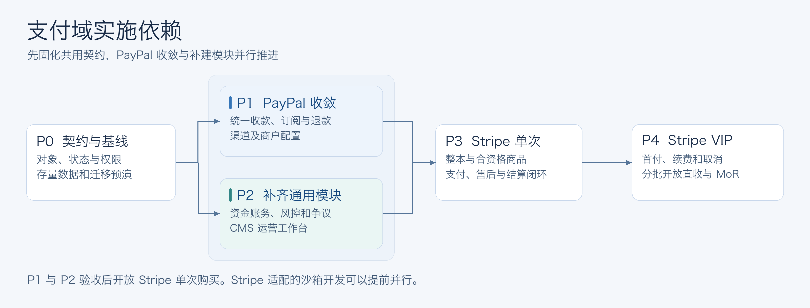
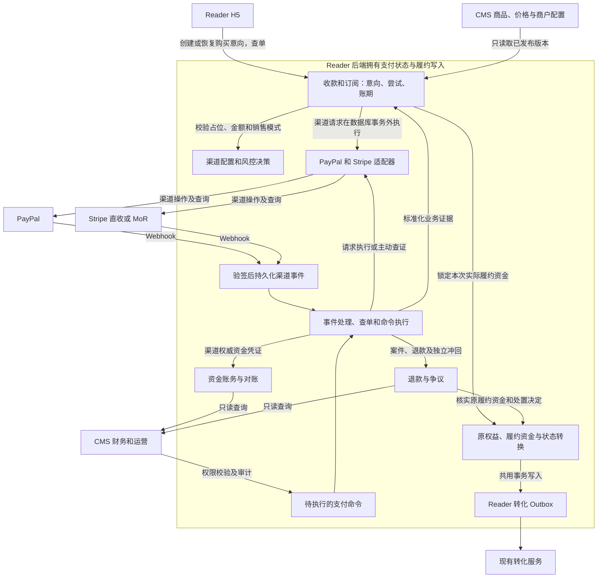
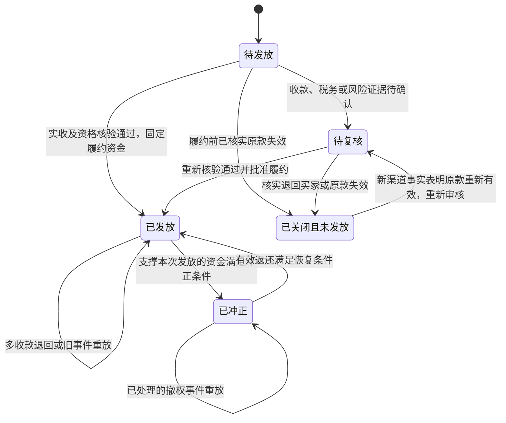

# StarNovel 支付域架构与开发实施方案

2026-11-21 · 设计评审稿

StarNovel 以一套支付域支撑金币充值、整本购买和 VIP。PayPal 与 Stripe 分别接入，Stripe 直收与 Managed Payments（MoR）按销售模式管理。开发从已经具备业务闭环的 PayPal 出发，先固化共用的订单、收款与权益契约，再补齐资金对账、风控和争议。第一笔对客户开放的 Stripe 交易直接进入正式处理路径。

## 1. 终态架构


编码 Agent 可直接读取[第 9 节的文本架构图与实现约束](#9-编码-agent-参考)。

支付域负责记录购买约定、支付协议、资金结果和售后案件。商品与定价负责可购套餐、售价、小说范围及版本。Reader 的履约逻辑负责金币流水、整本与 VIP 权益。转化服务消费符合现有规则的业务事件，沿用既有 Outbox、去重和投递契约。 [支付与权益业务规则](reader-payments-business-rules-and-support.md) · [转化事件口径](conversion-reporting-architecture.md#31-事件产生和业务口径)

**部署边界**采用现有 Reader、CMS 和 PostgreSQL。Reader 后端承载支付域并拥有状态写入。CMS 负责商品和商户配置、财务权限、命令提交、查账和案件处理。CMS 通过受限数据库权限提交带操作者和幂等键的支付命令，Reader 后台执行并回写结果。订单详情和运营页面读取支付域的查询结果。履约与支付仍可在同一数据库事务内提交，图中的模块边界是代码和数据职责边界。

| 通用模块 | 持有的职责 | Reader 或 CMS 获得的能力 |
| --- | --- | --- |
| 收款与支付订单 | 购买快照、渠道支付尝试、收款确认、异常订单 | 创建及恢复结账、按本地订单查状态、确认可履约收款。 |
| 订阅与计费 | 扣款协议、账单与已付周期、续费与停止续费状态 | 开通、查账期、取消自动续费、从扣费失败恢复。 |
| 退款 | 退款申请与执行状态、渠道退款明细、累计金额 | 审批与执行全额或部分退款、同步外部发起的退款、查询原收款及影响。 |
| 支付风控 | 跨渠道业务决策、渠道信号、复核及处置记录 | 结账前准确返回可执行动作，后台查询拦截、验证、预警和已收款待复核。 |
| 争议 | 案件、证据与原收款关联、处理方、期限、裁决 | 告警、跳转渠道后台、提供履约证据、跟踪资金及权益处置。 |
| 资金账务与对账 | 已证实的资金变动、手续费、代扣税和结算匹配 | 按订单、渠道收款、结算批次和银行入账查询与核对差异。 |
| 渠道与商户配置 | 账户和环境、商品映射、销售模式、支付方式及渠道能力 | 返回可用方式，按账户、商品类型和销售市场开放新购买。 |

## 2. 现状和迁移范围

- **开发分支** `codex/payment-domain`。
- **代码基线** `main` 与 `origin/main` 的提交 `5e5b3d8e5f72bdc8e27500f71d51e108b3703fde`（`Merge unified conversion reporting into main`）。开发分支从该提交创建。

下表按主线基线描述代码能力。生产部署与渠道权限需在实施时分别核实。

| 模块 | 当前覆盖 | 开发工作包 |
| --- | --- | --- |
| 收款与支付订单 | PayPal 金币与整本已有服务端定价、订单快照、收款确认、履约与补查。Stripe 路由返回 `503`。 [PayPal 订单服务](../reader-backend/internal/wallet/service.go#L133) · [Stripe 路由](../reader-backend/internal/wallet/handler.go#L199) | `PAY-02`、`ST-01` |
| 订阅与计费 | PayPal 已有计划映射、续费入账、账期校验和取消补偿。现有 provider 接口之下仍有 PayPal 专用执行路径。 [接口](../reader-backend/internal/payment/provider.go#L82) · [账期记录](../reader-backend/internal/wallet/service.go#L566) | `PAY-03`、`ST-02` |
| 退款 | CMS 可通过 PayPal 退剩余可退金额。已能累计渠道侧的部分退款，并在累计退满时冲正权益。 [退款入口](../cms-backend/internal/billing/refund.go#L109) · [退款规则](reader-payments-business-rules-and-support.md#1-产品规则) | `PAY-04`、`ST-01` |
| 资金账务与对账 | 有交易凭证、部分手续费与净额、订单及账期补查。PayPal 订阅收据的 `net_amount` 当前按收款总额写入，银行入账仍需核对。 [订阅收据入库](../reader-backend/internal/wallet/repository.go#L568) · [后台补查](../reader-backend/internal/wallet/reconcile.go#L18) | `FIN-01` 至 `FIN-03` |
| 渠道与商户配置 | 有 PayPal 账户、环境、身份锁和套餐计划映射。Stripe 密钥配置已有预留。 [CMS 收款配置](../cms-front/src/pages/PaymentTab.tsx#L8) · [账户校验](../reader-backend/internal/payment/paypal.go#L121) | `CFG-01` 至 `CFG-03` |
| 支付风控 | 有订单归属、套餐、金额等校验及卖家保障字段。缺公共风控决策、渠道风控记录和复核工作台。 [订单校验](../reader-backend/internal/wallet/service.go#L175) | `RSK-01` 至 `RSK-03` |
| 争议 | 缺案件模型、同步、举证期限及处置能力。仪表盘当前按订单列表中的 `Refunded` 计数。 [订单页统计](../cms-front/src/pages/DashboardTab.tsx#L23) | `DSP-01` 至 `DSP-03` |

## 3. 支付契约和数据边界


### 3.1 核心记录和唯一性

| 记录 | 保存内容与约束 |
| --- | --- |
| 购买订单 | 保留 `recharge_orders` 和稳定订单 ID。下单时固定用户、商品版本、金额币种、币数或小说、投放归因。VIP 每个计费单元关联一个本地订单。 |
| 购买意向与占位 | 本地购买意向先于渠道尝试建立，固定用户、环境和所购对象，绑定稳定的订单或订阅意向 ID。符合互斥规则的整本和新 VIP 使用业务范围的原子占位。重试、离开页面后继续和切渠道复用原意向。 |
| 支付尝试 | 每次授权或结账绑定原购买意向、本地订单及渠道账户、环境、销售模式、渠道会话 ID、创建幂等键和状态。一次有效意向可有历史尝试，同一时刻只允许一个可能继续收款的主动结账。 |
| 扣款协议与账期 | 保留 `user_subscriptions`。保存协议、渠道套餐版本、续费状态、每期服务起止及收款关联。Stripe 以账单 ID 区分计费单元，PayPal 以有账期证据的 `Sale` 交易关联本地账期订单。 |
| 渠道收款 | 以 `third_party_payment_orders` 为迁移起点。每条已核实收款按渠道、账户、环境、对象类型和外部 ID 唯一。PayPal 使用 Capture 或 Sale，Stripe 保留 Session、PaymentIntent、Charge、Invoice 的关系，退款和争议按实际收款对象关联。 |
| 履约资金关联 | 在首次履约事务中记录订单或账期、权益发放记录、实际采用的收款及其商品本金金额和币种。一次性订单选定一笔有效收款，已核实的多笔账单付款可以按凭证分摊。未用于履约的多收款仍有独立资金记录。历史关联按可信收款和履约证据回填，缺证据时进入待核对。 |
| 退款、争议、资金流水 | 每笔原收款可有多次退款请求。每次请求以本地请求 ID 去重，渠道退款和案件分别用各自外部 ID 去重。资金流水采用渠道权威流水身份，均限定渠道账户和环境。争议支持关联多笔收款，一笔收款可关联多个案件。缺交易关联时保存待匹配记录。 |
| 支付事件、风控和操作记录 | 验签事件按渠道账户、环境、事件 ID 入库。风控保存信号来源、原因、结果、决定及复核记录。后台操作保留权限校验结果、操作者、请求 ID、状态和审计记录。独立收款冲回可直接关联原收款，案件关联可为空。 |
| 销售模式与税务依据 | 支付尝试保存下单时的规则版本、市场依据及预期税务责任。实际收款及每期账单保存经渠道确认的交易地区、适用客户类型、MoR 模式、间接税责任方与证据引用。责任未知或与批准范围不一致时进入核对。 |

### 3.2 金额、状态与一致性

- 支付、履约、风控、订阅协议、退款和争议分别保存状态。比如支付可以已收款且处于待复核，VIP 可以已取消续费且仍有已付权益，争议可以已结案且资金仍待核对。Reader 查询状态由服务端组合返回。
- 回跳只查询本人订单。Webhook 和主动查单都提交到同一个记账入口。渠道调用放在事务外，事务内锁定订单、已核验收款及相关权益，并提交对应的业务结果与 Outbox。锁顺序按当前 PayPal 路径盘点后统一，退款与争议冲正沿用同一顺序。
- 只在已有尝试已失效且确认无法继续收款后切换渠道。若两次尝试都被证实收款，分别记录资金，按首次履约事务选定的收款发放一次。多收款进入有审计的退款处理，其退款或拒付只更新该笔资金和案件。对实际支撑履约的收款，退款、争议和返还按同一关联重新核对权益影响。
- 购买和订阅转化沿用现有业务键与归因快照。在收款确认且履约后产生 `Purchase`，符合首笔条件时产生一次 `Subscribe`。退款后保留原转化证据。资金账务提供可追溯的金额拆分，由转化模块沿用或单独评审调整现有价值口径。 [统一转化契约](conversion-reporting-architecture.md#31-事件产生和业务口径)

#### 跨渠道购买意向和互斥范围

创建或恢复购买意向与发起渠道结账是两个操作。Reader 返回稳定的本地意向 ID，H5 在回跳、刷新和切换渠道时携带它。将用户、操作和请求幂等键与参数摘要绑定，命中同一键返回已有记录，参数冲突返回明确错误。渠道尝试只能在已有意向下创建，重试原尝试和切换渠道各有独立的服务端校验。

整本购买按环境、用户和小说占位，并在同一事务中核对既有整本权益。适用同类防重规则的新 VIP 按环境、用户与服务端定义的 VIP 互斥组占位，同时检查正在续费或状态未知的旧协议。该约束在查询渠道之前以数据库唯一键或事务锁保证，两个客户端即使带不同请求键也回到同一购买意向或收到可操作的冲突。占位跟随已生效的权益或协议，未决支付保留占位，取消后的重新开通资格按批准的产品规则处理。已有并存的 PayPal 协议仍能独立管理。

金币购买保留重复购买能力。H5 只在用户明确发起另一笔充值时创建新意向。同一次点击的重复请求、页面恢复和渠道切换沿用原意向。所有渠道共用占位判断，单个渠道的会话过期后仍需核实未产生收款，再允许替换尝试。

#### 渠道写操作的重试边界

创建结账、扣款和退款等写操作保存稳定的渠道幂等键、首次发送时间、请求参数摘要、已知外部对象 ID 和重试截止时间。适配器按渠道及操作定义幂等支持和保留窗口，Worker 在首次发送前持久化这些信息。窗口内仅对适配器允许重试的错误重发原请求，使用原参数和键。没有可确认的窗口时，首次发送结果未知即进入查证。

超过窗口、渠道缺少可靠幂等保障，或适配器将返回归为仅可查证的结果时，任务转换为只查状态，按已知对象、订单引用、Webhook 和财务凭证核实。查证后仍无法确认结果，转人工待办并保留退款预留或原结账尝试占位。确实证实原请求未产生效果后，由授权人员重新提交并关联原请求。重放事件只重跑本地处理和查证，渠道写请求仍受时间窗口约束。 [Stripe 幂等请求](https://docs.stripe.com/api/idempotent_requests) · [PayPal 幂等说明](https://developer.paypal.com/api/rest/reference/idempotency/)

#### 退款、全退和权益比较口径

所有金额都记录币种和最小货币单位，分别存商品定价及商品本金、原渠道扣款与买家实付、渠道余额和银行结算金额。税、费和汇差单独保存。缺失值保留为未知。

| 判断 | 采用的金额与证据 |
| --- | --- |
| 渠道可退余额 | 在实际原收款的渠道退款币种内，根据原可退金额扣除已完成退款及在途预留，并核验渠道当前允许的金额与案件状态。多笔部分退款逐笔保留请求和结果。 |
| 买家是否全退 | 核实成功退款累计已覆盖原扣款的含税金额，比较双方使用同一原收款口径。若渠道使用不同呈现币种，使用渠道已确认的全退状态或可核对的金额对应关系。 |
| 权益影响 | 买家全退时，将该笔收款实际用于履约的全部本金计入退回。若一次发放由多笔收款支撑，按原发放关联累计已核实的退回本金，覆盖整次发放才适用全退冲正规则。部分退款、最终拒付损失或资金返还按核实的商品本金及已批准策略处理。本金分摊证据不足时进入复核。 |
| 商户资金差额 | 按渠道余额与结算凭证记录实退、代扣税、手续费、汇差、拒付划扣和返还。每项保留来源，避免影响买家全退判定。 |

例如商品本金为 10 USD、渠道含税扣款为 11 USD。两次成功退款在原扣款口径内分别为 5.50 USD，第一笔保留已发权益，第二笔达到买家全退且对应原履约收款时冲正一次。即使读者以 CAD 支付，或 Stripe 在结算中保留代收税，仍按渠道提供的原收款与退款对应关系判定。 [MoR 退款](https://docs.stripe.com/payments/managed-payments/how-it-works#refund-support) · [Stripe 本币金额](https://docs.stripe.com/payments/currencies/localize-prices/adaptive-pricing.md?payment-ui=stripe-hosted)

#### 资金凭证与业务凭证

收款、退款、争议对象提供业务状态和归属。渠道余额流水或结算报表中的余额变动明细提供权威资金凭证。按渠道账户、环境和权威流水身份建立账务记录。Stripe 使用 `BalanceTransaction` ID。PayPal 源由适配器根据真实报表字段定义稳定行标识，覆盖同一交易下不同资金动作。Webhook、查询结果和报表通过渠道引用链接到已有流水。缺引用或多项候选时保留待匹配，同额和时间接近只能作为核对线索。 [Stripe 余额流水](https://docs.stripe.com/api/balance_transactions/object) · [PayPal 资金事件代码](https://developer.paypal.com/reports/reference/t-codes)

同一笔退款、拒付或独立冲回由多个入口到达时，业务对象保留各自 ID，资金影响按核实作用入账一次。报表补齐已有流水或记录可审计的更正。银行入账匹配结算批次与银行流水，买卖款项与结算划拨分别呈现。资金返还与原资金动作及已执行的权益处置关联。

#### 权益状态转换与恢复

首次发放沿用原业务键去重。处理售后时，在锁定原权益和履约资金关联后，根据当前已核实的资金事实、审批结果和产品规则计算目标权益状态。仅在目标与当前状态不同时提交转换。保存转换序号、来源事实和实际权益变更，对同一份已处理的资金依据与审批重放返回原结果。旧事件只补充证据或触发查证，以核实的当前凭证重算状态。

同一发放允许在新事实支持时经历冲正、恢复、再次冲正。金币恢复量引用前次实际扣回数，按付费币和赠币分别恢复，历史缺口另留审计记录。例如发放 100、实际扣回 70，返还后最多恢复对应的 70。整本恢复关联原小说，VIP 恢复使用原账期起止时间，到期账期仍按原时间记录。每次资金变化都要能追到适用的权益转换或无需动作的判断。

### 3.3 状态与跨模块触发条件

| 对象 | 公共状态或结果 | 可以触发的动作 |
| --- | --- | --- |
| 支付尝试 | 待用户操作、待渠道确认、成功、失败、失效 | 查询或恢复原尝试。失效并确认无法收款时可另建尝试。 |
| 渠道收款 | 待核验、已核验、需复核 | 核验通过且满足履约条件时提交正常履约。发现已全退时跳过发放，保留原收款和退款事实。 |
| 订阅协议与已付账期 | 协议有待开通、续费中、待取消、已停止等状态。账期单独保存已核实收款、应付、累计实收及有效时间。 | 收款累计覆盖该账期适用的应付金额并核验凭证后发放对应 VIP，取消确认改变未来续费安排。 |
| 退款 | 待执行、结果待确认、成功、失败 | 成功后按退款口径核对累计退回与履约资金关联。未知结果继续查证原请求。 |
| 争议 | 待处理、处理中、已结案，另存渠道阶段、裁决和资金状态 | 到期提醒、财务处理和资金核对。结案且资金凭证满足权益策略时提交授权处置。 |
| 履约 | 待发放、待复核、已发放、已冲正 | 发放、冲正与恢复各有依据和转换记录。已恢复的权益在新损失被证实后可再次冲正。 |

渠道对已结案案件的更正以重新核实的渠道详情和资金凭证入账。已入账的资金流水若被撤销，应新增关联的返还或更正记录，保留原处理依据。

### 3.4 服务入口与运行责任

| 调用方 | 操作契约 | 返回或审计要求 |
| --- | --- | --- |
| Reader H5 | 查可用渠道、创建或恢复购买意向、在该意向下结账或切渠道、查自己的订单及订阅、取消续费。创建意向提交套餐和适用小说。发起渠道操作提交意向 ID、渠道和请求幂等键。 | 返回稳定的本地意向 ID、渠道跳转信息和可查询状态。金额、币种、账户与销售模式由服务端确定。 |
| CMS 财务或运营 | 查订单、退款、资金流水和案件。退款、风险复核和权益处置按权限提交命令。 | 返回操作编号和处理状态。记录操作者、依据、旧状态、目标记录及处理结果。凭证与证据只对授权角色开放。 |
| 支付后台任务 | 验签后持久接收、认领重试、主动查单、按游标回补、校验渠道资金凭证。 | 支持失败重试、状态查询和定向重放。事件接收幂等与业务处理幂等分别保障。权限不足、映射未知和金额异常进入可排查队列。 |
| 履约和转化模块 | 消费已核实资金结果，提交权益与业务事件。 | 复用现有金币、整本、VIP 和 Outbox。失败保留可重放状态，已完成履约保护原业务去重键。 |

## 4. 可执行开发工作包

### 4.1 支付与订阅公共路径

| 编号 | 交付内容 | 完成条件 |
| --- | --- | --- |
| `PAY-01` | Reader、CMS 和 QA 定好各记录的状态图、账户归属、金额字段、渠道能力与读写权限。CMS 迁移增加所需字段、约束和索引，使用旧数据做回填，保留存量 ID。接入共享事件入口与后台任务，留出每个渠道主动查单和断点补偿接口。 | 空库和存量副本升级可重跑。旧订单、订阅、退款和转化键在回填前后可核对。缺原交易证据的记录进入待复核。 |
| `PAY-02` | Reader 按购买意向管理结账和尝试，实现整本原子占位、PayPal 收款确认与履约。H5 保留同一次购买的意向 ID。首次履约保存实际采用的收款和本金分摊。 | 使用两套渠道 Mock 并发购买同用户同小说，验证不同请求键下也只有一个活跃意向。金币显式新购可独立结账。跨渠道晚到双扣仍保留两笔资金凭证及一次履约，多收款全退保留正常权益。 |
| `PAY-03` | Reader 迁移 PayPal 的订阅意向、协议状态、账期验证、取消和补偿。对适用的新 VIP 实现跨渠道互斥占位，提取共用账期履约。 | 同类 VIP 并发开通符合已批准的互斥规则，已有多协议仍可独立管理。首付、续费、取消、证据不足和已付权益回归通过。原首笔转化归属保留。 |
| `PAY-04` | CMS 提交带审计的退款命令，Reader 串行处理同一收款的可退金额和在途预留。新请求逐笔保存，旧未决请求按第 6.1 节接管。退款恢复按渠道重试窗口和原收款金额口径执行。 | 渠道成功但响应丢失、幂等窗口过期或旧退款缺首次发送时间时，恢复过程只查证。失败及多收款全退保留权益，实际用于履约的收款全退按权益状态转换处理。 |

### 4.2 资金账务与对账（部分实现）

| 编号 | 交付内容 | 完成条件 |
| --- | --- | --- |
| `FIN-01` | Reader 建立基于权威渠道流水的金额明细及业务对象关联。在来源账户与币种内，将本金、处理费、税、汇差、划扣及返还分项落库。补齐 PayPal 订阅净额的凭证状态。 | 同一 Stripe 退款以 `Refund` 事件、查单和报表到达时只影响余额一次，原始凭证全部可追溯。PayPal 多类资金动作逐笔区分。只有总额的历史记录将净额标为未知。 |
| `FIN-02` | Reader 提供 PayPal 和 Stripe 的报告导入或查询入口，使用已定义的流水标识补齐原记录或记录更正。将渠道余额与划拨批次匹配到银行入账，保留核实凭证和操作者。自动拉取按账户可用权限启用。 | 同一报告重复导入结果一致，消息与报表到达顺序互换时余额一致。每个已匹配批次能核对渠道汇总与银行实际金额。汇差、延迟结算及缺流水均可单列和补匹配。 |
| `FIN-03` | CMS 实现订单、资金流水、结算批次和待处理差异的关联视图。MoR 报表拆分代扣税和手续费，分币种显示汇总。仪表盘的退款和拒付改用各自完整统计来源。 | 财务能以一笔订单追到资金流水和银行入账，也能从一个批次反查交易。仅本地订单金额的历史数据明确展示覆盖范围。 |

### 4.3 渠道与商户配置（部分实现）

| 编号 | 交付内容 | 完成条件 |
| --- | --- | --- |
| `CFG-01` | Reader 与 CMS 建立渠道账户记录，环境、账户标识、凭证引用、Webhook 配置和能力独立管理。将现有 PayPal 账户映射到该记录并沿用身份校验。 | 测试与生产隔离。账户和环境匹配后才可创建交易或处理历史记录。密钥从配置引用加载，查询、审计和日志保留可展示的配置信息。 |
| `CFG-02` | CMS 建立已发布套餐版本到 PayPal Plan 或 Stripe Product、Price 的绑定。记录收款币种、税码、含税方式与允许销售模式。保留旧的套餐映射和续费协议版本。 | 改价后新订单使用新版本，已建订单和存量协议可按原版本继续查询、续费和退款。缺必填映射的商品可在 CMS 定位问题。 |
| `CFG-03` | Reader 按环境、账户、商品与市场筛选渠道。CMS 分别配置单次购买、订阅及 Stripe 直收／MoR 的收款资格与税务责任。按第 5 节保存计划与实际交易地区的依据及校验结果。 | 关闭新收款后，原交易继续处理。测试可付款但 Stripe 负责税务范围以外、Checkout 账单地区变化以及续费改变地区。超出批准范围的已收款记录和处置可追踪。 |

### 4.4 支付风控（缺少）

| 编号 | 交付内容 | 完成条件 |
| --- | --- | --- |
| `RSK-01` | Reader 将现有购买资格、未结束支付尝试与同类 VIP 防重纳入统一结账决策。支持记录放行、拦截、需要验证或复核及原因与规则版本。先对现有 PayPal 行为做观察和回归，阈值类规则经产品和运营确认后启用。 | 同一业务限制覆盖 PayPal、Stripe，换渠道仍执行。技术失败、普通扣款失败、风控拦截及未知分别展示。 |
| `RSK-02` | 适配器接入渠道实际提供的拒绝原因、卡验证、复核和风险预警，覆盖收款后才到账的信号。保存渠道原始原因和来源，能力按真实产品和账户开启。 | Stripe 待复核但已收款时，资金状态与复核状态可并存。PayPal 缺少对应信号时可展示为未知，订单处理继续依据真实收款凭证。 |
| `RSK-03` | CMS 提供复核队列、处理人、截止时间和审计。获批后复核当前收款再履约，拒绝时创建财务退款或争议待办。超过复核期限时升级给值班财务。 | 已收款待复核仍可查账。拒绝和超时均有负责人和截止时间，已有退款或争议可复用对应待办。重复通知、退款先到和复核结果交错都能收敛。 |

暂缓履约按配置开放，启用时需要指定风控处理人、财务接管人、复核和退款处理时限。拒绝且已收款未履约时，Reader 创建去重的财务退款待办，财务确认原收款和可退余额后走 `PAY-04`。已有活跃争议限制退款时，待办关联争议并跟踪渠道结果。争议结案后商户仍保留款项的，待办回到财务继续退款，或由授权人员重新核验并批准履约。到期未审的记录按配置升级给值班财务，继续保留待处置状态。原款已核实退给买家，或重新核验后已完成履约时，关闭待办。风险预警单独保存，已发放权益按正常售后路径处理。

### 4.5 争议（缺少）

| 编号 | 交付内容 | 完成条件 |
| --- | --- | --- |
| `DSP-01` | Reader 同步 PayPal `CUSTOMER.DISPUTE.*`、Stripe `charge.dispute.*` 及其详情。独立接入 PayPal `PAYMENT.CAPTURE.REVERSED` 与 `PAYMENT.SALE.REVERSED`，匹配原 Capture 或 Sale，并按资金凭证识别冲回。 | 两渠道案件及更正能回补。PayPal 单次和订阅的无案件冲回可入账，并在确认最终损失后进入原收款对应的处置队列。冲回、案件和报表任意先后到达都可关联并去重。 |
| `DSP-02` | CMS 实现案件列表、阶段、负责人、举证期限提醒和证据查询。按案件提供渠道后台入口。PayPal 和 Stripe 直收由财务处理，MoR 案件跟踪 Stripe 处理和结果。证据从订单、履约、使用及退款记录提取，按权限访问。 | 财务能从告警查到原交易、账期及所需证据。PayPal 原始协商阶段和 Stripe 直收／MoR 的处理责任可辨认。提醒可重跑且同一案件同一截止时间不会重复刷屏。 |
| `DSP-03` | 账务记录争议和独立冲回相关的冻结、划扣及返还。最终本金损失按原履约资金分摊进入审核，由通用履约逻辑计算目标状态。退款前查当前渠道可操作状态，冲突进入复核。 | 多收款的争议或冲回保留正常权益。原收款先退款后拒付按同一资金动作去重。不同的有效资金事实允许冲正、恢复、再次冲正。VIP 限于原账期，金币恢复限于实际扣回数。 |

争议权益的首版建议是案件开启时保留已付权益，确认最终本金损失后由授权人员审核原订单。独立冲回走同一套资金核验与处置。适配器关联原 Capture 或 Sale，有案件 ID 时再补案件关系。待核实的冲回保留待办，履约前已经核实足以使原收款失效的冲回阻止发放，履约后的最终损失进入授权审核。相同划扣由冲回通知、争议事件和报表重复到达时按权威资金流水合并。暂停未来续费由独立的订阅命令决定。 [现有权益与退款规则](reader-payments-business-rules-and-support.md#1-产品规则) · [PayPal 收款和订阅事件](https://developer.paypal.com/api/rest/webhooks/event-names/)

## 5. 渠道适配

适配层按收款、订阅、退款、风险信号、案件查询和资金对账定义能力接口。共用模块接收标准化凭证，渠道保留原始状态、操作限制与查询方式。各账户及案件实际提供的能力决定后台动作是否可用。

| 能力 | PayPal 适配 | Stripe 直收适配 | Stripe MoR 适配 |
| --- | --- | --- | --- |
| 单次收款 | 沿用 Orders 与 Capture。保存 PayPal Order 和收款引用。 | 托管 Checkout，`mode=payment`。按 Session、PaymentIntent、Charge 核验实收。 | 同一 Stripe 客户端，按销售模式启用 `managed_payments.enabled`，使用合资格商品、税码及受支持的参数。 |
| 订阅 | 沿用计划、协议及 `Sale` 证据，加上现有账期核验。 | Checkout `mode=subscription`，用 Billing 账单及收款证据确认账期。 | 新协议通过 MoR Checkout 创建，同步 Link 管理产生的协议及账单变化。 |
| 退款和争议 | 核对 Capture、Sale 的退款和独立冲回。案件走 Disputes API，能力按实时案件阶段取值。 | Refund API 和 Dashboard 退款，财务在渠道后台处理争议。 | 同步商户及 Stripe／Link 发起的退款。Stripe 通常负责争议响应，平台从案件及资金凭证跟踪。 |
| 风控和对账 | 依账户和产品接可用风险信号，使用交易与结算报告。 | Dashboard、Radar 和 3DS 的可用信号，余额流水及结算报告。 | 渠道负责风控。对账区分代扣税、手续费及用户实付币种。 |

[PayPal 事件](https://developer.paypal.com/api/rest/webhooks/event-names/) · [PayPal 争议操作](https://developer.paypal.com/platforms/disputes/handle-disputes/use-disputes-api/) · [PayPal 资金事件代码](https://developer.paypal.com/reports/reference/t-codes) · [Stripe Checkout 履约](https://docs.stripe.com/checkout/fulfillment.md?ui=full-page) · [MoR 结账参数与限制](https://docs.stripe.com/payments/managed-payments/update-checkout) · [MoR 售后与结算](https://docs.stripe.com/payments/managed-payments/how-it-works)

| 编号 | Stripe 交付内容 | 完成条件 |
| --- | --- | --- |
| `ST-01` | 升级 Stripe Go SDK 到支持选定 API 的版本，固定请求及 Webhook API 合约。实现单次 Checkout、事件验签、同步实收、退款、拒付及资金凭证。按直收和 MoR 分别配置资格及验收范围。 | 每种销售模式以自己的资格和证据放行。拟开放的模式完成 Checkout、履约、退款、争议和对账验收。MoR 另验收含税或税前、本币实付和 Link 售后。 |
| `ST-02` | 接入新订阅、实收账单、扣费失败、期末取消及补偿。支持 Customer Portal 或 Link 管理结果。按下述账期条件验收实收、应付和服务周期并去重。 | 首付和续费、部分付款后补足、零额、外部标记已付、期末取消及账期售后通过验收。支付事件乱序可恢复，存量协议按原账户和模式运行。 |

### 5.1 Stripe VIP 账期履约

Stripe 账单事件触发查询和核验。Reader 检查账户、环境、订阅协议、对应套餐版本及账单行的服务周期，按渠道账单口径确定应付金额。已核验的成功收款逐笔分配到该账期。只有普通付费账期的累计有效实收覆盖应付后才履约。退款已确认或扣费仍在途时，按可验证的有效实收重算。多账单行或分摊关系缺证据时先记收款并进入复核。

部分实收先入账，补足后按同一个本地账期发放一次。按账户与 Invoice ID 去重渠道账单，账期履约仍使用业务发放记录去重。若渠道重新开票，需要凭证证实它与已有账期的关系。零额账单和标记外部已付进入复核，只有另行批准的权益规则和独立证据才能开通。付费 `Purchase` 和订阅首付资格依据实际符合条件的收款与履约，单独的权益例外可另行定义事件口径。 [Stripe 账单事件](https://docs.stripe.com/api/events/types#event_types-invoice.paid) · [Invoice Payment 对象](https://docs.stripe.com/api/invoice-payment/object)

### 5.2 Stripe MoR 收款资格与税务责任

MoR 开通需要独立通过两项校验。收款资格检查商户账户、客户市场、商品和税码。税务配置按商户所在地、买家交易地区、适用客户类型及交易类型，记录间接税由 Stripe 还是 StarNovel 承担，以及财务批准的处理办法。Stripe 可在部分未承接间接税的市场继续作为 MoR 处理交易。整本与 VIP 优先评估，金币以 Stripe 对实际玩法的确认决定。MoR 需要 `2025-03-31.basil` 或更新 API。 [Managed Payments 配置](https://docs.stripe.com/payments/managed-payments/set-up) · [商品与客户资格](https://docs.stripe.com/payments/managed-payments/eligibility) · [税务覆盖与例外](https://docs.stripe.com/payments/managed-payments/tax-compliance#unsupported-countries-for-tax-coverage)

创建结账前，Reader 保存可用的服务端已核实账单地区，或将本次预计市场和来源明确标为待渠道确认。营销归因、IP 或展示币种仅作入口提示。渠道可达市场超出已核实范围时，开户验收需要证明可以在收款前约束实际市场，或由财务为其他可能成交的市场确定税务处理方案。证据不足的市场保持关闭。

单次收款和每次续费都查验 Stripe 返回的适用账单地区、客户类型和税务凭证，记录实际税务责任方。责任未知、地区变化或超出批准范围时，保存真实实收并标记差异，由财务确认税务及原交易后续处理。首次履约或续期先进入待确认，客服可查询并引导已购用户处理。处理动作限于原交易的授权入账、履约或退款，保留原销售模式和历史账期的核对结果。 [MoR 税务责任](https://docs.stripe.com/payments/managed-payments/tax-compliance) · [本币金额字段](https://docs.stripe.com/payments/currencies/localize-prices/adaptive-pricing.md?payment-ui=stripe-hosted)

## 6. 实施顺序与切换



| 阶段 | 依赖与负责人 | 放行条件 |
| --- | --- | --- |
| **P0 契约与存量基线** | `PAY-01`、`CFG-01`。Reader、CMS、QA、财务共同确认对象关联、权限与迁移证据。 | 空库及存量副本完成预演，记录现有订单、账期、退款、权益及 Outbox 基线。 |
| **P1 PayPal 收敛到公共路径** | P0 后执行 `PAY-02` 至 `PAY-04`、`CFG-02` 至 `CFG-03`。Reader 后端、CMS 与 H5 联调。 | PayPal 充值、整本、VIP、已审批未扣款、取消、退款及历史数据回归。CMS 与 Reader 执行端切换时核对在途任务。 |
| **P2 补齐运营和财务能力** | `FIN-01`、`RSK-01` 和 `DSP-01` 可从 P0 契约开始并行开发，其余工作包与 P1 的正式路径联调。Reader、CMS、财务和 QA。 | PayPal 样本完成风险、争议、退款和资金对账闭环。CMS 告警和权限验证通过。至少一组非线上渠道样本证明同一能力可映射到 Stripe。 |
| **P3 Stripe 单次购买** | `ST-01` 可并行在沙箱开发。客户开放依赖 P1、P2 所需的全部运营和资金能力。 | 按拟开模式、账户、商品、市场完成对应验收。直收与 MoR 各自放行。财务确认对账字段后小范围放量。 |
| **P4 Stripe VIP 与模式扩展** | `ST-02` 建在已验收的 Stripe 收款与共用订阅路径上。可分批开放直收、MoR 和适用套餐。 | 核对首付、续费、期末取消、退款和争议的账期结果。确认历史协议保持原渠道，不产生重复扣款或重复转化。 |

P2 的联调顺序按数据依赖安排。`FIN-02` 和 `FIN-03` 以 `FIN-01` 的资金流水为基础。`DSP-02` 读取 `DSP-01` 的案件，`DSP-03` 在 `FIN-01` 与 `PAY-04` 接通后验收资金和权益。`RSK-03` 接收 `RSK-01` 与 `RSK-02` 的决策和信号，暂缓履约配置随 `PAY-02` 验收。

### 6.1 Schema 兼容与协调切换

Reader 和 CMS 以数据库 Schema 版本精确匹配作为启动与健康检查条件。设计采用协调切换。每次发布提前列出旧版 `N`、迁移目标 `N+1`、可运行的 CMS 和 Reader 构建、退款及回放执行端，并验证同库转化服务消费契约。版本号以实际迁移编号为准。 [Reader 版本检查](../reader-backend/internal/db/postgres.go#L111) · [CMS 版本检查](../cms-backend/internal/db/postgres.go#L360) · [部署手册](../DEPLOYMENT_SOP.md)

| 数据库阶段 | 应用与事务接管 | Webhook 和补查 |
| --- | --- | --- |
| `N`，迁移前 | 运行匹配 `N` 的 CMS 和 Reader。暂停新结账、退款和其他渠道写操作的新增入口，先让旧执行端提交已知结果。交接原请求 ID、渠道对象、已核实凭证和能证明的发送时间与重试截止时间。无法证明的未决请求按只查证接管。停止旧执行端后交给新版认领。 | 旧 Reader 在停机前继续持久接收。记录最后的处理进度、未决事件和补查起点。 |
| 维护窗口 | 执行迁移和恢复旧单处理所需的最小回填，验结构、角色权限和关键关联。客户端进入维护状态。 | 保留原 Webhook URL。无法持久化时返回可重试的失败响应。将维护时段纳入渠道主动补查，覆盖期间发生的自动续费、退款和争议。 |
| `N+1`，恢复 | 只启动兼容 `N+1` 的 CMS、Reader 和相关任务。为迁移范围指定唯一执行端，再开启接收、补查和存量处理。剩余历史回填可分批重跑。存在处理缺口的商品或账户保持新增操作暂停。 | 恢复接收后从记录的起点重拉并带重叠窗口。用幂等键消化重试和重复通知，检查待履约、失败、未匹配资金及事件堆积后再开放新结账。旧 H5 兼容路由进入同一处理路径。 |

迁移前在存量副本演练三种结果。迁移失败回滚后恢复 `N` 应用，查询维护期的渠道事件。迁移成功但验收失败时维持新增操作暂停，使用兼容 `N+1` 的构建前滚修复。线上已有新写入或渠道扣款、退款等结果时，保留识别这些记录的任务并复核在途请求。确需恢复 `N` 数据库时，先确认数据恢复范围、原始凭证和渠道重放方案，经变更审批后协调恢复匹配的应用版本。单独暂停某个商户或销售模式的新购买时，既有会话、订阅、退款和争议继续处理。 [支付任务恢复入口](../reader-backend/cmd/payment-ops/main.go)

**旧 PayPal 未决退款。** 旧 `payment_refunds` 以订单为主键，`updated_at` 会在任务认领时刷新。新版迁移以原请求 ID 建立逐笔退款记录，并保留订单、原收款、已知渠道退款 ID、金额、冻结可退额度及原始证据。已知退款 ID 时直接查询原退款。无渠道退款 ID 且缺可信首次发送时间或安全窗口时，以时间未知和只查证接管，判断依据采用原交易的退款凭证与财务记录。保留待核对及在途预留直至可以确定结果，再结案或由授权人员创建关联的新请求。新版命令、旧兼容入口、Webhook、数据库冲正函数和 Worker 同批改为逐笔处理，旧的一单一请求写路径在接管前停用。 [旧表结构](../cms-backend/db/schema.sql#L423) · [旧任务刷新时间](../cms-backend/internal/billing/refund.go#L370)

## 7. 验收矩阵

| 场景 | 最低验证证据 |
| --- | --- |
| 结账与幂等 | 双开页面用不同请求键和不同渠道尝试购买同一本书或同互斥组 VIP，断言只有一个可能继续收款的意向。重复充值点击只生成一笔意向，明确再次充值可另建。覆盖回跳丢失、Webhook 乱序、切渠道、渠道写入成功但响应丢失和过期只查证。 |
| 续费与取消 | Stripe 账期部分实收先记账，补足后发放一次。覆盖零额、外部标记已付、同账期重开账单和首付续费事件乱序。取消只变更未来扣款，已有 PayPal 多协议可独立管理。 |
| 退款、拒付及恢复 | 覆盖多收款全退、实际履约收款累计全退、含税本币部分退款及 PayPal 单次和续费无案件冲回。覆盖同一发放冲正、资金返还、再次冲正与旧事件重放。验证金币仅恢复实际扣回量，其他 VIP 账期与独立解锁章节仍可用。 |
| 风控 | 区分普通扣款失败、风险拦截、验证、预警与人工复核。验证已收款拒绝后进入退款待办、超时升级、已有争议接管、获批与退款交错，以及最终责任人和处置结果。 |
| 对账 | 使用 PayPal 和 Stripe 脱敏报表核对付款、退款、税费、拒付调整和结算。同一资金动作从 Webhook、查单与报表乱序到达时只影响余额一次。验证未知净额、本币支付、代扣税、已更正流水、结算批次和银行入账匹配。 |
| 生命周期与运行 | 在存量副本演练 `N` 到 `N+1`、迁移中断重启、维护期回补和 PayPal 在途退款交接。构造旧退款已在渠道执行、响应丢失、`updated_at` 已刷新且缺首次发送时间的记录，验证新版只查询和核对。暂停新交易时验证既有任务继续运行。 |
| 权限与转化 | 未授权角色不能发起退款、复核及权益处置。履约事务回滚无转化事件，重复收款凭证、历史回补及退款不会重复投递。现有回传规则的价值与归因保持一致。 |

### 7.1 Stripe 销售模式与 Link 验收

| 验证层 | 需要的证据 |
| --- | --- |
| 自动化与脱敏样本 | 使用隔离 PostgreSQL 和渠道 Mock 验证同一正式处理链路。用渠道提供的 Link 退款和订阅变更样本验证事件同步、去重、资金关联及权益。 |
| PayPal 与 Stripe Sandbox | 验收拟开放产品的 Checkout、权限、退款、已付账期和渠道可模拟的异常。MoR 验证税码、标价、退款和金额拆分。通过 Sandbox 或渠道样本覆盖可收款但无 Stripe 税务覆盖、Checkout 实际地区与预期不同，以及续费时地区变更。 |
| Link 用户端与生产凭证 | 测试订单不会出现在 Link 用户端。MoR 面向客户开放前，按财务和渠道联调授权使用受控线上订单，验证用户可查到订单、通过 Link 发起退款与管理适用的新订阅、Reader 同步结果及权益。银行入账匹配使用财务核对的正式结算凭证。 |

Stripe 直收和 MoR 分别记录账户资格、适用商品和市场、测试结论及开放批准。缺渠道证据的模式留在关闭状态，已验收的模式可以先开放。合并和发布时提交对应的迁移回退记录、测试明细、渠道与命令操作说明及资金核对样例。 [Stripe Managed Payments 的 Link 测试](https://docs.stripe.com/payments/managed-payments/set-up#link)

## 8. 开工时需确定的产品与财务口径

| 待确认项 | 影响的工作包 | 设计起点 |
| --- | --- | --- |
| 首发 Stripe 直收或 MoR、商品与市场范围 | `CFG-02`、`CFG-03`、`ST-01` | 先用资格已确认的整本商品。金币以渠道对充值用途的确认结果决定。按第 5.2 节确定可达市场与实际税务责任。 |
| 含税或税前标价、退款税差和汇差口径 | `FIN-01`、`FIN-03`、`ST-01` | 按第 3.2 节区分渠道可退、买家实退、权益本金和商户结算。财务确认标价与对外展示。 |
| 部分退款、最终拒付损失及晚到返还的权益政策 | `PAY-04`、`DSP-03`、`RSK-03` | 维持现有部分退款和累计退满规则。争议开启保留已发权益，最终损失进入人工审批，资金返还可追溯地处理。 |
| 同类 VIP 的跨渠道重叠、风险阈值和复核时限 | `PAY-03`、`RSK-01`、`RSK-03`、`ST-02` | 已有多协议仍能各自管理。新开通按批准的规则检查在途结账与仍在续费的协议。启用暂缓履约前配置复核、升级负责人和退款处理时限。 |
| 零额、外部已付与其他非普通付费账期 | `ST-02` | 首版标记待复核。业务如需独立授权发放，由产品确定服务周期、收款证据与转化资格。 |

## 9. 编码 Agent 参考

图中的节点标明写入职责、事件来源和依赖。开发按第 4 至 6 节的工作包和顺序执行。开始每个工作包时，从第 2 节的代码入口核对现状，再应用第 3 节的公共契约和第 5 节的渠道约束。验收至少覆盖工作包完成条件及第 7 节的相关用例。

### 9.1 模块依赖与数据写入



### 9.2 已发权益的冲正与恢复



### 9.3 编码与验收时检查的不变量

```text
business_reservation = (environment, user_id, exclusive_purchase_scope)
purchase_intent -> at_most_one_attempt_that_can_still_collect
request_identity = (environment, user_or_actor_id, operation, request_key)
request_identity -> one_immutable_parameter_fingerprint
provider_reference = (provider, merchant_account, environment, object_type, external_id)
provider_money_movement -> one_authoritative_ledger_record
fulfillment_grant -> verified_funding_allocations
non_funding_payment_refund_or_reversal -> no_change_to_that_grant
entitlement_transition = (grant_id, validated_funding_and_approval_revision, target_state)
refund_command_with_unknown_outcome_and_unproven_window -> lookup_only
stripe_paid_period -> validated_service_period AND verified_allocated_cash >= eligible_amount_due
mor_release -> collection_eligibility AND approved_tax_responsibility_for_reachable_markets
```

这些写法表达跨模块约束。数据库字段和索引在 `PAY-01` 中结合现有迁移制定。测试应分别断言渠道资金动作、订单或账期状态、权益变更和转化结果，因为相同的资金事件对这几者可能产生不同影响。
