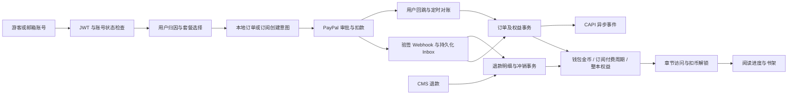

# Reader 后端整体流程深度 Code Review

> **2026-11-17 最终复验：17 项在本地代码及隔离验证范围内已关闭。** R04/R09/R14 的三项遗漏已追加修复；见[最终修复与验证](reader-backend-remaining-3-closure.md)。下文保留 `34ff7cf` 的原始问题证据及首轮验收边界。

- 审查日期：2026-11-17（Asia/Singapore）。
- 固定代码基准：`34ff7cf27f19a99097114174c03f9046996b066a`。
- 审查范围：`reader-backend` 全部业务包、服务启动及配置；交叉核对共享数据库 `cms-backend/db/schema.sql`，以及 CMS 的内容发布、推广链接、套餐维护和退款写入逻辑。
- 本次只做 Review。项目内仅新增本报告，没有修改业务代码、测试代码或部署配置；未提交或部署任何修复。
- 审查期间 HEAD 前进至 `c8b87fe`，变更仅涉及 Reader 前端样式。已逐文件比对，本报告涉及的后端 Go/SQL/go.mod/go.sum 与固定基准一致。

## 1. 审查结论

发现 **17 项需要修复的问题：4 项 P1、13 项 P2**。其中 **12 项通过临时复现测试验证，5 项通过完整调用链和数据结构静态确认**。未发现足以列为 P0 的证据。

最高优先级是：游客购买后缺少账号续期机制、已注册账号可经游客绑定接口直接更换凭据、归因字段长度不一致阻断支付入账，以及订阅管理接口把“没有 VIP 权益”误当成“没有需要管理的支付协议”。

`34ff7cf` 对金额快照、PayPal 退款明细、订阅创建串行化、整本权益证据和付费周期的保护确实存在，现有支付集成测试也通过。本报告没有把这些已经保护的路径重新列为缺陷。剩余风险主要集中在用户身份生命周期、协议状态恢复、内容异常处理和广告事件可靠性。

优先级含义：

- **P1**：应优先修复，涉及账号长期控制权、已付款用户访问或支付结算阻断。
- **P2**：应排期修复，存在明确触发条件，会造成业务功能错误、权益管理困难、内容泄露或数据失真。

“复现确认”表示在固定提交的临时副本和隔离数据库中观察到该行为，不表示已在生产中发生；“静态确认”表示代码路径成立，未连接真实渠道或生产环境验证发生率。

## 2. 整体链路与覆盖范围

| 链路 | 核对重点 | 相关发现 |
| --- | --- | --- |
| 游客、注册、登录、绑定 | 身份连续性、凭据变更、限流与代理信任 | R01、R02、R12 |
| 推广到定价、套餐 | 原始归因、价格继承、0 值语义、字段长度 | R03、R08、R09 |
| 单次充值与整本购买 | 服务端快照、金额/币种/所有权、幂等发货 | R03、R14、R16 |
| 订阅创建与状态管理 | 创建意图、取消、非 VIP 协议可见性、状态补偿 | R04、R05、R16 |
| Webhook、对账与退款 | 验签、持久化接收、乱序退款、周期权益 | R03、R05 |
| 阅读与内容缓存 | 发布状态、价格、权益、预览、存储错误 | R08、R10、R11、R13 |
| 书架及进度 | 并发顺序、客户端时间戳、状态字段耦合 | R07 |
| 用户反馈 | 路由鉴权、匿名身份、入库约束 | R06 |
| 广告事件 | 事务边界、失败恢复、订阅归因上下文 | R14、R15、R17 |
| 启动与停机 | 生产配置、连接池、任务退出顺序 | R12、R15、R16；第 6 节 |

## 3. 问题索引

| ID | 优先级 | 问题 | 证据级别 | 当前复验状态 |
| --- | --- | --- | --- | --- |
| R01 | P1 | 游客 JWT 到期后无法恢复原付费账号 | 复现确认 | 已修复（见复验边界） |
| R02 | P1 | 绑定接口可直接替换已注册账号的邮箱和密码 | 复现确认 | 已修复（见复验边界） |
| R03 | P1 | 合法长度的 UTM 阻断充值创建及订阅结算 | 复现确认 | 已修复（见复验边界） |
| R04 | P1 | 非 VIP 的有效支付协议对 Reader 用户不可见、难以取消 | 复现确认 | 已修复（见最终复验） |
| R05 | P2 | 定时对账不独立同步订阅状态，旧状态可长期阻塞重购 | 复现确认 | 已修复（见复验边界） |
| R06 | P2 | 反馈接口固定以 user_id=0 入库，标准数据下持续失败 | 复现确认 | 已修复（见复验边界） |
| R07 | P2 | 阅读进度的先查后写允许旧请求覆盖新进度 | 复现确认 | 已修复（见复验边界） |
| R08 | P2 | 显式配置 0 金币单价被当作继承值，仍按非零价格收费 | 复现确认 | 已修复（见复验边界） |
| R09 | P2 | 推广身份仅靠可重复的 UTM，link_id 无法固定价格及套餐 | 静态确认 | 已修复（见最终复验） |
| R10 | P2 | OSS 异常被转成成功空正文，并进入长时间正缓存 | 复现确认 | 已修复（见复验边界） |
| R11 | P2 | 锁定预览没有统一长度上限，可返回接近完整正文 | 复现确认 | 已修复（见复验边界） |
| R12 | P2 | 代理信任默认值允许伪造 IP 绕过游客限流 | 复现确认 | 已修复（见复验边界） |
| R13 | P2 | 删除缓存与并发回填竞态可重新缓存旧正文 | 静态确认 | 已修复（见复验边界） |
| R14 | P2 | 支付事务与 CAPI 事件之间存在永久丢失窗口 | 静态确认 | 已修复（见最终复验） |
| R15 | P2 | 停机时先关日志再排空生产者，导致事件日志丢失 | 复现确认 | 已修复（见复验边界） |
| R16 | P2 | 支付记录缺少环境及商户命名空间，切换配置后复用旧计划 | 静态确认 | 已修复（见复验边界） |
| R17 | P2 | 订阅支付没有持久化最初的广告匹配上下文 | 静态确认 | 已修复（见复验边界） |

## 4. 详细发现及修复建议

### R01 · P1 · 游客 JWT 到期后无法恢复原付费账号 · 已修复（见复验边界）

**代码依据**：`reader-backend/internal/auth/jwt.go:16-26`、`auth/service.go:41-76`、`auth/repository.go:34-38`、`auth/handler.go:45-52`、`wallet/handler.go:24-39`。

**触发与影响**：游客令牌固定 72 小时到期；系统没有 refresh/设备凭据恢复接口。`GuestLogin` 每次直接插入新用户，同一设备、同一 IP 也不会恢复旧用户。游客允许进入充值和订阅接口，所以一个没有绑定邮箱的付费游客在令牌到期后，无法通过现有 Reader 鉴权接口重新进入原账号，访问原余额、整本权益、订阅或执行取消。重新注册只会得到新的用户 ID。资产并未从数据库删除，但用户侧失去正常访问路径。

**验证**：同设备/IP 连续登录得到不同用户 ID；过期 JWT 被拒绝。源码路由检查确认不存在续期或游客恢复路径。

**建议**：在账号正式路径中增加可撤销、可轮换的高熵刷新凭据或设备凭据，让游客身份在访问令牌到期后保持连续；支付前提供账号保障流程。不能用 User-Agent/IP 作为恢复账号的认证证据。绑定邮箱后保留同一用户 ID，登录会话应有明确的失效策略。

**验收**：游客充值/购买后模拟超过 72 小时，仍可安全续期并访问同一账号；丢失设备凭据时可经已验证邮箱恢复；凭据泄露与退出登录可撤销会话。

### R02 · P1 · 绑定接口可直接替换已注册账号的邮箱和密码 · 已修复（见复验边界）

**代码依据**：`reader-backend/internal/auth/handler.go:187-216`、`auth/service.go:189-213`、`auth/repository.go:142-153`。

**触发与影响**：`POST /auth/bind` 只检查 Bearer 身份及目标邮箱是否被占用，既不限制当前用户必须是游客，也不验证原密码或新邮箱所有权。SQL 对任意已登录用户执行 `SET email=...,password_hash=... WHERE id=...`。因此，一个已注册账号的短期会话泄露可以被升级成永久凭据替换，原账号所有者可能失去登录能力。这不是匿名请求越权，前提是持有该账号的有效 Bearer。

**验证**：对已有邮箱和密码的用户调用绑定服务，不提供原密码即可替换邮箱，并使用新密码通过密码哈希校验。

**建议**：把“游客绑定”与“正式账号修改凭据”拆成明确业务操作。游客绑定在事务/条件更新中限定原邮箱为空；正式账号变更要求近期重新认证和邮箱验证。凭据变更后轮换或撤销旧会话，同时统一邮箱规范化及唯一性语义。

**验收**：正式账号调用游客绑定返回明确的 4xx；并发绑定只有一次成功；修改正式账号凭据需经过验证，旧会话按策略失效。

### R03 · P1 · 合法长度的 UTM 阻断充值创建及订阅结算 · 已修复（见复验边界）

**代码依据**：`cms-backend/db/schema.sql:50-53,230-231,261-262`、`reader-backend/internal/wallet/checkout.go:67-83`、`wallet/repository.go:487-511`。

**触发与影响**：`users.utm_source/utm_campaign` 和推广链接允许 100 字符，订单相应字段只允许 50 字符。创建充值订单、记录订阅扣款时直接复制用户字段。长度为 51–100 的有效归因数据会使 PostgreSQL 返回 `22001`。单次充值在创建本地订单时失败；订阅创建意图不复制这些字段，故可能已经在 PayPal 扣款，到本地记录续费订单和授予权益时才持续失败。重试不会消除数据长度冲突。

**验证**：使用 60 字符 campaign，在共享 schema 下分别调用 `CreateCheckout` 和已验证订阅交易入账方法，两者均返回 `SQLSTATE 22001`。

**建议**：迁移统一字段类型及长度，优先保留完整原始归因；入口、数据库、支付订单快照采用同一约束。审计并补偿已经因该错误未入账的交易。归因数据应按明确契约进入支付快照，不能让可接受的营销参数阻断资金事实的持久化。

**验收**：用 50、51、60、100 字符及多字节 campaign 覆盖充值、首期订阅、续费和退款；已扣款订单可完整入账、发放一次权益。

### R04 · P1 · 非 VIP 的有效支付协议对 Reader 用户不可见、难以取消 · 已修复（见最终复验）

**代码依据**：`reader-backend/internal/wallet/repository.go:410-418,619-623`、`wallet/handler.go:373-417`、`wallet/subscription_intent.go:67-89`、`novel/repository.go:26-32`。

**触发与影响**：订阅状态接口只返回满足“当前已付费且有阅读权益”谓词的记录。`PENDING`、`SUSPENDED`、已过本地付费期但渠道仍为 `ACTIVE` 的协议都会返回 `subscription:null`。这些协议仍能阻止用户创建新订阅，且部分状态仍有后续自动扣款可能。取消接口却要求用户先提供 `subscription_id`，Reader 又没有查询所有可管理协议的接口。用户换设备、丢失创建响应或付费期过期后，无法从该状态接口重新取得取消所需的协议 ID。

**验证**：存在真实格式的 `PENDING` 记录时，状态查询返回空，但创建其他订阅返回冲突。这里是 Reader 内的管理断路，不代表用户在 PayPal 官方渠道也无法取消。

**建议**：将支付协议生命周期与阅读权益分开建模和返回。状态接口独立提供 `has_reading_access`、协议状态、协议 ID、创建/取消进度和允许操作。取消、恢复审批及人工核对入口不应依赖当前 VIP 是否有效；支持安全地取消本人当前协议。

**验收**：待审批、暂停、欠费、过期权益、取消处理中均可查看管理对象及取消/恢复入口；新设备登录也可找回协议；已付款取消后的阅读权益保持至已付费周期结束。

### R05 · P2 · 定时对账不独立同步订阅状态 · 已修复（见复验边界）

**代码依据**：`reader-backend/internal/wallet/reconcile.go:176-209`、`wallet/repository.go:499-514,567-577`、`wallet/service.go:598-604`。

**触发与影响**：定时对账虽然读取渠道订阅详情，却只通过导入交易间接更新本地状态。对于已经存在、付费周期已确定的交易，`ON CONFLICT ... WHERE ... RETURNING` 不返回行，代码直接退出，后面的订阅状态更新不执行；无交易时同样不更新状态。如果取消/暂停 Webhook 丢失，本地状态可以持续错误。已取消的本地 `ACTIVE` 记录会继续阻止创建新协议，暂停后恢复等状态转换也可能无法修复。

**验证**：内存模拟渠道返回 `CANCELLED` 和已导入的同一交易，对账成功返回，但本地仍为 `ACTIVE`；随后创建订阅仍发生冲突。没有调用真实 PayPal。

**建议**：对账必须独立落地经渠道确认的协议状态，交易导入负责金额及付费周期，两者不能互相代替。保留 `CANCEL_PENDING` 等本地主动意图的状态约束，避免旧交易覆盖新状态；用独立字段记录渠道检查时间和结果。

**验收**：删除/延迟取消 Webhook，已有交易全部幂等命中及交易列表为空时，对账仍能纠正协议状态，并正确保留已付费权益。

### R06 · P2 · 反馈接口固定以 user_id=0 入库 · 已修复（见复验边界）

**代码依据**：`reader-backend/internal/feedback/handler.go:17-35`、`feedback/repository.go:19-26`、`cms-backend/db/schema.sql:339-344`。

**触发与影响**：反馈路由没有认证或可选认证中间件，因此即便传入 Bearer，Handler 也不会得到 `user_id`，最终把整数 `0` 写入有外键的 `feedback.user_id`。标准初始化数据没有 id=0 的用户，合法反馈持续返回 500，而不是作为匿名反馈保存。数据库异常还直接出现在响应中。

**验证**：用标准共享 schema 提交非空、格式合法的反馈，返回 500 和外键错误 `23503`。

**建议**：若支持匿名反馈，用户 ID 用 nullable 类型，无身份时写 SQL NULL；若需要登录，明确挂载认证中间件。已登录身份应由中间件提供，同时限制正文长度、拒绝空白内容、校验邮箱并统一错误响应。

**验收**：匿名和登录反馈分别按产品策略成功入库或明确返回 401；不会写入伪造 user_id=0，也不会向客户端暴露 SQL 信息。

### R07 · P2 · 阅读进度先查后写，旧请求可覆盖新进度 · 已修复（见复验边界）

**代码依据**：`reader-backend/internal/shelf/service.go:58-75`、`shelf/repository.go:119-129`，另见 `shelf/repository.go:79-93`、`shelf/service.go:11-15`。

**触发与影响**：两个同步请求同时读到相同旧进度，都通过 Service 的时间判断；Repository 的 UPSERT 没有版本或时间条件。较新的进度先写入，较旧请求随后仍会覆盖它，导致跨设备阅读回退。另一个静态确认的问题是直接信任客户端任意未来时间戳，此后正常时间的更新会被跳过；加入/移出书架还会更新同一个 `updated_at`，让收藏操作影响阅读进度的冲突判断。

**验证**：控制两个请求都先完成读取，让章节 2 先提交、章节 1 后提交，最终数据库保留章节 1。

**建议**：把冲突判断放入原子条件 UPSERT，或使用服务端 revision/CAS；阅读进度版本与书架收藏状态分开。限制客户端时间偏差，明确离线批次处理规则，校验章节索引和 offset 范围。

**验收**：交错请求不能使版本倒退；客户端时钟快一年不会永久冻结同步；加入/移除书架不干扰进度顺序。

### R08 · P2 · 显式 0 金币单价被当作继承值 · 已修复（见复验边界）

**代码依据**：`reader-backend/internal/novel/repository.go:269-286`、`cms-backend/internal/novel/service.go:897-903,1000-1005`。

**触发与影响**：CMS 明确允许千字单价为 0，但 Reader 查询对推广价和小说价都使用 `NULLIF(...,0)`，把“显式免费”变成“继承上一级价格”。例如小说默认 500、推广价 0，读者最终仍按 500 计算。全局价非零时，小说级 0 也存在相同问题。

**验证**：推广链接存储单价 0，Reader 的有效定价结果为 500。

**建议**：用 SQL NULL 表达继承，0 表达免费，所有价格解析统一采用这一语义；若产品不允许层级免费，则 CMS 必须明确拒绝 0，而不能保存后悄悄改变含义。

**验收**：覆盖推广/小说/全局三层中 NULL、0、正数的组合，目录、正文报价和解锁实际扣币结果一致。

### R09 · P2 · 推广身份仅靠可重复的 UTM，link_id 无法固定策略 · 已修复（见最终复验）

**代码依据**：`reader-backend/internal/novel/handler.go:133-153`、`novel/repository.go:267-281`、`wallet/checkout.go:48-56,73-79`、`auth/repository.go:34-38,54-58`；`cms-backend/db/schema.sql:224-240`、`cms-backend/internal/novel/service.go:1010-1018`。

**触发与影响**：CMS 会给 URL 附上 `link_id`，Reader Handler 也解析并传递 promoID，但有效定价查询没有使用它。用户仅保存 UTM 文本，套餐选择同样按 UTM 查最新链接；schema 没有保证 UTM 对唯一。两个链接共享 campaign 但价格、小说或套餐不同，后创建的链接即可改变原流量的实际策略。价格查询会按小说筛选，套餐查询却跨小说取最新链接，两条链路还可能选到不同推广配置。

**建议**：在服务端验证原始推广链接后，持久化稳定的 promotion_link_id，并明确归因和商业策略是否随运营修改而变化。用统一解析器决定小说、套餐、价格和像素。历史 UTM 回退仅在唯一匹配时执行，不以 `ORDER BY id DESC LIMIT 1` 消除歧义。

**验收**：相同 UTM 下同时存在不同小说和不同商业策略的链接，A 链接读者不会因创建 B 链接而切换策略；匿名展示和登录后的有效价格保持一致。

### R10 · P2 · OSS 故障被转换为成功空正文，并缓存约 2 小时 · 已修复（见复验边界）

**代码依据**：`reader-backend/internal/novel/service.go:214-228`、`novel/cache.go:114-121`、`reader-backend/internal/storage/oss.go:87-112`；CMS OSS 模式将数据库正文设为空：`cms-backend/internal/novel/service.go:553-555,823-825`。

**触发与影响**：启用 OSS 正文存储且发生网络错误、缺失对象或读取失败时，Service 忽略存储错误，保留数据库空正文并写入普通章节缓存。接口随后以成功结果返回。即使 OSS 很快恢复，空章节仍可能缓存 2 小时加抖动；解锁逻辑只依赖章节元数据，用户还可能为不可读的章节扣币。该问题依赖 OSS 正文模式，不应据此断言当前生产已受影响。

**验证**：模拟 OSS 错误、数据库正文为空，服务返回 nil error 和空章节，并进入 `SetChapter` 路径。

**建议**：正文读取失败必须区分不存在与临时故障，返回可重试错误；只有完整、验证通过的正文才能进入正缓存。安全回退应有内容版本一致性保证。OSS SDK 调用同时应传递 `ctx`，避免请求取消后继续长时间等待。

**验收**：模拟 OSS 超时、404 和短暂失败，不能得到成功空章节或留下长时间空缓存；恢复后下一次读取可成功，故障期间付费操作给出明确结果。

### R11 · P2 · 锁定预览没有统一长度上限 · 已修复（见复验边界）

**代码依据**：`reader-backend/internal/novel/service.go:335-357`。

**触发与影响**：预览逻辑优先返回前两个段落，或前三行，这两条分支没有长度上限。只有无合适分隔符时才执行 250 rune 截断。若正文主要集中在前两个长段落，付费墙会向未登录用户返回接近完整的正文，而仍标记 `locked=true`。

**验证**：20,007 字节的测试正文，锁定预览返回其中 20,002 字节。

**建议**：先定义统一的最大预览字符数及比例，再在上限内寻找段落边界。所有分支共同受限，不能用文本排版结构充当唯一授权边界。

**验收**：长段落、长行、无换行、多字节文字和短章节均符合预览上限；未授权响应不会因分段方式接近全章。

### R12 · P2 · 默认代理信任允许伪造 IP 绕过游客限流 · 已修复（见复验边界）

**代码依据**：`reader-backend/cmd/server/main.go:51-55`、`reader-backend/internal/auth/handler.go:13-26,48-50`；部署示例 `DEPLOYMENT_SOP.md:433-435`。

**触发与影响**：Gin 未设置可信代理范围，使用默认代理信任策略；游客限流键来自 `ClientIP()`。攻击者在同一连接来源下改变 X-Forwarded-For 即可切换限流键。仓库 Nginx 示例会追加该头，并没有明确清除用户自带链条。此外限流 map 没有回收，不同伪造 IP 可持续增加内存条目；注册和密码登录没有对应限流。

**验证**：同 TCP peer 的三次请求返回 200、429、200，第三次仅更换客户端提交的 X-Forwarded-For。实际暴露程度取决于生产网关是否另行清洗该头，未检查线上 Nginx 配置。

**建议**：明确设置可信代理，网关统一构造转发头；多实例采用共享且有 TTL 的计数器或有界本地结构。对注册、登录和凭据变更分别增加账号/IP 维度的限制，并回收空闲限流对象。

**验收**：伪造转发头不能改变实际客户端身份；入口限流在多节点下仍受控；大量不同来源不会留下永久增长的 map。

### R13 · P2 · 删除缓存与并发回填竞态可恢复旧正文 · 已修复（见复验边界）

**代码依据**：`reader-backend/internal/novel/service.go:112-121,151-162,210-228`、`novel/cache.go:60-67,87-94,114-121`；`cms-backend/internal/novel/service.go:120-145,591-596`。

**触发与影响**：Reader 先读旧数据库内容；CMS 随后提交更新并删除缓存；先前 Reader 请求最后才将旧值写回同一个缓存键。旧章节可能继续使用约 2–2.4 小时，目录/详情约 6–7.2 小时。`singleflight` 只能合并 Reader 实例内的相同读取，不能协调 CMS 写入。删除缓存错误也没有持久化重试。正文和字数可能与当前解锁报价不同，导致读旧文或反复价格冲突。

**边界**：正文入口仍调用查询发布状态的有效定价 SQL，因此不能仅凭这个竞态断言下架后仍会成功返回正文；这里确认的是缓存版本一致性缺陷。

**建议**：引入小说/章节内容版本，采用版本化缓存键或填充前版本校验；内容提交产生可靠失效事件。关键发布状态仍应有权威检查，旧读取不能重新发布已失效版本。

**验收**：精确控制“旧读取 → CMS 提交及失效 → 旧回填”的交错过程，后续请求不会长期命中旧版本；Redis 失效失败可恢复。

### R14 · P2 · 支付事务与 CAPI 事件之间存在永久丢失窗口 · 已修复（见最终复验）

**代码依据**：`reader-backend/internal/wallet/checkout.go:219-227`、`wallet/service.go:225-228,263-295,664-668`、`reader-backend/internal/workerpool/pool.go:39-53`。

**触发与影响**：资金与权益事务提交后，才提交内存广告任务。进程在二者之间退出、队列满或任务查归因失败时，事件直接丢失；`Submit` 的失败返回值未处理。订单重试命中成功状态后不会再设置本次 settled，订阅也只在 firstPayment 时触发，因此支付侧幂等恢复不会自动补回广告事件。未执行的任务没有 CAPI 日志，依赖日志的人工重发也无法找回它。

**建议**：在结算事务内写持久化事件 outbox，按订单/渠道交易 ID 建立稳定 event_id 和唯一约束；独立 worker 负责重试、退避及失败告警。发送成功但确认丢失时沿用 event_id，支持渠道去重，event_time 保存业务发生时间。

**验收**：在事务提交后立即杀进程、填满任务队列、模拟网络及归因查询失败，最终仍能发送且不会因重试重复计算交易事件。

### R15 · P2 · 停机时先关日志再排空生产者 · 已修复（见复验边界）

**代码依据**：`reader-backend/cmd/server/main.go:47-48,154-164`、`reader-backend/internal/tracking/capi.go:224-228,256-258`、`reader-backend/internal/workerpool/pool.go:57-74`。

**触发与影响**：HTTP 停止后立即调用 `tracking.Shutdown` 关闭 logChan，而支付/CAPI worker 要到 main 返回后的 defer 才开始排空。排队任务或正在发送的请求完成后仍会写已关闭通道，引发 panic。worker 的 recover 会兜住异常，所以不能说必然导致整个进程崩溃，但这些事件日志会丢失。worker 排空没有总时间限制，而部署容器只给 30 秒退出宽限，积压较多时还会被强制终止。

**验证**：关闭 tracking 后模拟后续生产者写日志，捕获到 send-on-closed-channel panic。

**建议**：按依赖顺序关闭：停止并等待后台生产者 → 排空发送 worker → 关闭并刷新日志 → 关闭 Redis/DB。各阶段共享明确的退出预算，日志刷新使用仍有效的上下文；持久化任务在预算耗尽时保留供下次恢复。

**验收**：排队若干慢 CAPI 请求后发送 SIGTERM，没有向已关闭通道发送；日志不会无声消失，退出时间符合部署预算。

### R16 · P2 · 支付计划和订单缺少环境、商户命名空间 · 已修复（见复验边界）

**代码依据**：`reader-backend/internal/payment/paypal.go:53-127`、`wallet/repository.go:337-379`、`wallet/service.go:399-405`；`cms-backend/db/schema.sql:184-196,251-273,278-298`。

**触发与影响**：支付 API 地址和凭据由当前全局配置决定；计划映射只以 `(provider,slot_id)` 唯一，订单及订阅也没有保存 sandbox/live 或商户身份。若在同一数据库切换环境或商户，价格、周期和币种相同的旧计划会被直接复用到新渠道账号；历史订单对账、取消与退款也会使用当前账号查询旧交易，产生找不到对象或无法处理的结果。5 分钟配置缓存还可能使 Reader 和立即读取配置的 CMS 在切换窗口内使用不同渠道配置。

**建议**：为渠道配置建立明确的 merchant/environment ID，计划映射、订单和订阅均绑定该身份；凭据更换与商户切换区分处理，历史交易仍路由至原配置。若暂不支持在线切换，应对已有交易的数据库禁止切换，并提供受控迁移工具。

**验收**：同一 slot 在 sandbox/live 或两个商户下生成各自计划；切换后旧订单仍能由原配置对账、取消及退款，新订单不会引用旧环境 plan_id。

### R17 · P2 · 订阅支付没有持久化最初广告匹配上下文 · 已修复（见复验边界）

**代码依据**：`reader-backend/internal/wallet/service.go:341-347,386-387,457-465,664-667,277-294`、`wallet/subscription_intent.go:19-31,80-83`、`wallet/repository.go:487-511`。

**触发与影响**：订阅创建接口收到了 fbp、fbc、IP、UA、sourceURL、country，但只把它们用于即时 InitiateCheckout。创建意图未保存这些值；实际支付订单也没有写入 `fb_lead_metadata`。首笔付款后的 Subscribe 重新读取订单时得到 `{}`，丢失最初的点击和浏览器匹配上下文；用户关闭页面、Webhook 延迟或后台对账时尤其无法补回。它不必然使 Meta 拒收事件，但会削弱匹配和归因质量。

**建议**：把经校验的归因快照与稳定推广身份持久化到订阅创建意图，再复制到每次支付对应的订单/outbox；后台发货从持久化快照取上下文。另应明确首购 Subscribe 与每次收款 Purchase/续费事件的统计口径，避免只看 Purchase 的收入看板漏掉订阅收入；这一事件口径需要产品定义，未单独计为缺陷。

**验收**：创建订阅后立即关页，由 Webhook 或对账确认首笔付款，发送事件仍含原始合法 fbc/fbp 等匹配信息；推广链接后续变更不会重写已发生交易的原始归因。

## 5. 验证结果与复现范围

### 5.1 固定提交上的现有检查

使用本机已有 Go 1.25.0 工具链，关闭依赖网络下载，构建缓存放在 `/tmp`。

| 检查 | 结果 | 说明 |
| --- | --- | --- |
| `go test -count=1 -v ./...` | 通过 | 首次未设置测试数据库，支付集成测试按设计跳过 |
| `go vet ./...` | 通过 | 未发现工具可报告的问题 |
| `go test -count=1 -v ./internal/wallet -run '^TestPaymentSettlementIntegration$'` | 通过 | 设置临时数据库后单独运行，主测试及 11 个子场景通过 |
| 源码完整性 | 通过 | 103 个审查源文件指纹未改变；额外逐文件核对与 `34ff7cf` 的 Go/SQL/module 文件一致 |

支付集成测试覆盖了并发幂等结算、退款先于发货、部分退款累计及重放、历史整本验证不重复加币、推广整本目标限制、取消任务认领、订阅创建意图、取消前付费边界快照、并发退款及退款周期缺口等路径。它通过不等于所有用户流程或真实 PayPal 集成已验证。

### 5.2 Review 专用临时复现

通过 `git archive 34ff7cf` 建立临时源码副本，仅在 `/tmp/star-novel-reader-review-34ff7cf` 加入探针，没有把测试写入项目。隔离 PostgreSQL 16 容器没有挂载业务目录，仅开放本机随机端口，完成后已停止并自动删除。PayPal 请求通过内存 HTTP transport 模拟，没有请求真实支付或 Meta 接口。

共运行 **11 个探针测试函数，验证 12 项发现**。这些探针断言的是缺陷行为确实存在，因此其 PASS 不代表对应业务正确。

| 探针 | 观察到的缺陷 | 对应发现 |
| --- | --- | --- |
| `TestReviewGuestIdentityIsNotRecoverableAfterExpiry` | 同设备/IP 生成新 ID；原令牌到期后被拒绝 | R01 |
| `TestReviewBindOverwritesRegisteredCredentials` | 已注册账号无需原密码即可替换邮箱和密码 | R02 |
| `TestReviewAcceptedCampaignLengthBreaksSettlement` | 60 字符 UTM 令充值创建、订阅入账均返回 22001 | R03 |
| `TestReviewSubscriptionRecoveryAndHiddenPending` | 已取消渠道协议仍保留 ACTIVE；PENDING 被隐藏且阻塞重购 | R04、R05 |
| `TestReviewFeedbackValidRequestFailsForeignKey` | 合法反馈返回 500/23503 | R06 |
| `TestReviewConcurrentProgressCanGoBackwards` | 新章节先写，旧章节后写，最终进度回退 | R07 |
| `TestReviewFreePromoZeroCostIsLost` | 推广单价 0 被解析为 500 | R08 |
| `TestReviewOSSFailureReturnsSuccessfulEmptyChapter` | 存储错误后返回成功空正文，并走正缓存写入 | R10 |
| `TestReviewPreviewHasNoUpperBound` | 锁定预览返回 20,002/20,007 字节 | R11 |
| `TestReviewForwardedIPBypassesGuestThrottle` | 同 TCP 来源更改 XFF 后绕过 429 | R12 |
| `TestReviewLoggerClosedBeforeQueuedProducer` | 日志关闭后生产者写入引发通道 panic | R15 |

**验证限制**：未访问生产数据库、线上配置及日志，未启动真实 Reader 集群或浏览器验收；没有做真实 PayPal 审批/扣款、Meta 事件发送、Redis 故障注入或容量压测。PostgreSQL 16 测试结果不替代部署环境版本与存量数据迁移验收。静态发现中的并发窗口、配置切换及广告丢失概率未量化。

## 6. 其他优化建议（不计入 17 项缺陷）

> **2026-11-17 更新：以下 7 条均已完成本地实现及隔离验证。** 不改变原 17 项缺陷的计数。详细设计、验证记录、发布顺序和任务恢复命令见 [第 6 节优化验收](reader-backend-section-6-optimizations.md)；尚未部署或确认生产迁移状态。

1. **[x] 收敛请求及数据库超时。** HTTP header/read/write/idle、分接口请求截止时间、pgx 连接建立/等待/查询、statement/lock/idle transaction timeout 已设置；OSS 全部网络调用传递上下文。连接池耗尽、慢 SQL 与 OSS 取消测试通过。
2. **[x] 限制批量与分页规模。** 普通请求体 64 KiB、Webhook 1 MiB；分页 limit 1–100、offset 最多 100000，拒绝溢出；书架每批 1–100 并预校验；H5 自动分批兼容。边界、未知长度 body 和 201 条分拆测试通过。
3. **[x] 完整检查迭代错误。** Reader 小说、钱包、书架全部手写 rows 循环核对并检查 `rows.Err()`；解锁索引 Scan 失败直接返回。异常索引行不再被静默忽略，PostgreSQL 回归通过。
4. **[x] 显式做 schema 兼容检查。** 引入 2026111701 版本基线登记；CMS 在事务及 advisory lock 中执行迁移/seed/序列修复，失败回滚并退出；Reader 启动和两服务 ready 检查精确版本。版本拒绝、迁移故障回滚和重复迁移测试通过。
5. **[x] 补足持久任务可观测性。** claim/执行/结果持久化错误可见，订单/订阅记录尝试次数和错误；每分钟汇总积压年龄、重试、未发货、取消和人工复核等指标；提供按 ID/回退游标恢复 CLI，并约束租约、已完成任务及幂等边界。隔离恢复与过期 worker 覆盖保护测试通过。
6. **[x] 补充会话与错误契约。** 新 JWT 校验 HS256、exp、正数用户 ID、issuer/audience；旧令牌使用数据库固定的最多 72 小时兼容窗口；内部错误与领域错误分离，数据库故障不再误报账号不存在/密码错误。JWT 正反例及错误隔离测试通过；本项仍属防御增强，没有无密钥伪造 JWT 的结论。
7. **[x] 明确商业规则。** 已形成 [产品及客服说明](reader-payments-business-rules-and-support.md)，明确部分退款保留权益、累计全退、金币 shortfall、无周期证据人工复核与工单恢复路径，并补充对应回归；未改变既有商品/退款策略。

## 7. 推荐修复顺序与回归方案

### 第一批：账号与付款后可用性

修复 R01–R04，并加入真实路由级回归：游客付费后令牌续期、正式账号禁止使用游客绑定替换凭据、长 UTM 的订阅结算、无 VIP 权益的协议查询及取消。资金与权益状态仍要保持原有幂等及金额核验，不能以放宽支付验证来绕过问题。

### 第二批：确定的功能错误

修复 R05–R12。重点覆盖“回调缺失但交易已入账”“旧同步请求晚到”“0 价格层级”“OSS 短暂失败”“付费预览超长段落”“反向代理头伪造”。推广身份迁移应保留历史归因，并明确冲突记录的处理方式。

### 第三批：跨进程一致性与运行可靠性

修复 R13–R17：为内容建立版本化发布/缓存模型，为支付事件建立事务 outbox，按依赖顺序停机，支付配置增加环境/商户命名空间，保存订阅归因快照。用故障注入验证提交后崩溃、缓存回填交错、队列满、回调重放和配置切换，避免仅写正常路径测试。

建议将账号生命周期、付费协议生命周期、阅读权益、订单资金状态、广告事件投递状态分别建模；在各自正式业务路径中实现约束，再通过可重放事件和明确事务边界协作。

## 8. 外部契约参考

本报告结论主要来自本地代码及隔离复现。PayPal 状态和交易概念交叉参考官方资料：

- [PayPal Subscriptions API](https://developer.paypal.com/api/subscriptions/v1/)：协议状态及取消、查询等操作；本报告把“支付协议状态”和“本地阅读权益”分开审查。
- [PayPal List transactions for subscription](https://developer.paypal.com/api/subscriptions/v1/subscriptions-transactions/)：交易列表是单独的查询资源；R05 关于状态补偿缺失的判断来自本地调用链及模拟复现。
- [PayPal Payment failures and recovering balances](https://developer.paypal.com/subscriptions/payment-failure-retry/)：扣款失败、后续重试及暂停机制说明；用于解释 R04 中“当前无 VIP”不等于“没有需要管理的协议”。
